<div align="center">

<a href="https://lemomo-ai.github.io/lemo-opuscar/"><picture><source media="(prefers-color-scheme: dark)" srcset="docs/readme/cover-en-dark.webp"><source media="(prefers-color-scheme: light)" srcset="docs/readme/cover-en-light.webp">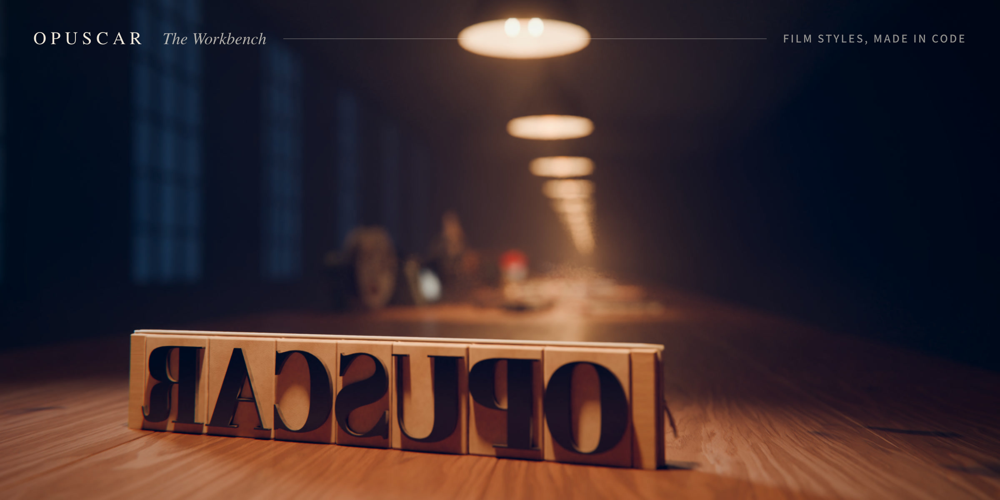</picture></a>

# Lemo-Opuscar

**<!--n-->99<!--/n--> film styles for your coding agent. Pick one, bring your story, and the agent makes the film, entirely in code.**

<p><!--n-->99<!--/n--> 种影片风格，每种都配一支完全用代码做出来的短片 · 🇨🇳 中文用户请看 <a href="README.zh-CN.md">简体中文说明</a></p>

[**▶ Open the gallery**](https://lemomo-ai.github.io/lemo-opuscar/) · [中文画廊](https://lemomo-ai.github.io/lemo-opuscar/zh/)

<a href="https://trendshift.io/repositories/262645?utm_source=trendshift-badge&amp;utm_medium=badge&amp;utm_campaign=badge-trendshift-262645" target="_blank" rel="noopener noreferrer"></a>

<sub>Official repo: [github.com/lemomo-ai/lemo-opuscar](https://github.com/lemomo-ai/lemo-opuscar) · by Lemomo ([@lemomo_ai](https://x.com/lemomo_ai))</sub>

</div>

> [!IMPORTANT]
> **This release was audited and improved with Claude Fable 5.2.**
>
> **Built for Claude.** Claude Fable, Opus and Sonnet all work; set effort to **high** (in Claude Code, type `/effort high`). Other models may not reproduce the styles well, so use them with care.

## 🆕 New

- **2026-11-12** · **33 new styles**: <!--n-->99<!--/n--> now, in 15 categories sorted by what the picture looks like, and the gallery in [English](https://lemomo-ai.github.io/lemo-opuscar/) and [Chinese](https://lemomo-ai.github.io/lemo-opuscar/zh/), with a page for every style. Some demo films remade, bugs fixed, style prompts improved. [See the styles ↓](#the-styles)
- **2026-10-22** · Make a style your own: change a style or start blank, and keep it. [See how ↓](#make-a-style-your-own)

## How it works

1. **Pick a style.** Browse the [gallery](https://lemomo-ai.github.io/lemo-opuscar/) by what the picture looks like, or search for what you are making: explainers, launches, news, music videos.
2. **Watch its demo.** Every style has a short film made in code, and a page with stills, what it suits and the `STYLE.md` your agent follows.
3. **Ask your agent.** [Install the skill](#install) once, then say it in one sentence:

```text
Make a film in the Neon Tubes style about the coffee farm my family runs.
```

Name the style in English or Chinese, or by its folder; the [style index](styles/README.md) lists them all. Add a length, a narrator, your own photos or music if you like:

> Make a 45-second film in the **watercolor** style about the coffee farm my family runs. Warm female narrator.

> Make a 40-second **LiDAR Survey** film about the old quarry in the hills behind our town, from public laser-scan data.

### Install

**The skill (recommended).** In your terminal:

```sh
claude plugin marketplace add lemomo-ai/lemo-opuscar
claude plugin install lemo-opuscar@lemolab
```

Then use it from any folder. On first use it downloads the guides, tools and style prompts to `~/lemo-opuscar`, shared by all your films; each film's project, from source to finished video, goes in the folder you started from. For other agents, copy [`plugin/skills/lemo-opuscar/`](plugin/skills/lemo-opuscar/) into their skills folder.

**Or clone the repo.** Films go into `films/<name>/` inside it.

```sh
git clone https://github.com/lemomo-ai/lemo-opuscar.git
cd lemo-opuscar
claude
```

### Update or uninstall

Update, then restart Claude Code (the library in `~/lemo-opuscar` updates itself on the next film):

```sh
claude plugin marketplace update lemolab && claude plugin update lemo-opuscar@lemolab
```

To have it update by itself: in Claude Code, type `/plugin`, open **Marketplaces**, pick **lemolab** and choose **Enable auto-update** (third-party marketplaces such as lemolab don't update automatically until you turn this on).

From a clone: `git pull`, then run `sh plugin/skills/lemo-opuscar/scripts/setup.sh deps` once (it updates only the core packages that changed; if you installed the voice or music packages, run `… deps voice music` instead).

After an update, ask for a film as usual; to make a style your own, see [below](#make-a-style-your-own).

Uninstall, then delete `~/lemo-opuscar`:

```sh
claude plugin uninstall lemo-opuscar@lemolab
```

Your own styles in `~/lemo-my-styles/` stay through updates and uninstalls; delete that folder yourself if you don't want them. If a step stays stuck, [open an issue](https://github.com/lemomo-ai/lemo-opuscar/issues).

### What happens next

Not sure yet? With the skill installed, type `/lemo-opuscar:lemo-opuscar` and nothing else. It asks which language to use, then what you'd like to do: a film in a library style, [make a style your own](#make-a-style-your-own), or a film in a style you've saved.

It asks you once, up front: anything it can't decide about your topic; whether you have your own **voice, music or other material**; whether you want to see a **storyboard** first (say yes and it stops once to show you the key shots in the real style; otherwise it goes straight to the finished film).

Then the agent reads three guides and works like a small studio:

| File | What it gives the agent |
|---|---|
| [`DIRECTOR.md`](DIRECTOR.md) | how to direct: story, sound, rhythm, camera, performance, self-checks |
| [`TECHNIQUE.md`](TECHNIQUE.md) | how to build: frame-by-frame rendering, voice, music, mixing |
| `styles/<style>/STYLE.md` | what the style looks and sounds like; the story is yours |

Every film is directed, drawn, scored and mixed by the agent writing code: 🎨 canvas and WebGL pages rendered frame by frame, 🎵 original scores from free sample libraries, 🎙️ text-to-speech narration. No video generation, no stock footage.

### Before you start

- A film takes an agent about 30–60 minutes and a fair amount of tokens.
- You need Node 20+, ffmpeg 7+ and Python 3.11+ (or [uv](https://docs.astral.sh/uv/)); the agent installs the rest. Ubuntu 24.04 ships ffmpeg 6.1, which is too old: use a [static build](https://johnvansickle.com/ffmpeg/).
- Three styles draw their characters with an image generator you bring (Manga Panels, Text Flash Cuts, Comic History Cartoon; marked ✦ in [the style list](styles/README.md)): the [Codex CLI](https://github.com/openai/codex) signed in to an account that can generate images, or another image tool you have. Without one, those three can't start; every other style works without it.
- Default output 1920×1080 at 24 fps (some styles set their own frame rate, such as 30 fps); other sizes on request.

## Make a style your own

Your own brand colours, logo, characters, the tone of your channel: change a library style into one that's only yours, or make one from a blank page that the library doesn't have. It's the same process I use to add a new style to the library.

<table><tr>
<td width="50%" valign="top"><a href="https://github.com/lemomo-ai/lemo-opuscar/releases/download/films/swiss-motion.mp4"></a><br><b>A library style</b> · Swiss Motion Graphics<br><sub>A flat grid, one signal colour, every move on the beat.</sub></td>
<td width="50%" valign="top"><a href="https://github.com/lemomo-ai/lemo-opuscar/releases/download/films/my-style-material-grid.mp4"></a><br><b>My style</b> · Material Grid · ▶ 31 s demo film<br><sub>The Swiss grid, beat and type kept, the shapes made of clay, plastic, felt, glass and chrome: from above it reads as a poster, one tilt and it's a table of objects.</sub></td>
</tr></table>

Pick it after starting the skill, or say it in one line:

> I want to change the **Ukiyo-e** style into my own version.

> Start from a blank page: a chalk-on-blackboard style, warm and slow.

To change a library style, it lists every style with the gallery link and you type the one to change. From a blank page, describe the look in your own words, or share a picture or a film you like; Claude picks the closest library style as the technique base, tells you why, and you agree or pick another. Then five steps:

1. **Plan it one question at a time.** What it's for (kinds of film; the platform, as vertical feeds want 1080×1920 or 1080×1440; brand colours, logo, fonts or recurring characters), what to change and which way, and last, a name. A library style is first sorted into **safe to change** (palette, type, pace, sound, signature moves), **changes its character** (materials and rendering, the colour logic, camera grammar) and **can't change** (the style's essence: change that and it's a different style). Each question has a few options, the recommended one first with the reason. Vague is fine: "more premium" or "livelier" becomes concrete changes to pick from. Choose "free conversation" to just talk it through, or say "you decide" at any point. At most five changes a round when changing a library style; everything is drawn in code, no image generation.
2. **Review the summary**: each part before, after and what it costs. Nothing is written until you agree.
3. **See one style frame first**, drawn with the real code; when you changed a library style, the original is rendered too, side by side: original left, yours right. If it still isn't right after two rounds, it says so and suggests a closer base.
4. **A 15–30 second demo film**, every change on screen, with music and sound effects. It checks the film and fixes it once before handing it over.
5. **Keep it when you're happy**: keep it as my style, another round, or not now. Until you say yes, everything stays in that project's folder.

A kept style lives in `~/lemo-my-styles/<name>/`, shaped like a library style (the style prompt, what changed, the demo film and its source), so later films can reuse the techniques. Name it like any other style: *"Make a 30-second film in my **Night Ukiyo-e** style about…"*; when you pick a style, your own are listed first. Library updates and reinstalling never touch them; when the base style is updated later, Claude mentions it once and asks whether to bring the useful fixes into your copy. The steps Claude follows are in [`MY-STYLES.md`](MY-STYLES.md).

## The styles

<!--n-->99<!--/n--> styles in 15 categories, sorted by what the picture looks like. A station opens it on the site's workbench; a card or a name opens the style's page, with its film, stills and the sentence to copy.

<!-- styles:start -->

**01** [Edit & Documentary](#01--edit--documentary) · **02** [Painting & Illustration](#02--painting--illustration) · **03** [Sketch & Board](#03--sketch--board) · **04** [Traditional Crafts](#04--traditional-crafts) · **05** [Print & Printmaking](#05--print--printmaking) · **06** [Graphic & Type](#06--graphic--type) · **07** [Line Diagrams](#07--line-diagrams) · **08** [Cartoons](#08--cartoons) · **09** [Games](#09--games) · **10** [Film & Tape](#10--film--tape) · **11** [Screens & Interfaces](#11--screens--interfaces) · **12** [Light & Lines](#12--light--lines) · **13** [3D & Miniature](#13--3d--miniature) · **14** [Instruments & Evidence](#14--instruments--evidence) · **15** [Data & Maps](#15--data--maps)

###### <a name="edit--documentary"></a>01 · Edit & Documentary

<a href="https://lemomo-ai.github.io/lemo-opuscar/#s01"><picture><source media="(prefers-color-scheme: dark)" srcset="docs/readme/station-01-en-dark.webp"><source media="(prefers-color-scheme: light)" srcset="docs/readme/station-01-en-light.webp">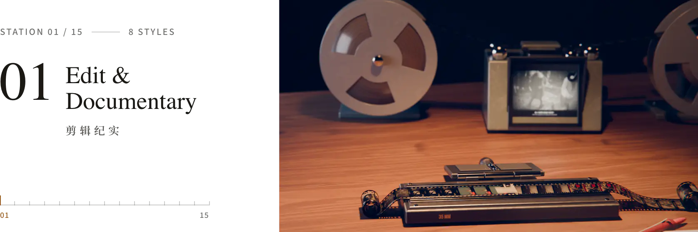</picture></a>

Cut from real footage, documents and data: captions, newsreels, montage, broadcast graphics.

<a href="https://lemomo-ai.github.io/lemo-opuscar/styles/caption-news/"><picture><source media="(prefers-color-scheme: dark)" srcset="docs/readme/cards/caption-news-en-dark.webp"><source media="(prefers-color-scheme: light)" srcset="docs/readme/cards/caption-news-en-light.webp">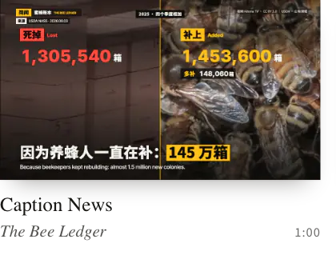</picture></a><a href="https://lemomo-ai.github.io/lemo-opuscar/styles/newsreel/"><picture><source media="(prefers-color-scheme: dark)" srcset="docs/readme/cards/newsreel-en-dark.webp"><source media="(prefers-color-scheme: light)" srcset="docs/readme/cards/newsreel-en-light.webp">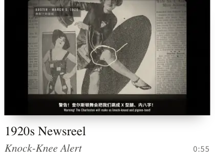</picture></a><a href="https://lemomo-ai.github.io/lemo-opuscar/styles/countdown/"><picture><source media="(prefers-color-scheme: dark)" srcset="docs/readme/cards/countdown-en-dark.webp"><source media="(prefers-color-scheme: light)" srcset="docs/readme/cards/countdown-en-light.webp">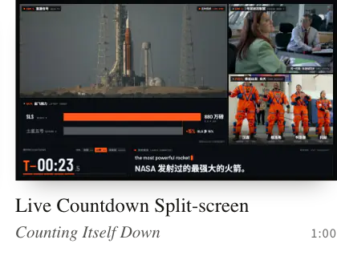</picture></a><a href="https://lemomo-ai.github.io/lemo-opuscar/styles/city-symphony/"><picture><source media="(prefers-color-scheme: dark)" srcset="docs/readme/cards/city-symphony-en-dark.webp"><source media="(prefers-color-scheme: light)" srcset="docs/readme/cards/city-symphony-en-light.webp">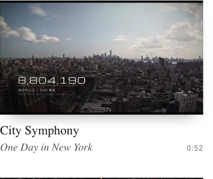</picture></a><a href="https://lemomo-ai.github.io/lemo-opuscar/styles/visual-investigation/"><picture><source media="(prefers-color-scheme: dark)" srcset="docs/readme/cards/visual-investigation-en-dark.webp"><source media="(prefers-color-scheme: light)" srcset="docs/readme/cards/visual-investigation-en-light.webp">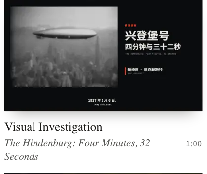</picture></a><a href="https://lemomo-ai.github.io/lemo-opuscar/styles/kino-montage/"><picture><source media="(prefers-color-scheme: dark)" srcset="docs/readme/cards/kino-montage-en-dark.webp"><source media="(prefers-color-scheme: light)" srcset="docs/readme/cards/kino-montage-en-light.webp">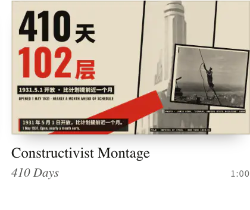</picture></a><a href="https://lemomo-ai.github.io/lemo-opuscar/styles/telestrator/"><picture><source media="(prefers-color-scheme: dark)" srcset="docs/readme/cards/telestrator-en-dark.webp"><source media="(prefers-color-scheme: light)" srcset="docs/readme/cards/telestrator-en-light.webp">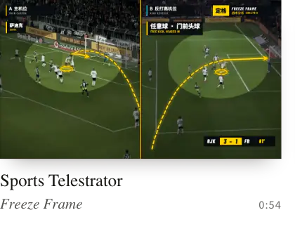</picture></a><a href="https://lemomo-ai.github.io/lemo-opuscar/styles/news-package/"><picture><source media="(prefers-color-scheme: dark)" srcset="docs/readme/cards/news-package-en-dark.webp"><source media="(prefers-color-scheme: light)" srcset="docs/readme/cards/news-package-en-light.webp">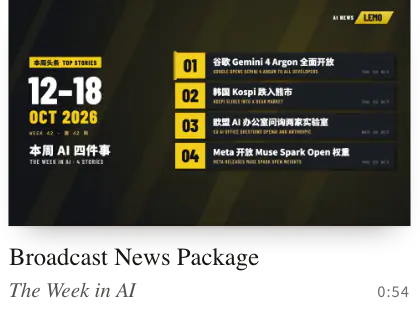</picture></a>

<sub>[Caption News](https://lemomo-ai.github.io/lemo-opuscar/styles/caption-news/) · [1920s Newsreel](https://lemomo-ai.github.io/lemo-opuscar/styles/newsreel/) · [Live Countdown Split-screen](https://lemomo-ai.github.io/lemo-opuscar/styles/countdown/) · [City Symphony](https://lemomo-ai.github.io/lemo-opuscar/styles/city-symphony/) · [Visual Investigation](https://lemomo-ai.github.io/lemo-opuscar/styles/visual-investigation/) · [Constructivist Montage](https://lemomo-ai.github.io/lemo-opuscar/styles/kino-montage/) · [Sports Telestrator](https://lemomo-ai.github.io/lemo-opuscar/styles/telestrator/) · [Broadcast News Package](https://lemomo-ai.github.io/lemo-opuscar/styles/news-package/)</sub>

###### <a name="painting--illustration"></a>02 · Painting & Illustration

<a href="https://lemomo-ai.github.io/lemo-opuscar/#s02"><picture><source media="(prefers-color-scheme: dark)" srcset="docs/readme/station-02-en-dark.webp"><source media="(prefers-color-scheme: light)" srcset="docs/readme/station-02-en-light.webp">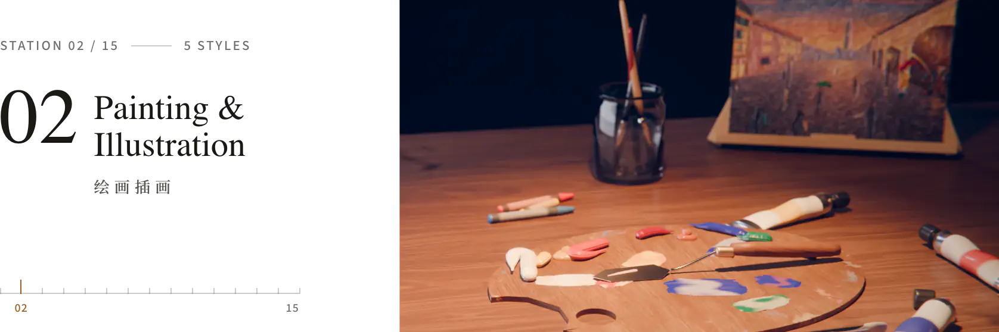</picture></a>

Pictures painted stroke by stroke: crayon, watercolour, oil, pen and wash, coloured pencil.

<a href="https://lemomo-ai.github.io/lemo-opuscar/styles/crayon-book/"><picture><source media="(prefers-color-scheme: dark)" srcset="docs/readme/cards/crayon-book-en-dark.webp"><source media="(prefers-color-scheme: light)" srcset="docs/readme/cards/crayon-book-en-light.webp">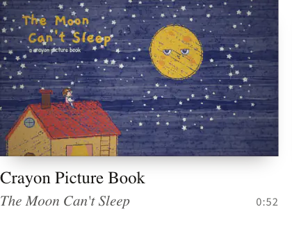</picture></a><a href="https://lemomo-ai.github.io/lemo-opuscar/styles/watercolor/"><picture><source media="(prefers-color-scheme: dark)" srcset="docs/readme/cards/watercolor-en-dark.webp"><source media="(prefers-color-scheme: light)" srcset="docs/readme/cards/watercolor-en-light.webp">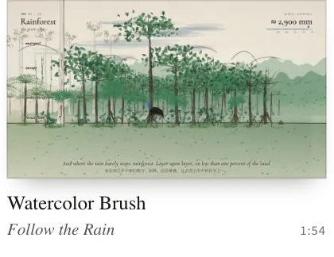</picture></a><a href="https://lemomo-ai.github.io/lemo-opuscar/styles/impasto/"><picture><source media="(prefers-color-scheme: dark)" srcset="docs/readme/cards/impasto-en-dark.webp"><source media="(prefers-color-scheme: light)" srcset="docs/readme/cards/impasto-en-light.webp">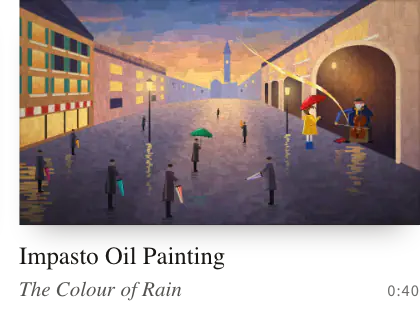</picture></a><a href="https://lemomo-ai.github.io/lemo-opuscar/styles/urban-sketch/"><picture><source media="(prefers-color-scheme: dark)" srcset="docs/readme/cards/urban-sketch-en-dark.webp"><source media="(prefers-color-scheme: light)" srcset="docs/readme/cards/urban-sketch-en-light.webp">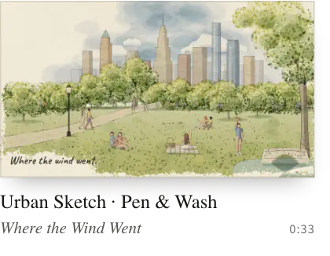</picture></a><a href="https://lemomo-ai.github.io/lemo-opuscar/styles/colored-pencil/"><picture><source media="(prefers-color-scheme: dark)" srcset="docs/readme/cards/colored-pencil-en-dark.webp"><source media="(prefers-color-scheme: light)" srcset="docs/readme/cards/colored-pencil-en-light.webp">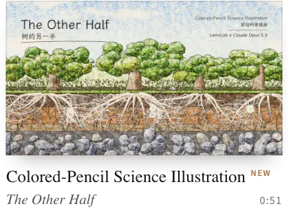</picture></a>

<sub>[Crayon Picture Book](https://lemomo-ai.github.io/lemo-opuscar/styles/crayon-book/) · [Watercolor Brush](https://lemomo-ai.github.io/lemo-opuscar/styles/watercolor/) · [Impasto Oil Painting](https://lemomo-ai.github.io/lemo-opuscar/styles/impasto/) · [Urban Sketch · Pen & Wash](https://lemomo-ai.github.io/lemo-opuscar/styles/urban-sketch/) · [Colored-Pencil Science Illustration](https://lemomo-ai.github.io/lemo-opuscar/styles/colored-pencil/)</sub>

###### <a name="sketch--board"></a>03 · Sketch & Board

<a href="https://lemomo-ai.github.io/lemo-opuscar/#s03"><picture><source media="(prefers-color-scheme: dark)" srcset="docs/readme/station-03-en-dark.webp"><source media="(prefers-color-scheme: light)" srcset="docs/readme/station-03-en-light.webp">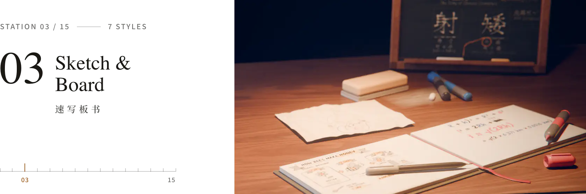</picture></a>

Drawn while it is explained: whiteboard, chalk, marker, sketch notes and stick figures.

<a href="https://lemomo-ai.github.io/lemo-opuscar/styles/one-line/"><picture><source media="(prefers-color-scheme: dark)" srcset="docs/readme/cards/one-line-en-dark.webp"><source media="(prefers-color-scheme: light)" srcset="docs/readme/cards/one-line-en-light.webp">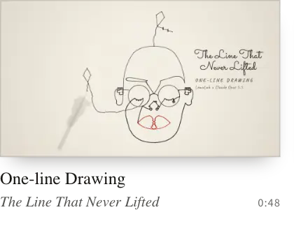</picture></a><a href="https://lemomo-ai.github.io/lemo-opuscar/styles/whiteboard/"><picture><source media="(prefers-color-scheme: dark)" srcset="docs/readme/cards/whiteboard-en-dark.webp"><source media="(prefers-color-scheme: light)" srcset="docs/readme/cards/whiteboard-en-light.webp">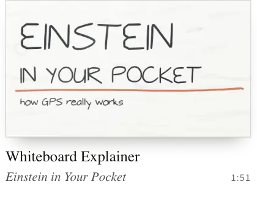</picture></a><a href="https://lemomo-ai.github.io/lemo-opuscar/styles/chalkboard/"><picture><source media="(prefers-color-scheme: dark)" srcset="docs/readme/cards/chalkboard-en-dark.webp"><source media="(prefers-color-scheme: light)" srcset="docs/readme/cards/chalkboard-en-light.webp">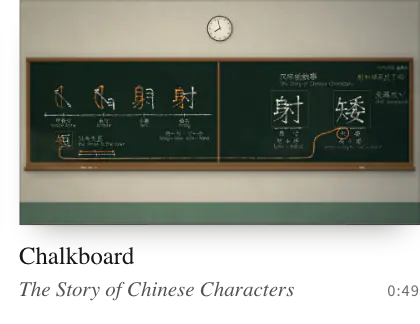</picture></a><a href="https://lemomo-ai.github.io/lemo-opuscar/styles/sketchnote/"><picture><source media="(prefers-color-scheme: dark)" srcset="docs/readme/cards/sketchnote-en-dark.webp"><source media="(prefers-color-scheme: light)" srcset="docs/readme/cards/sketchnote-en-light.webp">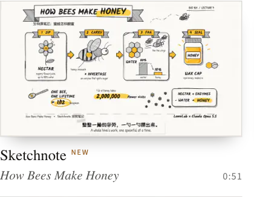</picture></a><a href="https://lemomo-ai.github.io/lemo-opuscar/styles/stick-explainer/"><picture><source media="(prefers-color-scheme: dark)" srcset="docs/readme/cards/stick-explainer-en-dark.webp"><source media="(prefers-color-scheme: light)" srcset="docs/readme/cards/stick-explainer-en-light.webp">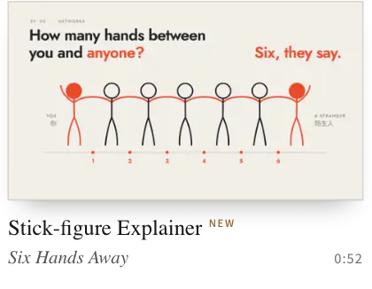</picture></a><a href="https://lemomo-ai.github.io/lemo-opuscar/styles/ipad-sketch/"><picture><source media="(prefers-color-scheme: dark)" srcset="docs/readme/cards/ipad-sketch-en-dark.webp"><source media="(prefers-color-scheme: light)" srcset="docs/readme/cards/ipad-sketch-en-light.webp">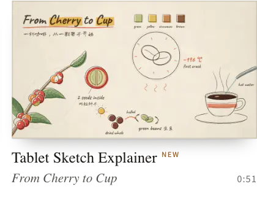</picture></a><a href="https://lemomo-ai.github.io/lemo-opuscar/styles/marker-paper/"><picture><source media="(prefers-color-scheme: dark)" srcset="docs/readme/cards/marker-paper-en-dark.webp"><source media="(prefers-color-scheme: light)" srcset="docs/readme/cards/marker-paper-en-light.webp">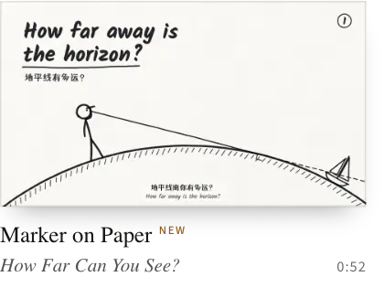</picture></a>

<sub>[One-line Drawing](https://lemomo-ai.github.io/lemo-opuscar/styles/one-line/) · [Whiteboard Explainer](https://lemomo-ai.github.io/lemo-opuscar/styles/whiteboard/) · [Chalkboard](https://lemomo-ai.github.io/lemo-opuscar/styles/chalkboard/) · [Sketchnote](https://lemomo-ai.github.io/lemo-opuscar/styles/sketchnote/) · [Stick-figure Explainer](https://lemomo-ai.github.io/lemo-opuscar/styles/stick-explainer/) · [Tablet Sketch Explainer](https://lemomo-ai.github.io/lemo-opuscar/styles/ipad-sketch/) · [Marker on Paper](https://lemomo-ai.github.io/lemo-opuscar/styles/marker-paper/)</sub>

###### <a name="traditional-crafts"></a>04 · Traditional Crafts

<a href="https://lemomo-ai.github.io/lemo-opuscar/#s04"><picture><source media="(prefers-color-scheme: dark)" srcset="docs/readme/station-04-en-dark.webp"><source media="(prefers-color-scheme: light)" srcset="docs/readme/station-04-en-light.webp">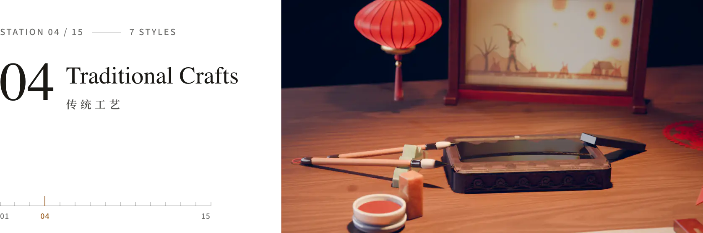</picture></a>

Old crafts, their look and their pace: ink wash, shadow puppets, woodblocks, paper-cuts, stained glass, gold leaf.

<a href="https://lemomo-ai.github.io/lemo-opuscar/styles/ink-wash/"><picture><source media="(prefers-color-scheme: dark)" srcset="docs/readme/cards/ink-wash-en-dark.webp"><source media="(prefers-color-scheme: light)" srcset="docs/readme/cards/ink-wash-en-light.webp">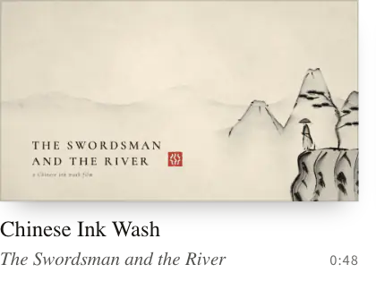</picture></a><a href="https://lemomo-ai.github.io/lemo-opuscar/styles/shadow-puppet/"><picture><source media="(prefers-color-scheme: dark)" srcset="docs/readme/cards/shadow-puppet-en-dark.webp"><source media="(prefers-color-scheme: light)" srcset="docs/readme/cards/shadow-puppet-en-light.webp">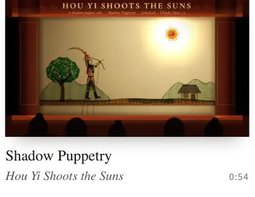</picture></a><a href="https://lemomo-ai.github.io/lemo-opuscar/styles/ukiyoe/"><picture><source media="(prefers-color-scheme: dark)" srcset="docs/readme/cards/ukiyoe-en-dark.webp"><source media="(prefers-color-scheme: light)" srcset="docs/readme/cards/ukiyoe-en-light.webp">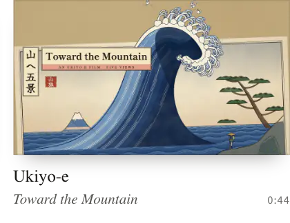</picture></a><a href="https://lemomo-ai.github.io/lemo-opuscar/styles/papercut-red/"><picture><source media="(prefers-color-scheme: dark)" srcset="docs/readme/cards/papercut-red-en-dark.webp"><source media="(prefers-color-scheme: light)" srcset="docs/readme/cards/papercut-red-en-light.webp">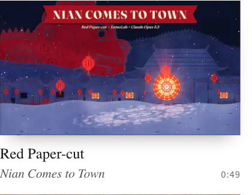</picture></a><a href="https://lemomo-ai.github.io/lemo-opuscar/styles/paper-lantern/"><picture><source media="(prefers-color-scheme: dark)" srcset="docs/readme/cards/paper-lantern-en-dark.webp"><source media="(prefers-color-scheme: light)" srcset="docs/readme/cards/paper-lantern-en-light.webp">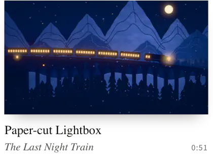</picture></a><a href="https://lemomo-ai.github.io/lemo-opuscar/styles/stained-glass/"><picture><source media="(prefers-color-scheme: dark)" srcset="docs/readme/cards/stained-glass-en-dark.webp"><source media="(prefers-color-scheme: light)" srcset="docs/readme/cards/stained-glass-en-light.webp">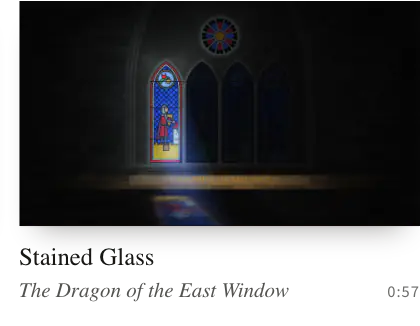</picture></a><a href="https://lemomo-ai.github.io/lemo-opuscar/styles/gilded-illumination/"><picture><source media="(prefers-color-scheme: dark)" srcset="docs/readme/cards/gilded-illumination-en-dark.webp"><source media="(prefers-color-scheme: light)" srcset="docs/readme/cards/gilded-illumination-en-light.webp">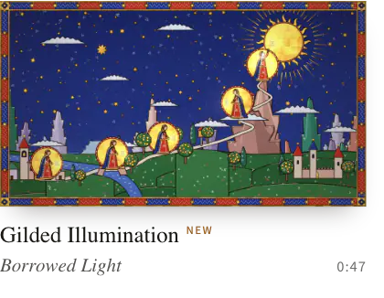</picture></a>

<sub>[Chinese Ink Wash](https://lemomo-ai.github.io/lemo-opuscar/styles/ink-wash/) · [Shadow Puppetry](https://lemomo-ai.github.io/lemo-opuscar/styles/shadow-puppet/) · [Ukiyo-e](https://lemomo-ai.github.io/lemo-opuscar/styles/ukiyoe/) · [Red Paper-cut](https://lemomo-ai.github.io/lemo-opuscar/styles/papercut-red/) · [Paper-cut Lightbox](https://lemomo-ai.github.io/lemo-opuscar/styles/paper-lantern/) · [Stained Glass](https://lemomo-ai.github.io/lemo-opuscar/styles/stained-glass/) · [Gilded Illumination](https://lemomo-ai.github.io/lemo-opuscar/styles/gilded-illumination/)</sub>

###### <a name="print--printmaking"></a>05 · Print & Printmaking

<a href="https://lemomo-ai.github.io/lemo-opuscar/#s05"><picture><source media="(prefers-color-scheme: dark)" srcset="docs/readme/station-05-en-dark.webp"><source media="(prefers-color-scheme: light)" srcset="docs/readme/station-05-en-light.webp">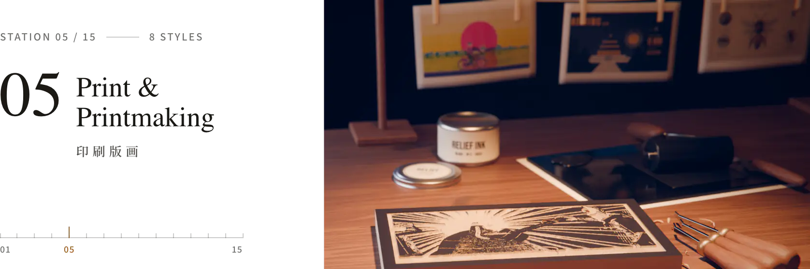</picture></a>

Ink pressed into paper: risograph, halftone, woodcut, engraving, screen print, collage.

<a href="https://lemomo-ai.github.io/lemo-opuscar/styles/risograph/"><picture><source media="(prefers-color-scheme: dark)" srcset="docs/readme/cards/risograph-en-dark.webp"><source media="(prefers-color-scheme: light)" srcset="docs/readme/cards/risograph-en-light.webp">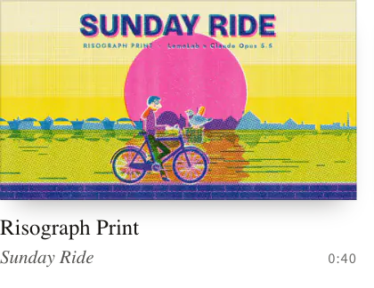</picture></a><a href="https://lemomo-ai.github.io/lemo-opuscar/styles/halftone-dossier/"><picture><source media="(prefers-color-scheme: dark)" srcset="docs/readme/cards/halftone-dossier-en-dark.webp"><source media="(prefers-color-scheme: light)" srcset="docs/readme/cards/halftone-dossier-en-light.webp">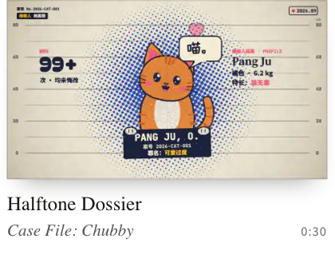</picture></a><a href="https://lemomo-ai.github.io/lemo-opuscar/styles/woodcut/"><picture><source media="(prefers-color-scheme: dark)" srcset="docs/readme/cards/woodcut-en-dark.webp"><source media="(prefers-color-scheme: light)" srcset="docs/readme/cards/woodcut-en-light.webp">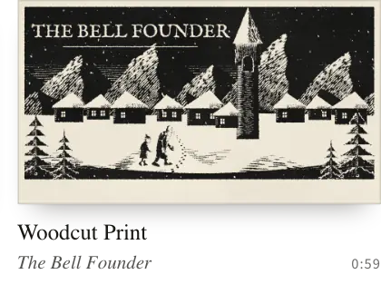</picture></a><a href="https://lemomo-ai.github.io/lemo-opuscar/styles/engraving/"><picture><source media="(prefers-color-scheme: dark)" srcset="docs/readme/cards/engraving-en-dark.webp"><source media="(prefers-color-scheme: light)" srcset="docs/readme/cards/engraving-en-light.webp">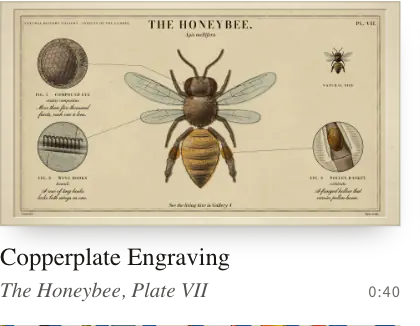</picture></a><a href="https://lemomo-ai.github.io/lemo-opuscar/styles/silkscreen-poster/"><picture><source media="(prefers-color-scheme: dark)" srcset="docs/readme/cards/silkscreen-poster-en-dark.webp"><source media="(prefers-color-scheme: light)" srcset="docs/readme/cards/silkscreen-poster-en-light.webp">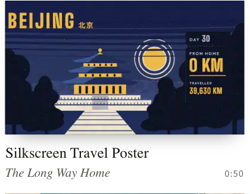</picture></a><a href="https://lemomo-ai.github.io/lemo-opuscar/styles/printed-long-take/"><picture><source media="(prefers-color-scheme: dark)" srcset="docs/readme/cards/printed-long-take-en-dark.webp"><source media="(prefers-color-scheme: light)" srcset="docs/readme/cards/printed-long-take-en-light.webp">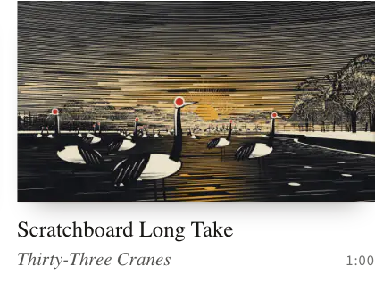</picture></a><a href="https://lemomo-ai.github.io/lemo-opuscar/styles/pop-art/"><picture><source media="(prefers-color-scheme: dark)" srcset="docs/readme/cards/pop-art-en-dark.webp"><source media="(prefers-color-scheme: light)" srcset="docs/readme/cards/pop-art-en-light.webp">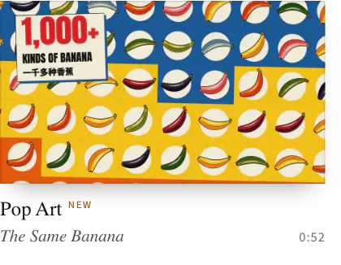</picture></a><a href="https://lemomo-ai.github.io/lemo-opuscar/styles/vintage-collage/"><picture><source media="(prefers-color-scheme: dark)" srcset="docs/readme/cards/vintage-collage-en-dark.webp"><source media="(prefers-color-scheme: light)" srcset="docs/readme/cards/vintage-collage-en-light.webp">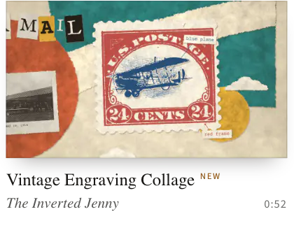</picture></a>

<sub>[Risograph Print](https://lemomo-ai.github.io/lemo-opuscar/styles/risograph/) · [Halftone Dossier](https://lemomo-ai.github.io/lemo-opuscar/styles/halftone-dossier/) · [Woodcut Print](https://lemomo-ai.github.io/lemo-opuscar/styles/woodcut/) · [Copperplate Engraving](https://lemomo-ai.github.io/lemo-opuscar/styles/engraving/) · [Silkscreen Travel Poster](https://lemomo-ai.github.io/lemo-opuscar/styles/silkscreen-poster/) · [Scratchboard Long Take](https://lemomo-ai.github.io/lemo-opuscar/styles/printed-long-take/) · [Pop Art](https://lemomo-ai.github.io/lemo-opuscar/styles/pop-art/) · [Vintage Engraving Collage](https://lemomo-ai.github.io/lemo-opuscar/styles/vintage-collage/)</sub>

###### <a name="graphic--type"></a>06 · Graphic & Type

<a href="https://lemomo-ai.github.io/lemo-opuscar/#s06"><picture><source media="(prefers-color-scheme: dark)" srcset="docs/readme/station-06-en-dark.webp"><source media="(prefers-color-scheme: light)" srcset="docs/readme/station-06-en-light.webp">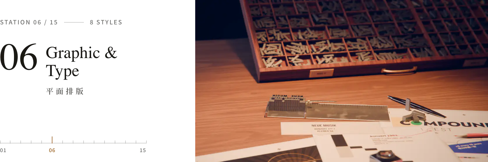</picture></a>

Flat shapes and type take the lead: Swiss grids, title sequences, pictograms, silhouettes.

<a href="https://lemomo-ai.github.io/lemo-opuscar/styles/swiss-motion/"><picture><source media="(prefers-color-scheme: dark)" srcset="docs/readme/cards/swiss-motion-en-dark.webp"><source media="(prefers-color-scheme: light)" srcset="docs/readme/cards/swiss-motion-en-light.webp">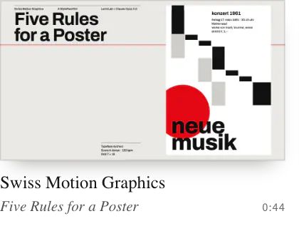</picture></a><a href="https://lemomo-ai.github.io/lemo-opuscar/styles/spy-titles/"><picture><source media="(prefers-color-scheme: dark)" srcset="docs/readme/cards/spy-titles-en-dark.webp"><source media="(prefers-color-scheme: light)" srcset="docs/readme/cards/spy-titles-en-light.webp">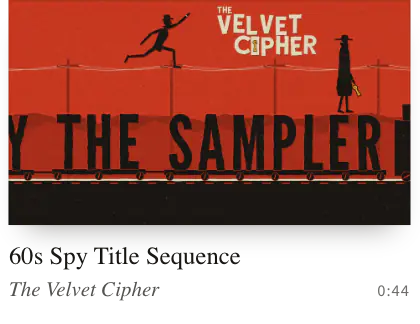</picture></a><a href="https://lemomo-ai.github.io/lemo-opuscar/styles/art-deco/"><picture><source media="(prefers-color-scheme: dark)" srcset="docs/readme/cards/art-deco-en-dark.webp"><source media="(prefers-color-scheme: light)" srcset="docs/readme/cards/art-deco-en-light.webp">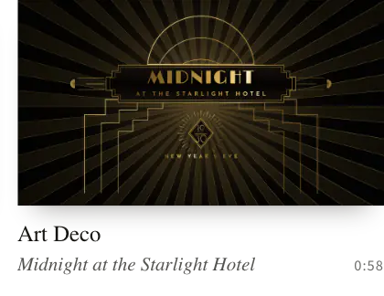</picture></a><a href="https://lemomo-ai.github.io/lemo-opuscar/styles/pictogram-motion/"><picture><source media="(prefers-color-scheme: dark)" srcset="docs/readme/cards/pictogram-motion-en-dark.webp"><source media="(prefers-color-scheme: light)" srcset="docs/readme/cards/pictogram-motion-en-light.webp">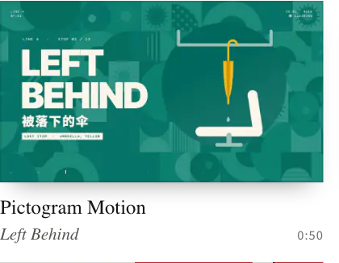</picture></a><a href="https://lemomo-ai.github.io/lemo-opuscar/styles/bauhaus-shapes/"><picture><source media="(prefers-color-scheme: dark)" srcset="docs/readme/cards/bauhaus-shapes-en-dark.webp"><source media="(prefers-color-scheme: light)" srcset="docs/readme/cards/bauhaus-shapes-en-light.webp">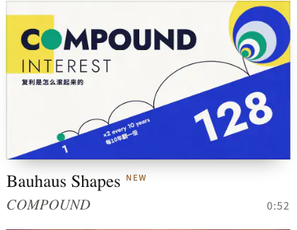</picture></a><a href="https://lemomo-ai.github.io/lemo-opuscar/styles/flat-space-explainer/"><picture><source media="(prefers-color-scheme: dark)" srcset="docs/readme/cards/flat-space-explainer-en-dark.webp"><source media="(prefers-color-scheme: light)" srcset="docs/readme/cards/flat-space-explainer-en-light.webp">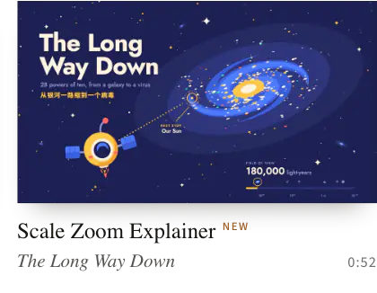</picture></a><a href="https://lemomo-ai.github.io/lemo-opuscar/styles/text-flash-cuts/"><picture><source media="(prefers-color-scheme: dark)" srcset="docs/readme/cards/text-flash-cuts-en-dark.webp"><source media="(prefers-color-scheme: light)" srcset="docs/readme/cards/text-flash-cuts-en-light.webp">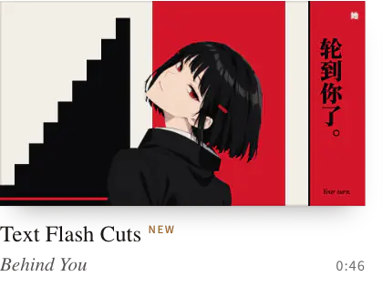</picture></a><a href="https://lemomo-ai.github.io/lemo-opuscar/styles/silhouette-rhythm/"><picture><source media="(prefers-color-scheme: dark)" srcset="docs/readme/cards/silhouette-rhythm-en-dark.webp"><source media="(prefers-color-scheme: light)" srcset="docs/readme/cards/silhouette-rhythm-en-light.webp">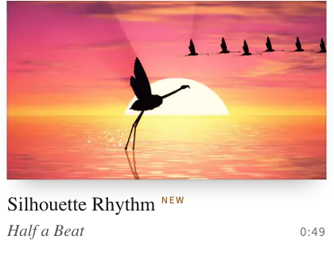</picture></a>

<sub>[Swiss Motion Graphics](https://lemomo-ai.github.io/lemo-opuscar/styles/swiss-motion/) · [60s Spy Title Sequence](https://lemomo-ai.github.io/lemo-opuscar/styles/spy-titles/) · [Art Deco](https://lemomo-ai.github.io/lemo-opuscar/styles/art-deco/) · [Pictogram Motion](https://lemomo-ai.github.io/lemo-opuscar/styles/pictogram-motion/) · [Bauhaus Shapes](https://lemomo-ai.github.io/lemo-opuscar/styles/bauhaus-shapes/) · [Scale Zoom Explainer](https://lemomo-ai.github.io/lemo-opuscar/styles/flat-space-explainer/) · [Text Flash Cuts](https://lemomo-ai.github.io/lemo-opuscar/styles/text-flash-cuts/) · [Silhouette Rhythm](https://lemomo-ai.github.io/lemo-opuscar/styles/silhouette-rhythm/)</sub>

###### <a name="line-diagrams"></a>07 · Line Diagrams

<a href="https://lemomo-ai.github.io/lemo-opuscar/#s07"><picture><source media="(prefers-color-scheme: dark)" srcset="docs/readme/station-07-en-dark.webp"><source media="(prefers-color-scheme: light)" srcset="docs/readme/station-07-en-light.webp"></picture></a>

Clean line drawings that show how things work: blueprints, cutaways, manuals, exploded views.

<a href="https://lemomo-ai.github.io/lemo-opuscar/styles/blueprint/"><picture><source media="(prefers-color-scheme: dark)" srcset="docs/readme/cards/blueprint-en-dark.webp"><source media="(prefers-color-scheme: light)" srcset="docs/readme/cards/blueprint-en-light.webp"></picture></a><a href="https://lemomo-ai.github.io/lemo-opuscar/styles/iso-infographic/"><picture><source media="(prefers-color-scheme: dark)" srcset="docs/readme/cards/iso-infographic-en-dark.webp"><source media="(prefers-color-scheme: light)" srcset="docs/readme/cards/iso-infographic-en-light.webp"></picture></a><a href="https://lemomo-ai.github.io/lemo-opuscar/styles/teardown/"><picture><source media="(prefers-color-scheme: dark)" srcset="docs/readme/cards/teardown-en-dark.webp"><source media="(prefers-color-scheme: light)" srcset="docs/readme/cards/teardown-en-light.webp"></picture></a><a href="https://lemomo-ai.github.io/lemo-opuscar/styles/hardcore-info/"><picture><source media="(prefers-color-scheme: dark)" srcset="docs/readme/cards/hardcore-info-en-dark.webp"><source media="(prefers-color-scheme: light)" srcset="docs/readme/cards/hardcore-info-en-light.webp"></picture></a><a href="https://lemomo-ai.github.io/lemo-opuscar/styles/precise-mechanism/"><picture><source media="(prefers-color-scheme: dark)" srcset="docs/readme/cards/precise-mechanism-en-dark.webp"><source media="(prefers-color-scheme: light)" srcset="docs/readme/cards/precise-mechanism-en-light.webp"></picture></a><a href="https://lemomo-ai.github.io/lemo-opuscar/styles/instruction-manual/"><picture><source media="(prefers-color-scheme: dark)" srcset="docs/readme/cards/instruction-manual-en-dark.webp"><source media="(prefers-color-scheme: light)" srcset="docs/readme/cards/instruction-manual-en-light.webp"></picture></a><a href="https://lemomo-ai.github.io/lemo-opuscar/styles/pen-plotter/"><picture><source media="(prefers-color-scheme: dark)" srcset="docs/readme/cards/pen-plotter-en-dark.webp"><source media="(prefers-color-scheme: light)" srcset="docs/readme/cards/pen-plotter-en-light.webp"></picture></a><a href="https://lemomo-ai.github.io/lemo-opuscar/styles/assembly-line-diagram/"><picture><source media="(prefers-color-scheme: dark)" srcset="docs/readme/cards/assembly-line-diagram-en-dark.webp"><source media="(prefers-color-scheme: light)" srcset="docs/readme/cards/assembly-line-diagram-en-light.webp"></picture></a>

<sub>[Blueprint](https://lemomo-ai.github.io/lemo-opuscar/styles/blueprint/) · [Isometric Infographic](https://lemomo-ai.github.io/lemo-opuscar/styles/iso-infographic/) · [Exploded Teardown](https://lemomo-ai.github.io/lemo-opuscar/styles/teardown/) · [Line-Art Cutaway](https://lemomo-ai.github.io/lemo-opuscar/styles/hardcore-info/) · [Color-Coded Mechanism](https://lemomo-ai.github.io/lemo-opuscar/styles/precise-mechanism/) · [Instruction Manual Art](https://lemomo-ai.github.io/lemo-opuscar/styles/instruction-manual/) · [Pen Plotter](https://lemomo-ai.github.io/lemo-opuscar/styles/pen-plotter/) · [Assembly-Line Diagram](https://lemomo-ai.github.io/lemo-opuscar/styles/assembly-line-diagram/)</sub>

###### <a name="cartoons"></a>08 · Cartoons

<a href="https://lemomo-ai.github.io/lemo-opuscar/#s08"><picture><source media="(prefers-color-scheme: dark)" srcset="docs/readme/station-08-en-dark.webp"><source media="(prefers-color-scheme: light)" srcset="docs/readme/station-08-en-light.webp"></picture></a>

Characters in classic cartoon looks: 1930s rubber hose, 80s cel anime, sitcom toons, manga panels.

<a href="https://lemomo-ai.github.io/lemo-opuscar/styles/rubber-hose/"><picture><source media="(prefers-color-scheme: dark)" srcset="docs/readme/cards/rubber-hose-en-dark.webp"><source media="(prefers-color-scheme: light)" srcset="docs/readme/cards/rubber-hose-en-light.webp"></picture></a><a href="https://lemomo-ai.github.io/lemo-opuscar/styles/cel-anime-80s/"><picture><source media="(prefers-color-scheme: dark)" srcset="docs/readme/cards/cel-anime-80s-en-dark.webp"><source media="(prefers-color-scheme: light)" srcset="docs/readme/cards/cel-anime-80s-en-light.webp"></picture></a><a href="https://lemomo-ai.github.io/lemo-opuscar/styles/scifi-toon/"><picture><source media="(prefers-color-scheme: dark)" srcset="docs/readme/cards/scifi-toon-en-dark.webp"><source media="(prefers-color-scheme: light)" srcset="docs/readme/cards/scifi-toon-en-light.webp"></picture></a><a href="https://lemomo-ai.github.io/lemo-opuscar/styles/midcentury-toon/"><picture><source media="(prefers-color-scheme: dark)" srcset="docs/readme/cards/midcentury-toon-en-dark.webp"><source media="(prefers-color-scheme: light)" srcset="docs/readme/cards/midcentury-toon-en-light.webp"></picture></a><a href="https://lemomo-ai.github.io/lemo-opuscar/styles/comic-history/"><picture><source media="(prefers-color-scheme: dark)" srcset="docs/readme/cards/comic-history-en-dark.webp"><source media="(prefers-color-scheme: light)" srcset="docs/readme/cards/comic-history-en-light.webp"></picture></a><a href="https://lemomo-ai.github.io/lemo-opuscar/styles/manga-panels/"><picture><source media="(prefers-color-scheme: dark)" srcset="docs/readme/cards/manga-panels-en-dark.webp"><source media="(prefers-color-scheme: light)" srcset="docs/readme/cards/manga-panels-en-light.webp"></picture></a>

<sub>[1930s Rubber Hose Cartoon](https://lemomo-ai.github.io/lemo-opuscar/styles/rubber-hose/) · [80s Cel Anime](https://lemomo-ai.github.io/lemo-opuscar/styles/cel-anime-80s/) · [Sci-Fi Sitcom Toon](https://lemomo-ai.github.io/lemo-opuscar/styles/scifi-toon/) · [Mid-century Cartoon](https://lemomo-ai.github.io/lemo-opuscar/styles/midcentury-toon/) · [Comic History Cartoon](https://lemomo-ai.github.io/lemo-opuscar/styles/comic-history/) · [Manga Panels](https://lemomo-ai.github.io/lemo-opuscar/styles/manga-panels/)</sub>

###### <a name="games"></a>09 · Games

<a href="https://lemomo-ai.github.io/lemo-opuscar/#s09"><picture><source media="(prefers-color-scheme: dark)" srcset="docs/readme/station-09-en-dark.webp"><source media="(prefers-color-scheme: light)" srcset="docs/readme/station-09-en-light.webp"></picture></a>

The look and rhythm of games: pixel RPGs, 2.5D pixel art, microgames, game shows.

<a href="https://lemomo-ai.github.io/lemo-opuscar/styles/pixel-rpg/"><picture><source media="(prefers-color-scheme: dark)" srcset="docs/readme/cards/pixel-rpg-en-dark.webp"><source media="(prefers-color-scheme: light)" srcset="docs/readme/cards/pixel-rpg-en-light.webp"></picture></a><a href="https://lemomo-ai.github.io/lemo-opuscar/styles/hd-2d/"><picture><source media="(prefers-color-scheme: dark)" srcset="docs/readme/cards/hd-2d-en-dark.webp"><source media="(prefers-color-scheme: light)" srcset="docs/readme/cards/hd-2d-en-light.webp"></picture></a><a href="https://lemomo-ai.github.io/lemo-opuscar/styles/microgame/"><picture><source media="(prefers-color-scheme: dark)" srcset="docs/readme/cards/microgame-en-dark.webp"><source media="(prefers-color-scheme: light)" srcset="docs/readme/cards/microgame-en-light.webp"></picture></a><a href="https://lemomo-ai.github.io/lemo-opuscar/styles/game-show/"><picture><source media="(prefers-color-scheme: dark)" srcset="docs/readme/cards/game-show-en-dark.webp"><source media="(prefers-color-scheme: light)" srcset="docs/readme/cards/game-show-en-light.webp"></picture></a>

<sub>[16-bit Pixel RPG](https://lemomo-ai.github.io/lemo-opuscar/styles/pixel-rpg/) · [2.5D Pixel Art](https://lemomo-ai.github.io/lemo-opuscar/styles/hd-2d/) · [Microgame Frenzy](https://lemomo-ai.github.io/lemo-opuscar/styles/microgame/) · [Rhythm Game Show](https://lemomo-ai.github.io/lemo-opuscar/styles/game-show/)</sub>

###### <a name="film--tape"></a>10 · Film & Tape

<a href="https://lemomo-ai.github.io/lemo-opuscar/#s10"><picture><source media="(prefers-color-scheme: dark)" srcset="docs/readme/station-10-en-dark.webp"><source media="(prefers-color-scheme: light)" srcset="docs/readme/station-10-en-light.webp"></picture></a>

The texture of a medium: silent film, VHS found footage, CRT terminals, scratched film, double exposure.

<a href="https://lemomo-ai.github.io/lemo-opuscar/styles/ascii-crt/"><picture><source media="(prefers-color-scheme: dark)" srcset="docs/readme/cards/ascii-crt-en-dark.webp"><source media="(prefers-color-scheme: light)" srcset="docs/readme/cards/ascii-crt-en-light.webp"></picture></a><a href="https://lemomo-ai.github.io/lemo-opuscar/styles/silent-film/"><picture><source media="(prefers-color-scheme: dark)" srcset="docs/readme/cards/silent-film-en-dark.webp"><source media="(prefers-color-scheme: light)" srcset="docs/readme/cards/silent-film-en-light.webp"></picture></a><a href="https://lemomo-ai.github.io/lemo-opuscar/styles/backrooms/"><picture><source media="(prefers-color-scheme: dark)" srcset="docs/readme/cards/backrooms-en-dark.webp"><source media="(prefers-color-scheme: light)" srcset="docs/readme/cards/backrooms-en-light.webp"></picture></a><a href="https://lemomo-ai.github.io/lemo-opuscar/styles/scratch-film/"><picture><source media="(prefers-color-scheme: dark)" srcset="docs/readme/cards/scratch-film-en-dark.webp"><source media="(prefers-color-scheme: light)" srcset="docs/readme/cards/scratch-film-en-light.webp"></picture></a><a href="https://lemomo-ai.github.io/lemo-opuscar/styles/double-exposure/"><picture><source media="(prefers-color-scheme: dark)" srcset="docs/readme/cards/double-exposure-en-dark.webp"><source media="(prefers-color-scheme: light)" srcset="docs/readme/cards/double-exposure-en-light.webp"></picture></a>

<sub>[CRT ASCII Terminal](https://lemomo-ai.github.io/lemo-opuscar/styles/ascii-crt/) · [1920s Silent Film](https://lemomo-ai.github.io/lemo-opuscar/styles/silent-film/) · [Liminal Found Footage](https://lemomo-ai.github.io/lemo-opuscar/styles/backrooms/) · [Scratch Film](https://lemomo-ai.github.io/lemo-opuscar/styles/scratch-film/) · [Double Exposure](https://lemomo-ai.github.io/lemo-opuscar/styles/double-exposure/)</sub>

###### <a name="screens--interfaces"></a>11 · Screens & Interfaces

<a href="https://lemomo-ai.github.io/lemo-opuscar/#s11"><picture><source media="(prefers-color-scheme: dark)" srcset="docs/readme/station-11-en-dark.webp"><source media="(prefers-color-scheme: light)" srcset="docs/readme/station-11-en-light.webp"></picture></a>

Told on screens: keynotes, live apps, HUDs, spreadsheets, app cards on a tabletop.

<a href="https://lemomo-ai.github.io/lemo-opuscar/styles/dark-keynote/"><picture><source media="(prefers-color-scheme: dark)" srcset="docs/readme/cards/dark-keynote-en-dark.webp"><source media="(prefers-color-scheme: light)" srcset="docs/readme/cards/dark-keynote-en-light.webp"></picture></a><a href="https://lemomo-ai.github.io/lemo-opuscar/styles/living-screencast/"><picture><source media="(prefers-color-scheme: dark)" srcset="docs/readme/cards/living-screencast-en-dark.webp"><source media="(prefers-color-scheme: light)" srcset="docs/readme/cards/living-screencast-en-light.webp"></picture></a><a href="https://lemomo-ai.github.io/lemo-opuscar/styles/hologram-hud/"><picture><source media="(prefers-color-scheme: dark)" srcset="docs/readme/cards/hologram-hud-en-dark.webp"><source media="(prefers-color-scheme: light)" srcset="docs/readme/cards/hologram-hud-en-light.webp"></picture></a><a href="https://lemomo-ai.github.io/lemo-opuscar/styles/desktop-flythrough/"><picture><source media="(prefers-color-scheme: dark)" srcset="docs/readme/cards/desktop-flythrough-en-dark.webp"><source media="(prefers-color-scheme: light)" srcset="docs/readme/cards/desktop-flythrough-en-light.webp"></picture></a><a href="https://lemomo-ai.github.io/lemo-opuscar/styles/spreadsheet/"><picture><source media="(prefers-color-scheme: dark)" srcset="docs/readme/cards/spreadsheet-en-dark.webp"><source media="(prefers-color-scheme: light)" srcset="docs/readme/cards/spreadsheet-en-light.webp"></picture></a><a href="https://lemomo-ai.github.io/lemo-opuscar/styles/one-bit-dither/"><picture><source media="(prefers-color-scheme: dark)" srcset="docs/readme/cards/one-bit-dither-en-dark.webp"><source media="(prefers-color-scheme: light)" srcset="docs/readme/cards/one-bit-dither-en-light.webp"></picture></a>

<sub>[Dark Tech Keynote](https://lemomo-ai.github.io/lemo-opuscar/styles/dark-keynote/) · [Mascot Screencast](https://lemomo-ai.github.io/lemo-opuscar/styles/living-screencast/) · [Sci-fi Hologram HUD](https://lemomo-ai.github.io/lemo-opuscar/styles/hologram-hud/) · [Tabletop App Flythrough](https://lemomo-ai.github.io/lemo-opuscar/styles/desktop-flythrough/) · [Spreadsheet Film](https://lemomo-ai.github.io/lemo-opuscar/styles/spreadsheet/) · [1-bit Dither](https://lemomo-ai.github.io/lemo-opuscar/styles/one-bit-dither/)</sub>

###### <a name="light--lines"></a>12 · Light & Lines

<a href="https://lemomo-ai.github.io/lemo-opuscar/#s12"><picture><source media="(prefers-color-scheme: dark)" srcset="docs/readme/station-12-en-dark.webp"><source media="(prefers-color-scheme: light)" srcset="docs/readme/station-12-en-light.webp"></picture></a>

Pictures drawn in light: neon tubes, circuit traces, fireflies, flow lines, an oscilloscope beam.

<a href="https://lemomo-ai.github.io/lemo-opuscar/styles/circuit-board/"><picture><source media="(prefers-color-scheme: dark)" srcset="docs/readme/cards/circuit-board-en-dark.webp"><source media="(prefers-color-scheme: light)" srcset="docs/readme/cards/circuit-board-en-light.webp"></picture></a><a href="https://lemomo-ai.github.io/lemo-opuscar/styles/firefly-pointillism/"><picture><source media="(prefers-color-scheme: dark)" srcset="docs/readme/cards/firefly-pointillism-en-dark.webp"><source media="(prefers-color-scheme: light)" srcset="docs/readme/cards/firefly-pointillism-en-light.webp"></picture></a><a href="https://lemomo-ai.github.io/lemo-opuscar/styles/flow-field/"><picture><source media="(prefers-color-scheme: dark)" srcset="docs/readme/cards/flow-field-en-dark.webp"><source media="(prefers-color-scheme: light)" srcset="docs/readme/cards/flow-field-en-light.webp"></picture></a><a href="https://lemomo-ai.github.io/lemo-opuscar/styles/oscilloscope-math/"><picture><source media="(prefers-color-scheme: dark)" srcset="docs/readme/cards/oscilloscope-math-en-dark.webp"><source media="(prefers-color-scheme: light)" srcset="docs/readme/cards/oscilloscope-math-en-light.webp"></picture></a><a href="https://lemomo-ai.github.io/lemo-opuscar/styles/neon-tubes/"><picture><source media="(prefers-color-scheme: dark)" srcset="docs/readme/cards/neon-tubes-en-dark.webp"><source media="(prefers-color-scheme: light)" srcset="docs/readme/cards/neon-tubes-en-light.webp"></picture></a>

<sub>[Circuit Board](https://lemomo-ai.github.io/lemo-opuscar/styles/circuit-board/) · [Firefly Pointillism](https://lemomo-ai.github.io/lemo-opuscar/styles/firefly-pointillism/) · [Flow-field Wind Lines](https://lemomo-ai.github.io/lemo-opuscar/styles/flow-field/) · [Oscilloscope Math](https://lemomo-ai.github.io/lemo-opuscar/styles/oscilloscope-math/) · [Neon Tubes](https://lemomo-ai.github.io/lemo-opuscar/styles/neon-tubes/)</sub>

###### <a name="3d--miniature"></a>13 · 3D & Miniature

<a href="https://lemomo-ai.github.io/lemo-opuscar/#s13"><picture><source media="(prefers-color-scheme: dark)" srcset="docs/readme/station-13-en-dark.webp"><source media="(prefers-color-scheme: light)" srcset="docs/readme/station-13-en-light.webp"></picture></a>

Real 3D scenes and small worlds: bricks, pop-up books, tilt-shift towns, glass, dioramas.

<a href="https://lemomo-ai.github.io/lemo-opuscar/styles/brick-toy/"><picture><source media="(prefers-color-scheme: dark)" srcset="docs/readme/cards/brick-toy-en-dark.webp"><source media="(prefers-color-scheme: light)" srcset="docs/readme/cards/brick-toy-en-light.webp"></picture></a><a href="https://lemomo-ai.github.io/lemo-opuscar/styles/paper-popup/"><picture><source media="(prefers-color-scheme: dark)" srcset="docs/readme/cards/paper-popup-en-dark.webp"><source media="(prefers-color-scheme: light)" srcset="docs/readme/cards/paper-popup-en-light.webp"></picture></a><a href="https://lemomo-ai.github.io/lemo-opuscar/styles/tilt-shift/"><picture><source media="(prefers-color-scheme: dark)" srcset="docs/readme/cards/tilt-shift-en-dark.webp"><source media="(prefers-color-scheme: light)" srcset="docs/readme/cards/tilt-shift-en-light.webp"></picture></a><a href="https://lemomo-ai.github.io/lemo-opuscar/styles/lowpoly-island/"><picture><source media="(prefers-color-scheme: dark)" srcset="docs/readme/cards/lowpoly-island-en-dark.webp"><source media="(prefers-color-scheme: light)" srcset="docs/readme/cards/lowpoly-island-en-light.webp"></picture></a><a href="https://lemomo-ai.github.io/lemo-opuscar/styles/glass-product/"><picture><source media="(prefers-color-scheme: dark)" srcset="docs/readme/cards/glass-product-en-dark.webp"><source media="(prefers-color-scheme: light)" srcset="docs/readme/cards/glass-product-en-light.webp"></picture></a><a href="https://lemomo-ai.github.io/lemo-opuscar/styles/memphis-diorama/"><picture><source media="(prefers-color-scheme: dark)" srcset="docs/readme/cards/memphis-diorama-en-dark.webp"><source media="(prefers-color-scheme: light)" srcset="docs/readme/cards/memphis-diorama-en-light.webp"></picture></a><a href="https://lemomo-ai.github.io/lemo-opuscar/styles/isometric-picture-book/"><picture><source media="(prefers-color-scheme: dark)" srcset="docs/readme/cards/isometric-picture-book-en-dark.webp"><source media="(prefers-color-scheme: light)" srcset="docs/readme/cards/isometric-picture-book-en-light.webp"></picture></a><a href="https://lemomo-ai.github.io/lemo-opuscar/styles/crayon-world/"><picture><source media="(prefers-color-scheme: dark)" srcset="docs/readme/cards/crayon-world-en-dark.webp"><source media="(prefers-color-scheme: light)" srcset="docs/readme/cards/crayon-world-en-light.webp"></picture></a>

<sub>[Brick Toy](https://lemomo-ai.github.io/lemo-opuscar/styles/brick-toy/) · [Paper Pop-up Book](https://lemomo-ai.github.io/lemo-opuscar/styles/paper-popup/) · [Tilt-Shift Miniature](https://lemomo-ai.github.io/lemo-opuscar/styles/tilt-shift/) · [Low-poly Isometric Island](https://lemomo-ai.github.io/lemo-opuscar/styles/lowpoly-island/) · [Glass Product Render](https://lemomo-ai.github.io/lemo-opuscar/styles/glass-product/) · [Memphis Diorama](https://lemomo-ai.github.io/lemo-opuscar/styles/memphis-diorama/) (by [@EianLu](https://x.com/EianLu)) · [Isometric People Scene](https://lemomo-ai.github.io/lemo-opuscar/styles/isometric-picture-book/) · [Crayon World 3D](https://lemomo-ai.github.io/lemo-opuscar/styles/crayon-world/) (by [@2nd1st](https://github.com/2nd1st))</sub>

###### <a name="instruments--evidence"></a>14 · Instruments & Evidence

<a href="https://lemomo-ai.github.io/lemo-opuscar/#s14"><picture><source media="(prefers-color-scheme: dark)" srcset="docs/readme/station-14-en-dark.webp"><source media="(prefers-color-scheme: light)" srcset="docs/readme/station-14-en-light.webp"></picture></a>

Seen through instruments: satellite, LiDAR, microscope, X-ray, thermal camera; every number sourced.

<a href="https://lemomo-ai.github.io/lemo-opuscar/styles/satellite-briefing/"><picture><source media="(prefers-color-scheme: dark)" srcset="docs/readme/cards/satellite-briefing-en-dark.webp"><source media="(prefers-color-scheme: light)" srcset="docs/readme/cards/satellite-briefing-en-light.webp"></picture></a><a href="https://lemomo-ai.github.io/lemo-opuscar/styles/briefing-board/"><picture><source media="(prefers-color-scheme: dark)" srcset="docs/readme/cards/briefing-board-en-dark.webp"><source media="(prefers-color-scheme: light)" srcset="docs/readme/cards/briefing-board-en-light.webp"></picture></a><a href="https://lemomo-ai.github.io/lemo-opuscar/styles/lidar-survey/"><picture><source media="(prefers-color-scheme: dark)" srcset="docs/readme/cards/lidar-survey-en-dark.webp"><source media="(prefers-color-scheme: light)" srcset="docs/readme/cards/lidar-survey-en-light.webp"></picture></a><a href="https://lemomo-ai.github.io/lemo-opuscar/styles/microscope/"><picture><source media="(prefers-color-scheme: dark)" srcset="docs/readme/cards/microscope-en-dark.webp"><source media="(prefers-color-scheme: light)" srcset="docs/readme/cards/microscope-en-light.webp"></picture></a><a href="https://lemomo-ai.github.io/lemo-opuscar/styles/archive-lighttable/"><picture><source media="(prefers-color-scheme: dark)" srcset="docs/readme/cards/archive-lighttable-en-dark.webp"><source media="(prefers-color-scheme: light)" srcset="docs/readme/cards/archive-lighttable-en-light.webp"></picture></a><a href="https://lemomo-ai.github.io/lemo-opuscar/styles/security-xray/"><picture><source media="(prefers-color-scheme: dark)" srcset="docs/readme/cards/security-xray-en-dark.webp"><source media="(prefers-color-scheme: light)" srcset="docs/readme/cards/security-xray-en-light.webp"></picture></a><a href="https://lemomo-ai.github.io/lemo-opuscar/styles/dark-documentary/"><picture><source media="(prefers-color-scheme: dark)" srcset="docs/readme/cards/dark-documentary-en-dark.webp"><source media="(prefers-color-scheme: light)" srcset="docs/readme/cards/dark-documentary-en-light.webp"></picture></a><a href="https://lemomo-ai.github.io/lemo-opuscar/styles/thermal-camera/"><picture><source media="(prefers-color-scheme: dark)" srcset="docs/readme/cards/thermal-camera-en-dark.webp"><source media="(prefers-color-scheme: light)" srcset="docs/readme/cards/thermal-camera-en-light.webp"></picture></a>

<sub>[Satellite Briefing](https://lemomo-ai.github.io/lemo-opuscar/styles/satellite-briefing/) · [Engineering Briefing Board](https://lemomo-ai.github.io/lemo-opuscar/styles/briefing-board/) · [LiDAR Survey](https://lemomo-ai.github.io/lemo-opuscar/styles/lidar-survey/) · [Under the Microscope](https://lemomo-ai.github.io/lemo-opuscar/styles/microscope/) · [Archive Light Table](https://lemomo-ai.github.io/lemo-opuscar/styles/archive-lighttable/) · [Security X-ray](https://lemomo-ai.github.io/lemo-opuscar/styles/security-xray/) · [Radar Sweep Documentary](https://lemomo-ai.github.io/lemo-opuscar/styles/dark-documentary/) · [Thermal Camera](https://lemomo-ai.github.io/lemo-opuscar/styles/thermal-camera/)</sub>

###### <a name="data--maps"></a>15 · Data & Maps

<a href="https://lemomo-ai.github.io/lemo-opuscar/#s15"><picture><source media="(prefers-color-scheme: dark)" srcset="docs/readme/station-15-en-dark.webp"><source media="(prefers-color-scheme: light)" srcset="docs/readme/station-15-en-light.webp"></picture></a>

Numbers and places made visible: charts, maps, physical data, models, simulations.

<a href="https://lemomo-ai.github.io/lemo-opuscar/styles/dataviz/"><picture><source media="(prefers-color-scheme: dark)" srcset="docs/readme/cards/dataviz-en-dark.webp"><source media="(prefers-color-scheme: light)" srcset="docs/readme/cards/dataviz-en-light.webp"></picture></a><a href="https://lemomo-ai.github.io/lemo-opuscar/styles/white-model/"><picture><source media="(prefers-color-scheme: dark)" srcset="docs/readme/cards/white-model-en-dark.webp"><source media="(prefers-color-scheme: light)" srcset="docs/readme/cards/white-model-en-light.webp"></picture></a><a href="https://lemomo-ai.github.io/lemo-opuscar/styles/data-physical/"><picture><source media="(prefers-color-scheme: dark)" srcset="docs/readme/cards/data-physical-en-dark.webp"><source media="(prefers-color-scheme: light)" srcset="docs/readme/cards/data-physical-en-light.webp"></picture></a><a href="https://lemomo-ai.github.io/lemo-opuscar/styles/transit-map/"><picture><source media="(prefers-color-scheme: dark)" srcset="docs/readme/cards/transit-map-en-dark.webp"><source media="(prefers-color-scheme: light)" srcset="docs/readme/cards/transit-map-en-light.webp"></picture></a><a href="https://lemomo-ai.github.io/lemo-opuscar/styles/map-explainer/"><picture><source media="(prefers-color-scheme: dark)" srcset="docs/readme/cards/map-explainer-en-dark.webp"><source media="(prefers-color-scheme: light)" srcset="docs/readme/cards/map-explainer-en-light.webp"></picture></a><a href="https://lemomo-ai.github.io/lemo-opuscar/styles/pip-simulation/"><picture><source media="(prefers-color-scheme: dark)" srcset="docs/readme/cards/pip-simulation-en-dark.webp"><source media="(prefers-color-scheme: light)" srcset="docs/readme/cards/pip-simulation-en-light.webp"></picture></a>

<sub>[Data Storytelling](https://lemomo-ai.github.io/lemo-opuscar/styles/dataviz/) · [Projection-Mapped Model](https://lemomo-ai.github.io/lemo-opuscar/styles/white-model/) · [Data Physicalization](https://lemomo-ai.github.io/lemo-opuscar/styles/data-physical/) · [Transit Map](https://lemomo-ai.github.io/lemo-opuscar/styles/transit-map/) · [3D Map Explainer](https://lemomo-ai.github.io/lemo-opuscar/styles/map-explainer/) · [Blob Simulation](https://lemomo-ai.github.io/lemo-opuscar/styles/pip-simulation/)</sub>
<!-- styles:end -->

## More films

### 🎬 Feature presentation: OPUSCAR 98

<a href="https://lemomo-ai.github.io/lemo-opuscar/opuscar98/"><picture><source media="(prefers-color-scheme: dark)" srcset="docs/readme/opuscar98-en-dark.webp"><source media="(prefers-color-scheme: light)" srcset="docs/readme/opuscar98-en-light.webp"></picture></a>

<a href="https://lemomo-ai.github.io/lemo-opuscar/opuscar98/"><b>▶ The film</b></a> · 1927 – 2025 · 6:31<br>
<sub>One Clawd walks through all 98 Best Picture winners, each one redrawn in a style that fits the film.</sub>

<a href="https://lemomo-ai.github.io/lemo-opuscar/opuscar98/#styles"><b>All 98 styles, open</b></a> · 77 in 2D · 4 in 2.5D · 17 in 3D<br>
<sub>Each film's style, a frame and a style prompt to reuse on your own topic.</sub>

Every frame, every note and every cut was written in code by Claude Opus 5.5. [**▶ Watch**](https://lemomo-ai.github.io/lemo-opuscar/opuscar98/) · [**All 98 styles**](https://lemomo-ai.github.io/lemo-opuscar/opuscar98/#styles) · [**Download 1080p**](https://github.com/lemomo-ai/lemo-opuscar/releases/download/films/opuscar98.mp4)

### Thank you for every star

A thank-you film at each milestone, made in code like everything here. Click a poster to watch on the [thank-you page](https://lemomo-ai.github.io/lemo-opuscar/thanks/).

<!-- thanks:start -->
<a href="https://lemomo-ai.github.io/lemo-opuscar/thanks/#stars6000"><picture><source media="(prefers-color-scheme: dark)" srcset="docs/readme/thanks/stars6000-en-dark.webp"><source media="(prefers-color-scheme: light)" srcset="docs/readme/thanks/stars6000-en-light.webp"></picture></a><a href="https://lemomo-ai.github.io/lemo-opuscar/thanks/#stars3000"><picture><source media="(prefers-color-scheme: dark)" srcset="docs/readme/thanks/stars3000-en-dark.webp"><source media="(prefers-color-scheme: light)" srcset="docs/readme/thanks/stars3000-en-light.webp"></picture></a><a href="https://lemomo-ai.github.io/lemo-opuscar/thanks/#stars2000"><picture><source media="(prefers-color-scheme: dark)" srcset="docs/readme/thanks/stars2000-en-dark.webp"><source media="(prefers-color-scheme: light)" srcset="docs/readme/thanks/stars2000-en-light.webp"></picture></a><a href="https://lemomo-ai.github.io/lemo-opuscar/thanks/#stars800"><picture><source media="(prefers-color-scheme: dark)" srcset="docs/readme/thanks/stars800-en-dark.webp"><source media="(prefers-color-scheme: light)" srcset="docs/readme/thanks/stars800-en-light.webp"></picture></a><a href="https://lemomo-ai.github.io/lemo-opuscar/thanks/#stars300"><picture><source media="(prefers-color-scheme: dark)" srcset="docs/readme/thanks/stars300-en-dark.webp"><source media="(prefers-color-scheme: light)" srcset="docs/readme/thanks/stars300-en-light.webp"></picture></a>
<!-- thanks:end -->

<a href="https://www.star-history.com/#lemomo-ai/lemo-opuscar&Date">
 <picture>
   <source media="(prefers-color-scheme: dark)" srcset="https://api.star-history.com/svg?repos=lemomo-ai/lemo-opuscar&type=Date&theme=dark" />
   <source media="(prefers-color-scheme: light)" srcset="https://api.star-history.com/svg?repos=lemomo-ai/lemo-opuscar&type=Date" />
   
 </picture>
</a>

## About

I'm **Lemomo** ([@lemomo-ai](https://github.com/lemomo-ai)). More about me on my profile.

**Not an awesome list.** Every film here was made by me, with Claude Opus 5.5, apart from two styles contributed from outside: Memphis Diorama by [@EianLu](https://x.com/EianLu) and Crayon World 3D by [@2nd1st](https://github.com/2nd1st). The styles were tuned with Opus 5.5 and work with Claude Fable, Opus and Sonnet; other models may not reproduce them.

## Licence

Made by **LemoLab × Claude Opus 5.5**.

[`LICENSE`](LICENSE) says which licence applies to which file; the full texts are in [`LICENSES/`](LICENSES), and [`REUSE.toml`](REUSE.toml) gives the same rules file by file. In short:

- **Code**: [MIT](LICENSES/MIT.txt). The code in `core/`, `tools/`, `styleboard/`, the scripts in `plugin/` and each demo's code, with the data, configuration and `CREDITS` that go with it (Clawd and the Claude app interface that Mascot Screencast's code draws are not covered: see [`LICENSE`](LICENSE)).
- **Docs**: [CC BY-NC 4.0](https://creativecommons.org/licenses/by-nc/4.0/). Every Markdown file (each style's `STYLE.md` and `DEMO.md`, the guides `AGENTS.md`, `DIRECTOR.md`, `TECHNIQUE.md`, `MY-STYLES.md` …) and the image-generation prompts. You may share and adapt them for non-commercial purposes; credit **Lemo-Opuscar by Lemomo (LemoLab)** with a link to this repository and to the licence, and say if you changed them. On top of that licence, we give you and the people working with you on a film (staff, contractors, the client) a worldwide, royalty-free, non-exclusive, irrevocable permission to read, follow, copy and adapt them to make your own films, commercial and client films included, and to include them, or versions you adapted, in the project files you deliver for that film; a style you change and keep as your own counts ([Make a style your own](#make-a-style-your-own)). That extra permission doesn't cover sharing them or adapted versions with anyone beyond those people and those project files, or selling them. Any other commercial use (for example selling them, or putting them, whole, in part or adapted, into a product or service run for commercial advantage, paid or not) needs a commercial licence: email [lemomo.studio@gmail.com](mailto:lemomo.studio@gmail.com).
- **Demo films, their posters, stills and subtitles, and the pictures made from them** (in `styles/`, `docs/`, the gallery and the Releases): [CC BY 4.0](https://creativecommons.org/licenses/by/4.0/). You may share, adapt and use them commercially; credit **Lemo-Opuscar by Lemomo (LemoLab)** with a link to this repository and to the licence, and say if you changed them. Third-party footage, photographs, satellite imagery, music and maps in them keep their own licences (see the film's `CREDITS`); Clawd, Anthropic's character in OPUSCAR 98, the thank-you films and Mascot Screencast, is not covered, nor are third-party product interfaces, names and logos, such as Anthropic's Claude app interface in Mascot Screencast (see [`LICENSE`](LICENSE)).
- **The two contributed styles**: the same terms; credit their author too: *Memphis Diorama by EianLu, in Lemo-Opuscar by Lemomo (LemoLab)* and *Crayon World 3D by 2nd1st, in Lemo-Opuscar by Lemomo (LemoLab)*.
- **Films you make with the library**: yours, commercial films included, no credit needed (a "Made with Lemo-Opuscar" is always welcome); third-party material you use in them (for example samples under CC BY) keeps its own terms.
- **Third-party assets**: they keep their own licences: the fonts in `core/fonts/` (OFL), the Poly Haven models and textures in `core/assets/polyhaven/` (CC0), the sample libraries the toolkit downloads ([`core/audio/INSTRUMENTS.md`](core/audio/INSTRUMENTS.md)), and the footage, photographs, data, maps and music in each demo (its `CREDITS`). `REUSE.toml` names each such file kept in this repository.
- **Six voice tracks are not CC BY 4.0**: the narration in Chalkboard, Circuit Board, Tabletop App Flythrough, Isometric People Scene and Scratchboard Long Take (Microsoft Edge TTS, an online service) and in Broadcast News Package (Doubao TTS, under Volcengine's terms). They are excluded from the licence above: don't extract them or reuse them in other work. You may still share those six films whole, as published, under CC BY 4.0 for everything but the narration. In your own films use Kokoro (the default) or a voice you have the right to use.

> [!NOTE]
> **What changed in 2.0.0.** In 2.0.0 we updated the whole style library with Claude Fable 5.2, and the updated docs (the style prompts and the guides) are under CC BY-NC 4.0: share and adapt them for non-commercial purposes, and use them to make your own films, commercial films included; any other commercial use needs a commercial licence. The code stays MIT, and films you make with the library are yours, commercial films included. Versions published before 2.0.0, and the forks made from them, keep the licence they were published under.
>
> Why: the style library has been repackaged and sold inside paid products. The new licence keeps it free for everyone: use it, change any style into your own, or build your own project on it, as long as it isn't commercial and you credit it. The code, earlier versions and the films you make are not affected.

You are responsible for the materials you use in your films.

## More from LemoLab

- 📸 **[lemo-wake](https://github.com/lemomo-ai/lemo-wake)**: one picture in, a seamless loop of about five seconds out.
- 🍋 **[lemo-mod](https://github.com/lemomo-ai/lemo-mod)**: re-skin Claude Code with 21 styles, in the terminal and the desktop app.
- 🟥 **[Stampy](https://github.com/lemomo-ai/lemo-stampy)**: a tiny Mac menu bar stamp that marks your copies "For XX use only".

<a href="https://github.com/lemomo-ai/lemo-opuscar/stargazers"><picture><source media="(prefers-color-scheme: dark)" srcset="docs/readme/end-en-dark.webp"><source media="(prefers-color-scheme: light)" srcset="docs/readme/end-en-light.webp"></picture></a>

**Watch → Custom → Releases** to hear about new versions · Follow [@lemomo_ai](https://x.com/lemomo_ai) on 𝕏 · Business enquiries: [lemomo.studio@gmail.com](mailto:lemomo.studio@gmail.com)
