<div align="center">

<a href="https://lemomo-ai.github.io/lemo-opuscar/zh/">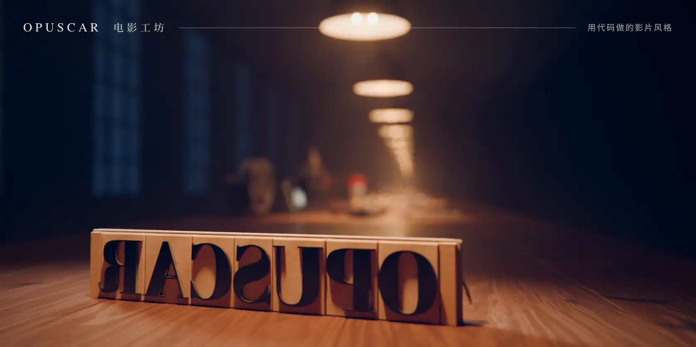</a>

# Lemo-Opuscar

**<!--n-->99<!--/n--> 种影片风格，交给你的编程 agent。挑一个风格，带上你的故事，agent 用代码把整支片做出来。**

[**▶ 打开画廊**](https://lemomo-ai.github.io/lemo-opuscar/zh/) · [English README](README.md) · [English gallery](https://lemomo-ai.github.io/lemo-opuscar/)

<a href="https://trendshift.io/repositories/262645?utm_source=trendshift-badge&amp;utm_medium=badge&amp;utm_campaign=badge-trendshift-262645" target="_blank" rel="noopener noreferrer"></a>

<sub>官方仓库：[github.com/lemomo-ai/lemo-opuscar](https://github.com/lemomo-ai/lemo-opuscar) · 作者 Lemomo（[@lemomo_ai](https://x.com/lemomo_ai)）</sub>

</div>

> [!IMPORTANT]
> **这一版经 Claude Fable 5.2 审计和改进。**
>
> **本插件为 Claude 专用。** Claude Fable、Opus、Sonnet 都能用，推理强度（effort）建议选 **high**（在 Claude Code 里输入 `/effort high`）。其他模型适配度不高，请谨慎使用。

## 🆕 最新

- **2026-11-26** · **两万颗星，谢谢大家！** 新感谢片【两万块骨牌】：一颗星一块骨牌，用Python驱动Blender做成。[往下看 ↓](#谢谢每一颗星)
- **2026-11-12** · **33 种新风格**：现在共 <!--n-->99<!--/n--> 种，按画面像什么分成 15 类；画廊有[中文版](https://lemomo-ai.github.io/lemo-opuscar/zh/)和[英文版](https://lemomo-ai.github.io/lemo-opuscar/)，每个风格都有自己的一页；部分 demo 片重新做了，修了 bug，优化了风格提示词。[往下看 ↓](#风格)
- **2026-10-22** · 新玩法「改成你自己的风格」：改库里的风格或从空白做，存成你自己的。[往下看 ↓](#改成你自己的风格)

## 怎么用

1. **挑一个风格。** 在[画廊](https://lemomo-ai.github.io/lemo-opuscar/zh/)里按画面像什么去找，或者按你要做的东西搜：科普、发布、新闻、MV。
2. **看它的 demo。** 每个风格都有一支用代码做的短片，风格页里还有静帧、适合做什么，以及 agent 会照着做的 `STYLE.md`。
3. **告诉你的 agent。** 先[装一次 skill](#安装)，再用一句话说：

```text
用霓虹灯管风格给我做一支关于我家咖啡园的片子。
```

风格用中文名、英文名或文件夹名都行，全部风格见[风格索引](styles/README.md)。还可以加上时长、旁白的声音，或者你自己的照片和音乐：

> 用**油画厚涂**风格做一支 30 秒的片子，讲我家那只每天在窗台等我下班的橘猫。

> 用**点云测绘**风格做一支 40 秒的片子，讲我们镇后山那座废弃的采石场，数据用公开的激光扫描。

### 安装

**装成 skill（推荐）。** 在终端里：

```sh
claude plugin marketplace add lemomo-ai/lemo-opuscar
claude plugin install lemo-opuscar@lemolab
```

之后在任何目录都能用。第一次使用时，它会把指南、工具和风格提示词下载到 `~/lemo-opuscar`，所有片子共用这一份；每支片子的工程，从源码到成片，都放在你发起时所在的文件夹里。其他 agent 可以把 [`plugin/skills/lemo-opuscar/`](plugin/skills/lemo-opuscar/) 复制到它们的 skills 目录。

**或者 clone 仓库。** 片子做到仓库里的 `films/<名字>/`。

```sh
git clone https://github.com/lemomo-ai/lemo-opuscar.git
cd lemo-opuscar
claude
```

### 更新和卸载

更新，然后重启 Claude Code（`~/lemo-opuscar` 里的库会在下一次做片时自动更新）：

```sh
claude plugin marketplace update lemolab && claude plugin update lemo-opuscar@lemolab
```

想让它自动更新：在 Claude Code 里输入 `/plugin`，进 **Marketplaces**，选 **lemolab**，点 **Enable auto-update**（lemolab 这类第三方 marketplace 默认不自动更新，要自己打开）。

用 clone 的：`git pull`，然后跑一次 `sh plugin/skills/lemo-opuscar/scripts/setup.sh deps`（只更新有变化的核心包；装过配音或音乐包的，改跑 `… deps voice music`）。

更新后照常说要做什么片；想把风格改成自己的，看[下面](#改成你自己的风格)。

卸载，然后删除 `~/lemo-opuscar`：

```sh
claude plugin uninstall lemo-opuscar@lemolab
```

你自己的风格存在 `~/lemo-my-styles/`，更新和卸载都不会删；不要了就自己删掉这个文件夹。一直卡住就[提个 issue](https://github.com/lemomo-ai/lemo-opuscar/issues)。

### 接下来会发生什么

还没想好也没关系：装成 skill 的，输入 `/lemo-opuscar:lemo-opuscar` 直接启动。它先问你用什么语言，再问这次想做什么：用库里的风格做片、[把风格改成你自己的](#改成你自己的风格)，或者用你存过的风格。

它开工前只问你一次：主题里它定不了的事；你有没有自己的**配音、音乐或其他素材**；要不要先看**分镜故事板**（要看的话，它会停一次，给你看用真实风格画出来的关键镜头；不看就直接做完成片）。

然后 agent 会读三份指南，像一个小工作室一样开工。指南是英文写给 agent 看的，你用中文跟它说就行，片子的配音和字幕默认跟你用的语言一致。

| 文件 | 给 agent 的东西 |
|---|---|
| [`DIRECTOR.md`](DIRECTOR.md) | 怎么导：故事、声音、节奏、镜头、表演、自检 |
| [`TECHNIQUE.md`](TECHNIQUE.md) | 怎么做：逐帧渲染、配音、配乐、混音 |
| `styles/<风格>/STYLE.md` | 这个风格长什么样、听起来什么样；故事由你定 |

每一支片子都是 agent 写代码导演、作画、配乐、混音的：🎨 Canvas 和 WebGL 页面逐帧渲染，🎵 用免费采样库写的原创配乐，🎙️ TTS 语音合成配音。不用视频生成，也不用素材库画面。

### 开始之前

- 一支片子 agent 大约要做 30–60 分钟，token 用量不小。
- 需要 Node 20+、ffmpeg 7+ 和 Python 3.11+（或 [uv](https://docs.astral.sh/uv/)），其余由 agent 安装。Ubuntu 24.04 自带的 ffmpeg 是 6.1，版本太旧，请换成[静态版](https://johnvansickle.com/ffmpeg/)。
- 有三个风格的人物要用生图工具画，需要你自己提供（黑白漫画分格、文字闪切、搞笑历史卡通，在[风格清单](styles/README.md)里标 ✦）：登录了能生图账号的 [Codex CLI](https://github.com/openai/codex)，或者你手上别的生图工具。没有的话这三个风格没法开始；其余风格都用不到。
- 默认输出 1920×1080、24 fps（有些风格自带帧率，比如 30 fps），其他尺寸可以指定。

## 改成你自己的风格

每个人想要的都不一样：有自己的品牌色、logo、IP 和账号调性。现在你可以把库里的风格改成只属于你的，或者从空白做一个库里没有的。走的就是我自己往库里加新风格的流程。

<table><tr>
<td width="50%" valign="top"><a href="https://github.com/lemomo-ai/lemo-opuscar/releases/download/films/swiss-motion.mp4"></a><br><b>库里的风格</b> · 瑞士动态排版<br><sub>平面网格、一个信号色、动作卡着节拍。</sub></td>
<td width="50%" valign="top"><a href="https://github.com/lemomo-ai/lemo-opuscar/releases/download/films/my-style-material-grid.mp4"></a><br><b>我的风格</b> · 材质网格 · ▶ 31 秒 demo 片<br><sub>留下瑞士排版的网格、节拍和字体，换成陶土、塑料、绒布、玻璃和铬的实物：俯视是一张海报，镜头一倾全是实物。</sub></td>
</tr></table>

启动 skill 后在入口里选，或者一句话直接说：

> 我想把**浮世绘**风格改成我自己的版本。

> 从空白开始，做一个黑板粉笔画的风格，暖一点、慢一点。

改库里的风格，它会列出全部风格和画廊链接，你打字说改哪一个。从空白开始，就用你自己的话描述想要的样子，也可以给一张喜欢的图或一支片；Claude 从库里挑一个最接近的风格当技法底子，说清楚为什么选它，你点头或者换一个。接下来五步：

1. **一个问题一个问题定方案。** 拿来做什么（做什么片、发在哪个平台，竖屏就用 1080×1920 或 1080×1440；有没有品牌色、logo、字体或固定角色），想改哪里、往哪个方向改，最后起名字。改库里的风格时，它先把风格分成三组讲给你听：**放心改**（配色、字体、动作快慢、声音、标志镜头）、**一改就变味**（材质和画法、配色的逻辑、镜头语法）、**不能改**（风格的本质，改了就是另一个风格）。每个问题都带几个选项，推荐的排第一，附上理由。说得模糊也行，比如「高级一点」「活泼一点」，它会翻译成具体的改法让你挑。嫌慢就选每题最后的「自由对话」，直接聊；随时说「你定」，剩下的它按推荐填好。改库里风格时一轮最多改五处；全部用代码画，不用生图。
2. **看汇总，点头。** 每一项改前是什么、改后是什么、代价是什么，你点头了它才写下来。
3. **先看一张风格图。** 用真实的绘制代码画出来。改库里风格的，同一个画面用原风格再出一张，左边原版、右边你的并排放。两轮还不对，它会直说，建议换一个更接近的底子。
4. **一支 15–30 秒的 demo 片。** 每一处改动都在画面里出现，配音乐和音效。它自己检查、修一轮再交给你。
5. **满意了再固化。** 它问你：固化、再改一轮，还是先不固化。你点头之前，一切都只在这次的项目文件夹里。

固化以后，风格存在 `~/lemo-my-styles/<名字>/`，和库里的风格同一个结构：风格说明、改了什么、demo 片和它的源码，以后做片能接着用这些技法。之后像用库里的风格一样叫它的名字：“用我的**夜浮世绘**风格做一支 30 秒的片子，讲……”；挑风格时，你自己的风格排在最前面。库更新、重装 skill 都不会动它们；底子风格以后更新了，它会提一句，问你要不要把有用的修复同步过来。Claude 照着 [`MY-STYLES.md`](MY-STYLES.md) 一步步做。

## 风格

<!--n-->99<!--/n--> 种风格，按画面像什么分成 15 类。点工位图到网站上的这一站，点卡片或风格名打开它的风格页：影片、静帧，还有可以直接复制的那句话。

<!-- styles:start -->

**01** [剪辑纪实](#01--剪辑纪实) · **02** [绘画插画](#02--绘画插画) · **03** [速写板书](#03--速写板书) · **04** [传统工艺](#04--传统工艺) · **05** [印刷版画](#05--印刷版画) · **06** [平面排版](#06--平面排版) · **07** [线稿图解](#07--线稿图解) · **08** [卡通动画](#08--卡通动画) · **09** [电子游戏](#09--电子游戏) · **10** [胶片录像](#10--胶片录像) · **11** [屏幕界面](#11--屏幕界面) · **12** [发光线条](#12--发光线条) · **13** [立体微缩](#13--立体微缩) · **14** [仪器实证](#14--仪器实证) · **15** [数据地图](#15--数据地图)

###### <a name="剪辑纪实"></a>01 · 剪辑纪实

<a href="https://lemomo-ai.github.io/lemo-opuscar/zh/#s01#gh-light-mode-only">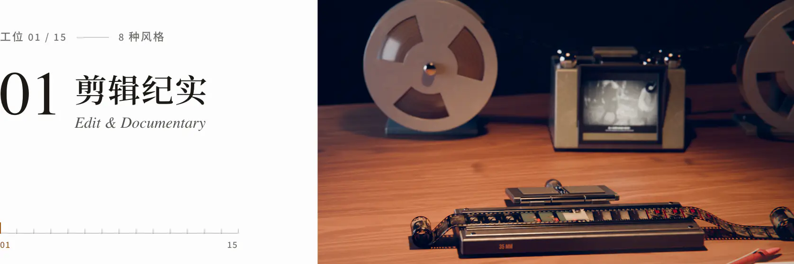</a><a href="https://lemomo-ai.github.io/lemo-opuscar/zh/#s01#gh-dark-mode-only">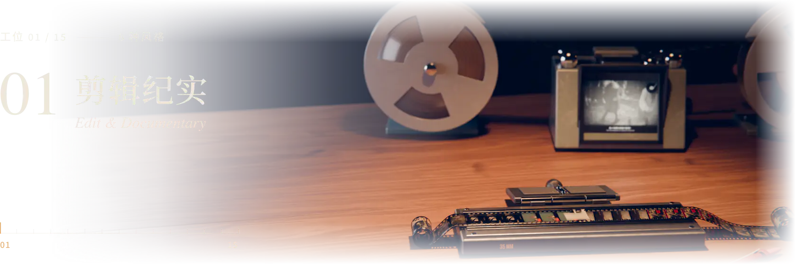</a>

用真实影像、文件和数据剪成：字幕新闻、新闻片、蒙太奇、电视包装。

<a href="https://lemomo-ai.github.io/lemo-opuscar/zh/styles/caption-news/">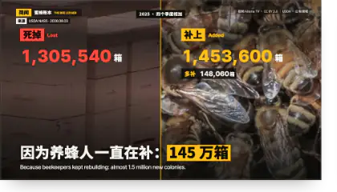</a><a href="https://lemomo-ai.github.io/lemo-opuscar/zh/styles/newsreel/">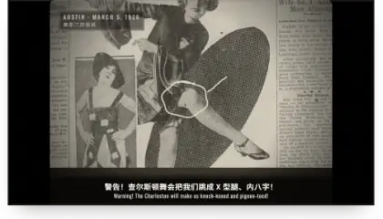</a><a href="https://lemomo-ai.github.io/lemo-opuscar/zh/styles/countdown/">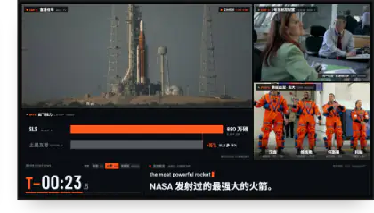</a><br><a href="https://lemomo-ai.github.io/lemo-opuscar/zh/styles/caption-news/#gh-light-mode-only"></a><a href="https://lemomo-ai.github.io/lemo-opuscar/zh/styles/caption-news/#gh-dark-mode-only"></a><a href="https://lemomo-ai.github.io/lemo-opuscar/zh/styles/newsreel/#gh-light-mode-only"></a><a href="https://lemomo-ai.github.io/lemo-opuscar/zh/styles/newsreel/#gh-dark-mode-only">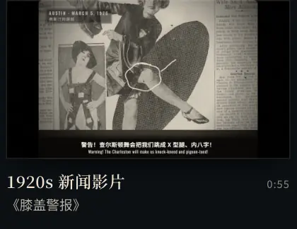</a><a href="https://lemomo-ai.github.io/lemo-opuscar/zh/styles/countdown/#gh-light-mode-only">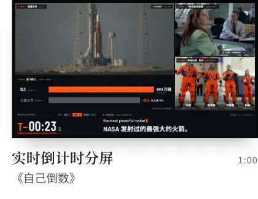</a><a href="https://lemomo-ai.github.io/lemo-opuscar/zh/styles/countdown/#gh-dark-mode-only"></a><br><a href="https://lemomo-ai.github.io/lemo-opuscar/zh/styles/city-symphony/">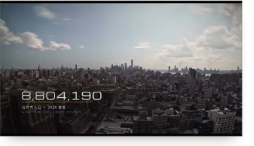</a><a href="https://lemomo-ai.github.io/lemo-opuscar/zh/styles/visual-investigation/">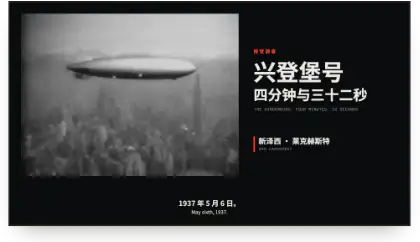</a><a href="https://lemomo-ai.github.io/lemo-opuscar/zh/styles/kino-montage/">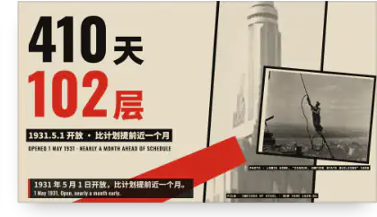</a><br><a href="https://lemomo-ai.github.io/lemo-opuscar/zh/styles/city-symphony/#gh-light-mode-only"></a><a href="https://lemomo-ai.github.io/lemo-opuscar/zh/styles/city-symphony/#gh-dark-mode-only"></a><a href="https://lemomo-ai.github.io/lemo-opuscar/zh/styles/visual-investigation/#gh-light-mode-only">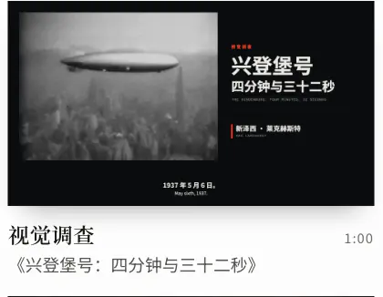</a><a href="https://lemomo-ai.github.io/lemo-opuscar/zh/styles/visual-investigation/#gh-dark-mode-only"></a><a href="https://lemomo-ai.github.io/lemo-opuscar/zh/styles/kino-montage/#gh-light-mode-only">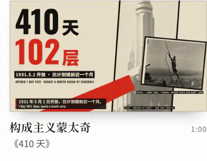</a><a href="https://lemomo-ai.github.io/lemo-opuscar/zh/styles/kino-montage/#gh-dark-mode-only">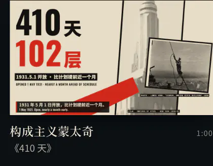</a><br><a href="https://lemomo-ai.github.io/lemo-opuscar/zh/styles/telestrator/">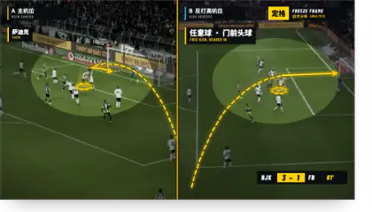</a><a href="https://lemomo-ai.github.io/lemo-opuscar/zh/styles/news-package/">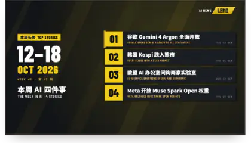</a><br><a href="https://lemomo-ai.github.io/lemo-opuscar/zh/styles/telestrator/#gh-light-mode-only">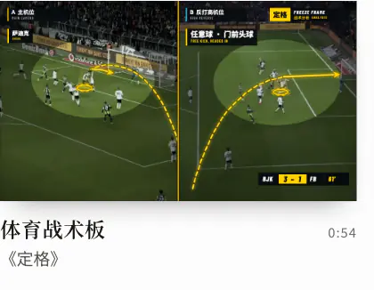</a><a href="https://lemomo-ai.github.io/lemo-opuscar/zh/styles/telestrator/#gh-dark-mode-only"></a><a href="https://lemomo-ai.github.io/lemo-opuscar/zh/styles/news-package/#gh-light-mode-only">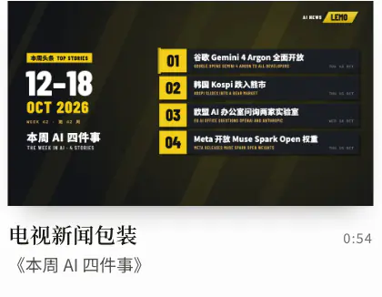</a><a href="https://lemomo-ai.github.io/lemo-opuscar/zh/styles/news-package/#gh-dark-mode-only"></a>

<sub>[字幕新闻](https://lemomo-ai.github.io/lemo-opuscar/zh/styles/caption-news/) · [1920s 新闻影片](https://lemomo-ai.github.io/lemo-opuscar/zh/styles/newsreel/) · [实时倒计时分屏](https://lemomo-ai.github.io/lemo-opuscar/zh/styles/countdown/) · [城市交响曲](https://lemomo-ai.github.io/lemo-opuscar/zh/styles/city-symphony/) · [视觉调查](https://lemomo-ai.github.io/lemo-opuscar/zh/styles/visual-investigation/) · [构成主义蒙太奇](https://lemomo-ai.github.io/lemo-opuscar/zh/styles/kino-montage/) · [体育战术板](https://lemomo-ai.github.io/lemo-opuscar/zh/styles/telestrator/) · [电视新闻包装](https://lemomo-ai.github.io/lemo-opuscar/zh/styles/news-package/)</sub>

###### <a name="绘画插画"></a>02 · 绘画插画

<a href="https://lemomo-ai.github.io/lemo-opuscar/zh/#s02#gh-light-mode-only">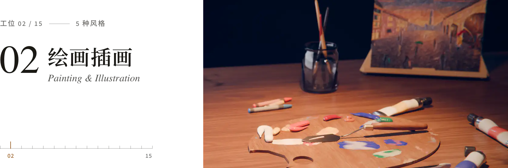</a><a href="https://lemomo-ai.github.io/lemo-opuscar/zh/#s02#gh-dark-mode-only">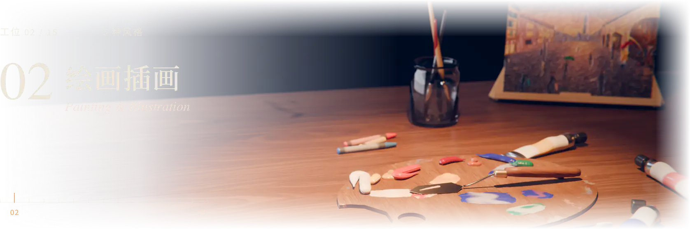</a>

一笔一笔画出来的画面：蜡笔、水彩、油画、钢笔淡彩、彩铅。

<a href="https://lemomo-ai.github.io/lemo-opuscar/zh/styles/crayon-book/">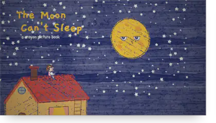</a><a href="https://lemomo-ai.github.io/lemo-opuscar/zh/styles/watercolor/">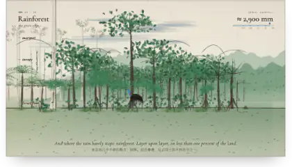</a><a href="https://lemomo-ai.github.io/lemo-opuscar/zh/styles/impasto/">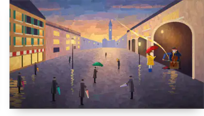</a><br><a href="https://lemomo-ai.github.io/lemo-opuscar/zh/styles/crayon-book/#gh-light-mode-only">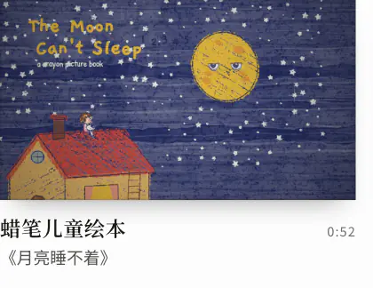</a><a href="https://lemomo-ai.github.io/lemo-opuscar/zh/styles/crayon-book/#gh-dark-mode-only"></a><a href="https://lemomo-ai.github.io/lemo-opuscar/zh/styles/watercolor/#gh-light-mode-only">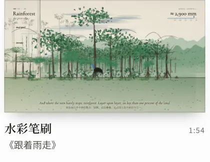</a><a href="https://lemomo-ai.github.io/lemo-opuscar/zh/styles/watercolor/#gh-dark-mode-only"></a><a href="https://lemomo-ai.github.io/lemo-opuscar/zh/styles/impasto/#gh-light-mode-only"></a><a href="https://lemomo-ai.github.io/lemo-opuscar/zh/styles/impasto/#gh-dark-mode-only">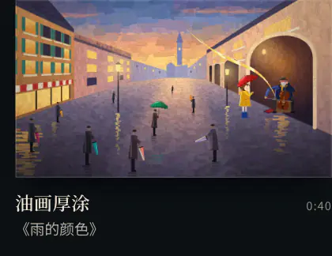</a><br><a href="https://lemomo-ai.github.io/lemo-opuscar/zh/styles/urban-sketch/">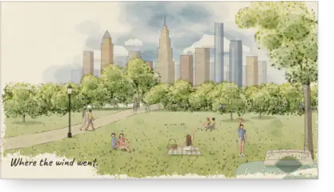</a><a href="https://lemomo-ai.github.io/lemo-opuscar/zh/styles/colored-pencil/">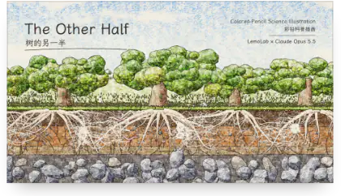</a><br><a href="https://lemomo-ai.github.io/lemo-opuscar/zh/styles/urban-sketch/#gh-light-mode-only">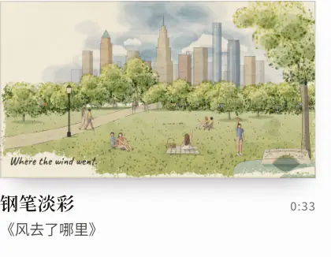</a><a href="https://lemomo-ai.github.io/lemo-opuscar/zh/styles/urban-sketch/#gh-dark-mode-only"></a><a href="https://lemomo-ai.github.io/lemo-opuscar/zh/styles/colored-pencil/#gh-light-mode-only"></a><a href="https://lemomo-ai.github.io/lemo-opuscar/zh/styles/colored-pencil/#gh-dark-mode-only"></a>

<sub>[蜡笔儿童绘本](https://lemomo-ai.github.io/lemo-opuscar/zh/styles/crayon-book/) · [水彩笔刷](https://lemomo-ai.github.io/lemo-opuscar/zh/styles/watercolor/) · [油画厚涂](https://lemomo-ai.github.io/lemo-opuscar/zh/styles/impasto/) · [钢笔淡彩](https://lemomo-ai.github.io/lemo-opuscar/zh/styles/urban-sketch/) · [彩铅科普插画](https://lemomo-ai.github.io/lemo-opuscar/zh/styles/colored-pencil/)</sub>

###### <a name="速写板书"></a>03 · 速写板书

<a href="https://lemomo-ai.github.io/lemo-opuscar/zh/#s03#gh-light-mode-only">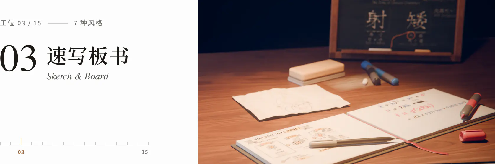</a><a href="https://lemomo-ai.github.io/lemo-opuscar/zh/#s03#gh-dark-mode-only">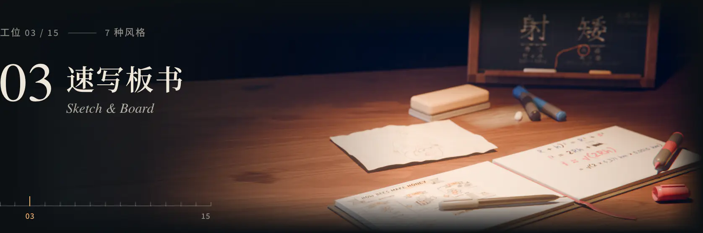</a>

边讲边画：白板、黑板粉笔、马克笔、视觉笔记、火柴人。

<a href="https://lemomo-ai.github.io/lemo-opuscar/zh/styles/one-line/">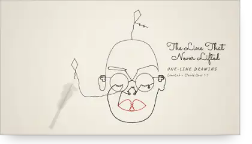</a><a href="https://lemomo-ai.github.io/lemo-opuscar/zh/styles/whiteboard/">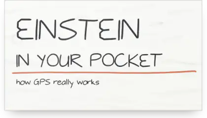</a><a href="https://lemomo-ai.github.io/lemo-opuscar/zh/styles/chalkboard/">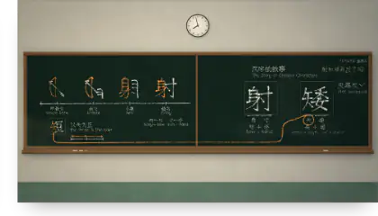</a><br><a href="https://lemomo-ai.github.io/lemo-opuscar/zh/styles/one-line/#gh-light-mode-only"></a><a href="https://lemomo-ai.github.io/lemo-opuscar/zh/styles/one-line/#gh-dark-mode-only">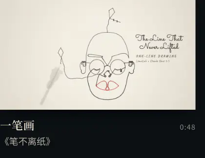</a><a href="https://lemomo-ai.github.io/lemo-opuscar/zh/styles/whiteboard/#gh-light-mode-only">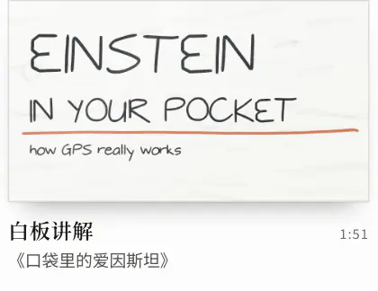</a><a href="https://lemomo-ai.github.io/lemo-opuscar/zh/styles/whiteboard/#gh-dark-mode-only">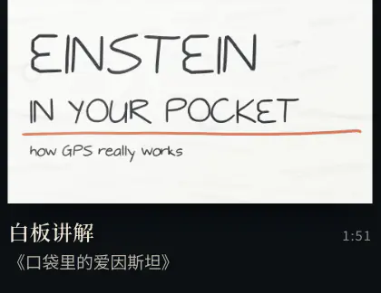</a><a href="https://lemomo-ai.github.io/lemo-opuscar/zh/styles/chalkboard/#gh-light-mode-only"></a><a href="https://lemomo-ai.github.io/lemo-opuscar/zh/styles/chalkboard/#gh-dark-mode-only">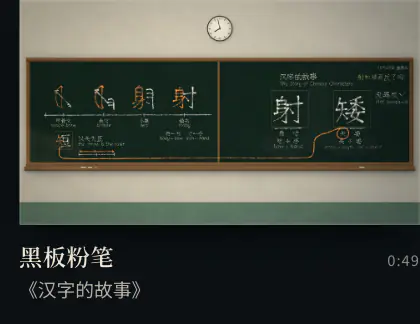</a><br><a href="https://lemomo-ai.github.io/lemo-opuscar/zh/styles/sketchnote/">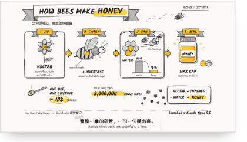</a><a href="https://lemomo-ai.github.io/lemo-opuscar/zh/styles/stick-explainer/">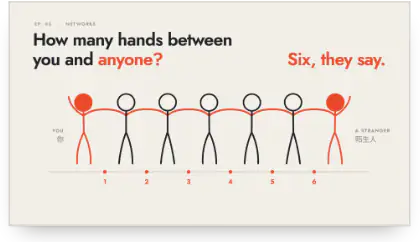</a><a href="https://lemomo-ai.github.io/lemo-opuscar/zh/styles/ipad-sketch/">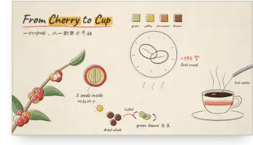</a><br><a href="https://lemomo-ai.github.io/lemo-opuscar/zh/styles/sketchnote/#gh-light-mode-only">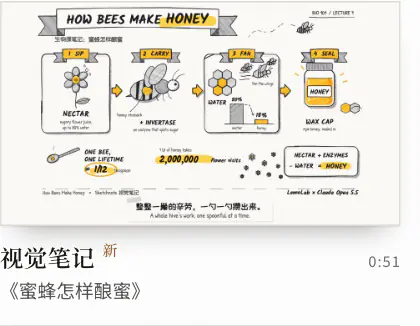</a><a href="https://lemomo-ai.github.io/lemo-opuscar/zh/styles/sketchnote/#gh-dark-mode-only">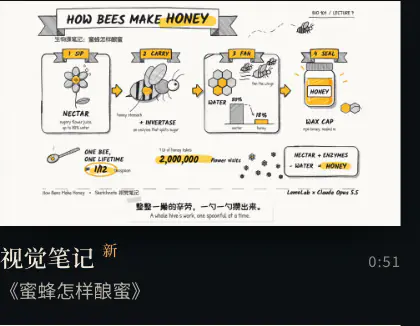</a><a href="https://lemomo-ai.github.io/lemo-opuscar/zh/styles/stick-explainer/#gh-light-mode-only"></a><a href="https://lemomo-ai.github.io/lemo-opuscar/zh/styles/stick-explainer/#gh-dark-mode-only"></a><a href="https://lemomo-ai.github.io/lemo-opuscar/zh/styles/ipad-sketch/#gh-light-mode-only"></a><a href="https://lemomo-ai.github.io/lemo-opuscar/zh/styles/ipad-sketch/#gh-dark-mode-only"></a><br><a href="https://lemomo-ai.github.io/lemo-opuscar/zh/styles/marker-paper/">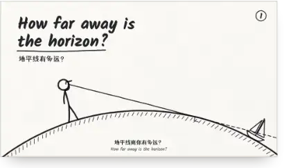</a><br><a href="https://lemomo-ai.github.io/lemo-opuscar/zh/styles/marker-paper/#gh-light-mode-only"></a><a href="https://lemomo-ai.github.io/lemo-opuscar/zh/styles/marker-paper/#gh-dark-mode-only"></a>

<sub>[一笔画](https://lemomo-ai.github.io/lemo-opuscar/zh/styles/one-line/) · [白板讲解](https://lemomo-ai.github.io/lemo-opuscar/zh/styles/whiteboard/) · [黑板粉笔](https://lemomo-ai.github.io/lemo-opuscar/zh/styles/chalkboard/) · [视觉笔记](https://lemomo-ai.github.io/lemo-opuscar/zh/styles/sketchnote/) · [火柴人讲解](https://lemomo-ai.github.io/lemo-opuscar/zh/styles/stick-explainer/) · [平板速写讲解](https://lemomo-ai.github.io/lemo-opuscar/zh/styles/ipad-sketch/) · [马克笔白纸速写](https://lemomo-ai.github.io/lemo-opuscar/zh/styles/marker-paper/)</sub>

###### <a name="传统工艺"></a>04 · 传统工艺

<a href="https://lemomo-ai.github.io/lemo-opuscar/zh/#s04#gh-light-mode-only">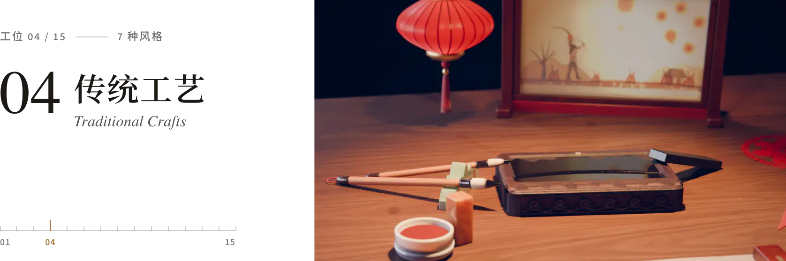</a><a href="https://lemomo-ai.github.io/lemo-opuscar/zh/#s04#gh-dark-mode-only">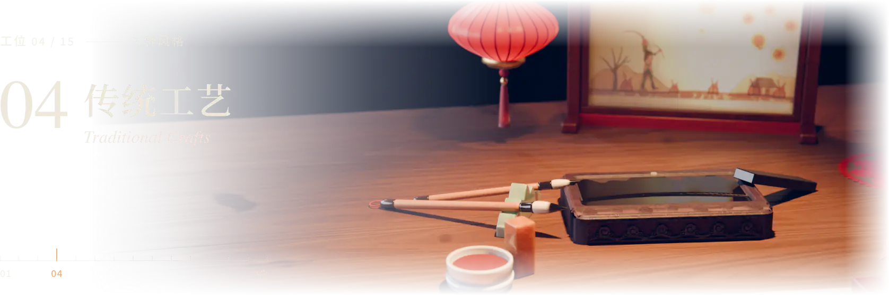</a>

老手艺的样子和节奏：水墨、皮影、浮世绘、剪纸、彩窗、金箔。

<a href="https://lemomo-ai.github.io/lemo-opuscar/zh/styles/ink-wash/"></a><a href="https://lemomo-ai.github.io/lemo-opuscar/zh/styles/shadow-puppet/">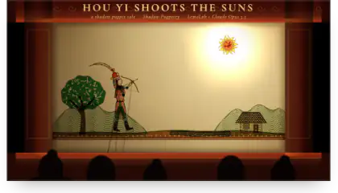</a><a href="https://lemomo-ai.github.io/lemo-opuscar/zh/styles/ukiyoe/">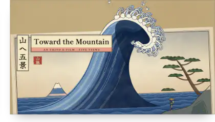</a><br><a href="https://lemomo-ai.github.io/lemo-opuscar/zh/styles/ink-wash/#gh-light-mode-only">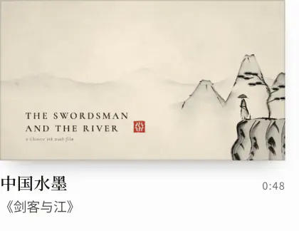</a><a href="https://lemomo-ai.github.io/lemo-opuscar/zh/styles/ink-wash/#gh-dark-mode-only"></a><a href="https://lemomo-ai.github.io/lemo-opuscar/zh/styles/shadow-puppet/#gh-light-mode-only">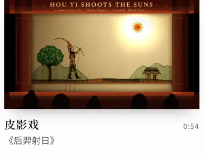</a><a href="https://lemomo-ai.github.io/lemo-opuscar/zh/styles/shadow-puppet/#gh-dark-mode-only"></a><a href="https://lemomo-ai.github.io/lemo-opuscar/zh/styles/ukiyoe/#gh-light-mode-only"></a><a href="https://lemomo-ai.github.io/lemo-opuscar/zh/styles/ukiyoe/#gh-dark-mode-only"></a><br><a href="https://lemomo-ai.github.io/lemo-opuscar/zh/styles/papercut-red/"></a><a href="https://lemomo-ai.github.io/lemo-opuscar/zh/styles/paper-lantern/"></a><a href="https://lemomo-ai.github.io/lemo-opuscar/zh/styles/stained-glass/"></a><br><a href="https://lemomo-ai.github.io/lemo-opuscar/zh/styles/papercut-red/#gh-light-mode-only"></a><a href="https://lemomo-ai.github.io/lemo-opuscar/zh/styles/papercut-red/#gh-dark-mode-only"></a><a href="https://lemomo-ai.github.io/lemo-opuscar/zh/styles/paper-lantern/#gh-light-mode-only"></a><a href="https://lemomo-ai.github.io/lemo-opuscar/zh/styles/paper-lantern/#gh-dark-mode-only"></a><a href="https://lemomo-ai.github.io/lemo-opuscar/zh/styles/stained-glass/#gh-light-mode-only"></a><a href="https://lemomo-ai.github.io/lemo-opuscar/zh/styles/stained-glass/#gh-dark-mode-only"></a><br><a href="https://lemomo-ai.github.io/lemo-opuscar/zh/styles/gilded-illumination/"></a><br><a href="https://lemomo-ai.github.io/lemo-opuscar/zh/styles/gilded-illumination/#gh-light-mode-only"></a><a href="https://lemomo-ai.github.io/lemo-opuscar/zh/styles/gilded-illumination/#gh-dark-mode-only"></a>

<sub>[中国水墨](https://lemomo-ai.github.io/lemo-opuscar/zh/styles/ink-wash/) · [皮影戏](https://lemomo-ai.github.io/lemo-opuscar/zh/styles/shadow-puppet/) · [浮世绘](https://lemomo-ai.github.io/lemo-opuscar/zh/styles/ukiyoe/) · [红色窗花剪纸](https://lemomo-ai.github.io/lemo-opuscar/zh/styles/papercut-red/) · [纸雕灯影](https://lemomo-ai.github.io/lemo-opuscar/zh/styles/paper-lantern/) · [彩色玻璃窗](https://lemomo-ai.github.io/lemo-opuscar/zh/styles/stained-glass/) · [金箔彩绘](https://lemomo-ai.github.io/lemo-opuscar/zh/styles/gilded-illumination/)</sub>

###### <a name="印刷版画"></a>05 · 印刷版画

<a href="https://lemomo-ai.github.io/lemo-opuscar/zh/#s05#gh-light-mode-only"></a><a href="https://lemomo-ai.github.io/lemo-opuscar/zh/#s05#gh-dark-mode-only"></a>

油墨压进纸里：孔版、网点、木刻、铜版、丝印、拼贴。

<a href="https://lemomo-ai.github.io/lemo-opuscar/zh/styles/risograph/"></a><a href="https://lemomo-ai.github.io/lemo-opuscar/zh/styles/halftone-dossier/"></a><a href="https://lemomo-ai.github.io/lemo-opuscar/zh/styles/woodcut/"></a><br><a href="https://lemomo-ai.github.io/lemo-opuscar/zh/styles/risograph/#gh-light-mode-only"></a><a href="https://lemomo-ai.github.io/lemo-opuscar/zh/styles/risograph/#gh-dark-mode-only"></a><a href="https://lemomo-ai.github.io/lemo-opuscar/zh/styles/halftone-dossier/#gh-light-mode-only"></a><a href="https://lemomo-ai.github.io/lemo-opuscar/zh/styles/halftone-dossier/#gh-dark-mode-only"></a><a href="https://lemomo-ai.github.io/lemo-opuscar/zh/styles/woodcut/#gh-light-mode-only"></a><a href="https://lemomo-ai.github.io/lemo-opuscar/zh/styles/woodcut/#gh-dark-mode-only"></a><br><a href="https://lemomo-ai.github.io/lemo-opuscar/zh/styles/engraving/"></a><a href="https://lemomo-ai.github.io/lemo-opuscar/zh/styles/silkscreen-poster/"></a><a href="https://lemomo-ai.github.io/lemo-opuscar/zh/styles/printed-long-take/"></a><br><a href="https://lemomo-ai.github.io/lemo-opuscar/zh/styles/engraving/#gh-light-mode-only"></a><a href="https://lemomo-ai.github.io/lemo-opuscar/zh/styles/engraving/#gh-dark-mode-only"></a><a href="https://lemomo-ai.github.io/lemo-opuscar/zh/styles/silkscreen-poster/#gh-light-mode-only"></a><a href="https://lemomo-ai.github.io/lemo-opuscar/zh/styles/silkscreen-poster/#gh-dark-mode-only"></a><a href="https://lemomo-ai.github.io/lemo-opuscar/zh/styles/printed-long-take/#gh-light-mode-only"></a><a href="https://lemomo-ai.github.io/lemo-opuscar/zh/styles/printed-long-take/#gh-dark-mode-only"></a><br><a href="https://lemomo-ai.github.io/lemo-opuscar/zh/styles/pop-art/"></a><a href="https://lemomo-ai.github.io/lemo-opuscar/zh/styles/vintage-collage/"></a><br><a href="https://lemomo-ai.github.io/lemo-opuscar/zh/styles/pop-art/#gh-light-mode-only"></a><a href="https://lemomo-ai.github.io/lemo-opuscar/zh/styles/pop-art/#gh-dark-mode-only"></a><a href="https://lemomo-ai.github.io/lemo-opuscar/zh/styles/vintage-collage/#gh-light-mode-only"></a><a href="https://lemomo-ai.github.io/lemo-opuscar/zh/styles/vintage-collage/#gh-dark-mode-only"></a>

<sub>[孔版印刷](https://lemomo-ai.github.io/lemo-opuscar/zh/styles/risograph/) · [网点档案](https://lemomo-ai.github.io/lemo-opuscar/zh/styles/halftone-dossier/) · [木刻版画](https://lemomo-ai.github.io/lemo-opuscar/zh/styles/woodcut/) · [铜版画](https://lemomo-ai.github.io/lemo-opuscar/zh/styles/engraving/) · [丝印旅行海报](https://lemomo-ai.github.io/lemo-opuscar/zh/styles/silkscreen-poster/) · [刮版画长镜头](https://lemomo-ai.github.io/lemo-opuscar/zh/styles/printed-long-take/) · [波普艺术](https://lemomo-ai.github.io/lemo-opuscar/zh/styles/pop-art/) · [复古版画拼贴](https://lemomo-ai.github.io/lemo-opuscar/zh/styles/vintage-collage/)</sub>

###### <a name="平面排版"></a>06 · 平面排版

<a href="https://lemomo-ai.github.io/lemo-opuscar/zh/#s06#gh-light-mode-only"></a><a href="https://lemomo-ai.github.io/lemo-opuscar/zh/#s06#gh-dark-mode-only"></a>

平面图形和字当主角：瑞士网格、片头字幕、象形符号、剪影。

<a href="https://lemomo-ai.github.io/lemo-opuscar/zh/styles/swiss-motion/"></a><a href="https://lemomo-ai.github.io/lemo-opuscar/zh/styles/spy-titles/"></a><a href="https://lemomo-ai.github.io/lemo-opuscar/zh/styles/art-deco/"></a><br><a href="https://lemomo-ai.github.io/lemo-opuscar/zh/styles/swiss-motion/#gh-light-mode-only"></a><a href="https://lemomo-ai.github.io/lemo-opuscar/zh/styles/swiss-motion/#gh-dark-mode-only"></a><a href="https://lemomo-ai.github.io/lemo-opuscar/zh/styles/spy-titles/#gh-light-mode-only"></a><a href="https://lemomo-ai.github.io/lemo-opuscar/zh/styles/spy-titles/#gh-dark-mode-only"></a><a href="https://lemomo-ai.github.io/lemo-opuscar/zh/styles/art-deco/#gh-light-mode-only"></a><a href="https://lemomo-ai.github.io/lemo-opuscar/zh/styles/art-deco/#gh-dark-mode-only"></a><br><a href="https://lemomo-ai.github.io/lemo-opuscar/zh/styles/pictogram-motion/"></a><a href="https://lemomo-ai.github.io/lemo-opuscar/zh/styles/bauhaus-shapes/"></a><a href="https://lemomo-ai.github.io/lemo-opuscar/zh/styles/flat-space-explainer/"></a><br><a href="https://lemomo-ai.github.io/lemo-opuscar/zh/styles/pictogram-motion/#gh-light-mode-only"></a><a href="https://lemomo-ai.github.io/lemo-opuscar/zh/styles/pictogram-motion/#gh-dark-mode-only"></a><a href="https://lemomo-ai.github.io/lemo-opuscar/zh/styles/bauhaus-shapes/#gh-light-mode-only"></a><a href="https://lemomo-ai.github.io/lemo-opuscar/zh/styles/bauhaus-shapes/#gh-dark-mode-only"></a><a href="https://lemomo-ai.github.io/lemo-opuscar/zh/styles/flat-space-explainer/#gh-light-mode-only"></a><a href="https://lemomo-ai.github.io/lemo-opuscar/zh/styles/flat-space-explainer/#gh-dark-mode-only"></a><br><a href="https://lemomo-ai.github.io/lemo-opuscar/zh/styles/text-flash-cuts/"></a><a href="https://lemomo-ai.github.io/lemo-opuscar/zh/styles/silhouette-rhythm/"></a><br><a href="https://lemomo-ai.github.io/lemo-opuscar/zh/styles/text-flash-cuts/#gh-light-mode-only"></a><a href="https://lemomo-ai.github.io/lemo-opuscar/zh/styles/text-flash-cuts/#gh-dark-mode-only"></a><a href="https://lemomo-ai.github.io/lemo-opuscar/zh/styles/silhouette-rhythm/#gh-light-mode-only"></a><a href="https://lemomo-ai.github.io/lemo-opuscar/zh/styles/silhouette-rhythm/#gh-dark-mode-only"></a>

<sub>[瑞士动态排版](https://lemomo-ai.github.io/lemo-opuscar/zh/styles/swiss-motion/) · [60s 间谍片头](https://lemomo-ai.github.io/lemo-opuscar/zh/styles/spy-titles/) · [装饰艺术](https://lemomo-ai.github.io/lemo-opuscar/zh/styles/art-deco/) · [象形运动图形](https://lemomo-ai.github.io/lemo-opuscar/zh/styles/pictogram-motion/) · [包豪斯几何](https://lemomo-ai.github.io/lemo-opuscar/zh/styles/bauhaus-shapes/) · [扁平尺度漫游](https://lemomo-ai.github.io/lemo-opuscar/zh/styles/flat-space-explainer/) · [文字闪切](https://lemomo-ai.github.io/lemo-opuscar/zh/styles/text-flash-cuts/) · [剪影律动](https://lemomo-ai.github.io/lemo-opuscar/zh/styles/silhouette-rhythm/)</sub>

###### <a name="线稿图解"></a>07 · 线稿图解

<a href="https://lemomo-ai.github.io/lemo-opuscar/zh/#s07#gh-light-mode-only"></a><a href="https://lemomo-ai.github.io/lemo-opuscar/zh/#s07#gh-dark-mode-only"></a>

干净的线稿讲清东西怎么运转：蓝图、剖视、说明书、爆炸图。

<a href="https://lemomo-ai.github.io/lemo-opuscar/zh/styles/blueprint/"></a><a href="https://lemomo-ai.github.io/lemo-opuscar/zh/styles/iso-infographic/"></a><a href="https://lemomo-ai.github.io/lemo-opuscar/zh/styles/teardown/"></a><br><a href="https://lemomo-ai.github.io/lemo-opuscar/zh/styles/blueprint/#gh-light-mode-only"></a><a href="https://lemomo-ai.github.io/lemo-opuscar/zh/styles/blueprint/#gh-dark-mode-only"></a><a href="https://lemomo-ai.github.io/lemo-opuscar/zh/styles/iso-infographic/#gh-light-mode-only"></a><a href="https://lemomo-ai.github.io/lemo-opuscar/zh/styles/iso-infographic/#gh-dark-mode-only"></a><a href="https://lemomo-ai.github.io/lemo-opuscar/zh/styles/teardown/#gh-light-mode-only"></a><a href="https://lemomo-ai.github.io/lemo-opuscar/zh/styles/teardown/#gh-dark-mode-only"></a><br><a href="https://lemomo-ai.github.io/lemo-opuscar/zh/styles/hardcore-info/"></a><a href="https://lemomo-ai.github.io/lemo-opuscar/zh/styles/precise-mechanism/"></a><a href="https://lemomo-ai.github.io/lemo-opuscar/zh/styles/instruction-manual/"></a><br><a href="https://lemomo-ai.github.io/lemo-opuscar/zh/styles/hardcore-info/#gh-light-mode-only"></a><a href="https://lemomo-ai.github.io/lemo-opuscar/zh/styles/hardcore-info/#gh-dark-mode-only"></a><a href="https://lemomo-ai.github.io/lemo-opuscar/zh/styles/precise-mechanism/#gh-light-mode-only"></a><a href="https://lemomo-ai.github.io/lemo-opuscar/zh/styles/precise-mechanism/#gh-dark-mode-only"></a><a href="https://lemomo-ai.github.io/lemo-opuscar/zh/styles/instruction-manual/#gh-light-mode-only"></a><a href="https://lemomo-ai.github.io/lemo-opuscar/zh/styles/instruction-manual/#gh-dark-mode-only"></a><br><a href="https://lemomo-ai.github.io/lemo-opuscar/zh/styles/pen-plotter/"></a><a href="https://lemomo-ai.github.io/lemo-opuscar/zh/styles/assembly-line-diagram/"></a><br><a href="https://lemomo-ai.github.io/lemo-opuscar/zh/styles/pen-plotter/#gh-light-mode-only"></a><a href="https://lemomo-ai.github.io/lemo-opuscar/zh/styles/pen-plotter/#gh-dark-mode-only"></a><a href="https://lemomo-ai.github.io/lemo-opuscar/zh/styles/assembly-line-diagram/#gh-light-mode-only"></a><a href="https://lemomo-ai.github.io/lemo-opuscar/zh/styles/assembly-line-diagram/#gh-dark-mode-only"></a>

<sub>[工程蓝图](https://lemomo-ai.github.io/lemo-opuscar/zh/styles/blueprint/) · [等距信息图](https://lemomo-ai.github.io/lemo-opuscar/zh/styles/iso-infographic/) · [产品拆解](https://lemomo-ai.github.io/lemo-opuscar/zh/styles/teardown/) · [线稿剖面图解](https://lemomo-ai.github.io/lemo-opuscar/zh/styles/hardcore-info/) · [分色机械图解](https://lemomo-ai.github.io/lemo-opuscar/zh/styles/precise-mechanism/) · [说明书插画](https://lemomo-ai.github.io/lemo-opuscar/zh/styles/instruction-manual/) · [笔式绘图仪](https://lemomo-ai.github.io/lemo-opuscar/zh/styles/pen-plotter/) · [流水线图解](https://lemomo-ai.github.io/lemo-opuscar/zh/styles/assembly-line-diagram/)</sub>

###### <a name="卡通动画"></a>08 · 卡通动画

<a href="https://lemomo-ai.github.io/lemo-opuscar/zh/#s08#gh-light-mode-only"></a><a href="https://lemomo-ai.github.io/lemo-opuscar/zh/#s08#gh-dark-mode-only"></a>

经典卡通画风的角色：30 年代橡皮管、80 年代赛璐璐、情景喜剧、漫画分格。

<a href="https://lemomo-ai.github.io/lemo-opuscar/zh/styles/rubber-hose/"></a><a href="https://lemomo-ai.github.io/lemo-opuscar/zh/styles/cel-anime-80s/"></a><a href="https://lemomo-ai.github.io/lemo-opuscar/zh/styles/scifi-toon/"></a><br><a href="https://lemomo-ai.github.io/lemo-opuscar/zh/styles/rubber-hose/#gh-light-mode-only"></a><a href="https://lemomo-ai.github.io/lemo-opuscar/zh/styles/rubber-hose/#gh-dark-mode-only"></a><a href="https://lemomo-ai.github.io/lemo-opuscar/zh/styles/cel-anime-80s/#gh-light-mode-only"></a><a href="https://lemomo-ai.github.io/lemo-opuscar/zh/styles/cel-anime-80s/#gh-dark-mode-only"></a><a href="https://lemomo-ai.github.io/lemo-opuscar/zh/styles/scifi-toon/#gh-light-mode-only"></a><a href="https://lemomo-ai.github.io/lemo-opuscar/zh/styles/scifi-toon/#gh-dark-mode-only"></a><br><a href="https://lemomo-ai.github.io/lemo-opuscar/zh/styles/midcentury-toon/"></a><a href="https://lemomo-ai.github.io/lemo-opuscar/zh/styles/comic-history/"></a><a href="https://lemomo-ai.github.io/lemo-opuscar/zh/styles/manga-panels/"></a><br><a href="https://lemomo-ai.github.io/lemo-opuscar/zh/styles/midcentury-toon/#gh-light-mode-only"></a><a href="https://lemomo-ai.github.io/lemo-opuscar/zh/styles/midcentury-toon/#gh-dark-mode-only"></a><a href="https://lemomo-ai.github.io/lemo-opuscar/zh/styles/comic-history/#gh-light-mode-only"></a><a href="https://lemomo-ai.github.io/lemo-opuscar/zh/styles/comic-history/#gh-dark-mode-only"></a><a href="https://lemomo-ai.github.io/lemo-opuscar/zh/styles/manga-panels/#gh-light-mode-only"></a><a href="https://lemomo-ai.github.io/lemo-opuscar/zh/styles/manga-panels/#gh-dark-mode-only"></a>

<sub>[1930s 橡皮管卡通](https://lemomo-ai.github.io/lemo-opuscar/zh/styles/rubber-hose/) · [80 年代赛璐璐动画](https://lemomo-ai.github.io/lemo-opuscar/zh/styles/cel-anime-80s/) · [科幻情景喜剧卡通](https://lemomo-ai.github.io/lemo-opuscar/zh/styles/scifi-toon/) · [50s 扁平卡通](https://lemomo-ai.github.io/lemo-opuscar/zh/styles/midcentury-toon/) · [搞笑历史卡通](https://lemomo-ai.github.io/lemo-opuscar/zh/styles/comic-history/) · [黑白漫画分格](https://lemomo-ai.github.io/lemo-opuscar/zh/styles/manga-panels/)</sub>

###### <a name="电子游戏"></a>09 · 电子游戏

<a href="https://lemomo-ai.github.io/lemo-opuscar/zh/#s09#gh-light-mode-only"></a><a href="https://lemomo-ai.github.io/lemo-opuscar/zh/#s09#gh-dark-mode-only"></a>

游戏的画面和节奏：像素 RPG、2.5D 像素、微游戏、综艺。

<a href="https://lemomo-ai.github.io/lemo-opuscar/zh/styles/pixel-rpg/"></a><a href="https://lemomo-ai.github.io/lemo-opuscar/zh/styles/hd-2d/"></a><a href="https://lemomo-ai.github.io/lemo-opuscar/zh/styles/microgame/"></a><a href="https://lemomo-ai.github.io/lemo-opuscar/zh/styles/game-show/"></a><br><a href="https://lemomo-ai.github.io/lemo-opuscar/zh/styles/pixel-rpg/#gh-light-mode-only"></a><a href="https://lemomo-ai.github.io/lemo-opuscar/zh/styles/pixel-rpg/#gh-dark-mode-only"></a><a href="https://lemomo-ai.github.io/lemo-opuscar/zh/styles/hd-2d/#gh-light-mode-only"></a><a href="https://lemomo-ai.github.io/lemo-opuscar/zh/styles/hd-2d/#gh-dark-mode-only"></a><a href="https://lemomo-ai.github.io/lemo-opuscar/zh/styles/microgame/#gh-light-mode-only"></a><a href="https://lemomo-ai.github.io/lemo-opuscar/zh/styles/microgame/#gh-dark-mode-only"></a><a href="https://lemomo-ai.github.io/lemo-opuscar/zh/styles/game-show/#gh-light-mode-only"></a><a href="https://lemomo-ai.github.io/lemo-opuscar/zh/styles/game-show/#gh-dark-mode-only"></a>

<sub>[16-bit 像素 RPG](https://lemomo-ai.github.io/lemo-opuscar/zh/styles/pixel-rpg/) · [2.5D 像素](https://lemomo-ai.github.io/lemo-opuscar/zh/styles/hd-2d/) · [微游戏快闪](https://lemomo-ai.github.io/lemo-opuscar/zh/styles/microgame/) · [节奏综艺](https://lemomo-ai.github.io/lemo-opuscar/zh/styles/game-show/)</sub>

###### <a name="胶片录像"></a>10 · 胶片录像

<a href="https://lemomo-ai.github.io/lemo-opuscar/zh/#s10#gh-light-mode-only"></a><a href="https://lemomo-ai.github.io/lemo-opuscar/zh/#s10#gh-dark-mode-only"></a>

媒介本身的质感：默片、录像带、CRT 终端、胶片直刻、双重曝光。

<a href="https://lemomo-ai.github.io/lemo-opuscar/zh/styles/ascii-crt/"></a><a href="https://lemomo-ai.github.io/lemo-opuscar/zh/styles/silent-film/"></a><a href="https://lemomo-ai.github.io/lemo-opuscar/zh/styles/backrooms/"></a><br><a href="https://lemomo-ai.github.io/lemo-opuscar/zh/styles/ascii-crt/#gh-light-mode-only"></a><a href="https://lemomo-ai.github.io/lemo-opuscar/zh/styles/ascii-crt/#gh-dark-mode-only"></a><a href="https://lemomo-ai.github.io/lemo-opuscar/zh/styles/silent-film/#gh-light-mode-only"></a><a href="https://lemomo-ai.github.io/lemo-opuscar/zh/styles/silent-film/#gh-dark-mode-only"></a><a href="https://lemomo-ai.github.io/lemo-opuscar/zh/styles/backrooms/#gh-light-mode-only"></a><a href="https://lemomo-ai.github.io/lemo-opuscar/zh/styles/backrooms/#gh-dark-mode-only"></a><br><a href="https://lemomo-ai.github.io/lemo-opuscar/zh/styles/scratch-film/"></a><a href="https://lemomo-ai.github.io/lemo-opuscar/zh/styles/double-exposure/"></a><br><a href="https://lemomo-ai.github.io/lemo-opuscar/zh/styles/scratch-film/#gh-light-mode-only"></a><a href="https://lemomo-ai.github.io/lemo-opuscar/zh/styles/scratch-film/#gh-dark-mode-only"></a><a href="https://lemomo-ai.github.io/lemo-opuscar/zh/styles/double-exposure/#gh-light-mode-only"></a><a href="https://lemomo-ai.github.io/lemo-opuscar/zh/styles/double-exposure/#gh-dark-mode-only"></a>

<sub>[CRT 字符终端](https://lemomo-ai.github.io/lemo-opuscar/zh/styles/ascii-crt/) · [1920s 默片](https://lemomo-ai.github.io/lemo-opuscar/zh/styles/silent-film/) · [后室录像带](https://lemomo-ai.github.io/lemo-opuscar/zh/styles/backrooms/) · [胶片直刻](https://lemomo-ai.github.io/lemo-opuscar/zh/styles/scratch-film/) · [双重曝光](https://lemomo-ai.github.io/lemo-opuscar/zh/styles/double-exposure/)</sub>

###### <a name="屏幕界面"></a>11 · 屏幕界面

<a href="https://lemomo-ai.github.io/lemo-opuscar/zh/#s11#gh-light-mode-only"></a><a href="https://lemomo-ai.github.io/lemo-opuscar/zh/#s11#gh-dark-mode-only"></a>

在屏幕里讲：发布会、实机界面、全息、表格、桌面卡片。

<a href="https://lemomo-ai.github.io/lemo-opuscar/zh/styles/dark-keynote/"></a><a href="https://lemomo-ai.github.io/lemo-opuscar/zh/styles/living-screencast/"></a><a href="https://lemomo-ai.github.io/lemo-opuscar/zh/styles/hologram-hud/"></a><br><a href="https://lemomo-ai.github.io/lemo-opuscar/zh/styles/dark-keynote/#gh-light-mode-only"></a><a href="https://lemomo-ai.github.io/lemo-opuscar/zh/styles/dark-keynote/#gh-dark-mode-only"></a><a href="https://lemomo-ai.github.io/lemo-opuscar/zh/styles/living-screencast/#gh-light-mode-only"></a><a href="https://lemomo-ai.github.io/lemo-opuscar/zh/styles/living-screencast/#gh-dark-mode-only"></a><a href="https://lemomo-ai.github.io/lemo-opuscar/zh/styles/hologram-hud/#gh-light-mode-only"></a><a href="https://lemomo-ai.github.io/lemo-opuscar/zh/styles/hologram-hud/#gh-dark-mode-only"></a><br><a href="https://lemomo-ai.github.io/lemo-opuscar/zh/styles/desktop-flythrough/"></a><a href="https://lemomo-ai.github.io/lemo-opuscar/zh/styles/spreadsheet/"></a><a href="https://lemomo-ai.github.io/lemo-opuscar/zh/styles/one-bit-dither/"></a><br><a href="https://lemomo-ai.github.io/lemo-opuscar/zh/styles/desktop-flythrough/#gh-light-mode-only"></a><a href="https://lemomo-ai.github.io/lemo-opuscar/zh/styles/desktop-flythrough/#gh-dark-mode-only"></a><a href="https://lemomo-ai.github.io/lemo-opuscar/zh/styles/spreadsheet/#gh-light-mode-only"></a><a href="https://lemomo-ai.github.io/lemo-opuscar/zh/styles/spreadsheet/#gh-dark-mode-only"></a><a href="https://lemomo-ai.github.io/lemo-opuscar/zh/styles/one-bit-dither/#gh-light-mode-only"></a><a href="https://lemomo-ai.github.io/lemo-opuscar/zh/styles/one-bit-dither/#gh-dark-mode-only"></a>

<sub>[暗色科技发布](https://lemomo-ai.github.io/lemo-opuscar/zh/styles/dark-keynote/) · [像素小人录屏](https://lemomo-ai.github.io/lemo-opuscar/zh/styles/living-screencast/) · [科幻全息界面](https://lemomo-ai.github.io/lemo-opuscar/zh/styles/hologram-hud/) · [桌面卡片穿梭](https://lemomo-ai.github.io/lemo-opuscar/zh/styles/desktop-flythrough/) · [表格动画](https://lemomo-ai.github.io/lemo-opuscar/zh/styles/spreadsheet/) · [1-bit 点阵](https://lemomo-ai.github.io/lemo-opuscar/zh/styles/one-bit-dither/)</sub>

###### <a name="发光线条"></a>12 · 发光线条

<a href="https://lemomo-ai.github.io/lemo-opuscar/zh/#s12#gh-light-mode-only"></a><a href="https://lemomo-ai.github.io/lemo-opuscar/zh/#s12#gh-dark-mode-only"></a>

用光画出来的画面：霓虹灯管、电路走线、萤火、流线、示波器。

<a href="https://lemomo-ai.github.io/lemo-opuscar/zh/styles/circuit-board/"></a><a href="https://lemomo-ai.github.io/lemo-opuscar/zh/styles/firefly-pointillism/"></a><a href="https://lemomo-ai.github.io/lemo-opuscar/zh/styles/flow-field/"></a><br><a href="https://lemomo-ai.github.io/lemo-opuscar/zh/styles/circuit-board/#gh-light-mode-only"></a><a href="https://lemomo-ai.github.io/lemo-opuscar/zh/styles/circuit-board/#gh-dark-mode-only"></a><a href="https://lemomo-ai.github.io/lemo-opuscar/zh/styles/firefly-pointillism/#gh-light-mode-only"></a><a href="https://lemomo-ai.github.io/lemo-opuscar/zh/styles/firefly-pointillism/#gh-dark-mode-only"></a><a href="https://lemomo-ai.github.io/lemo-opuscar/zh/styles/flow-field/#gh-light-mode-only"></a><a href="https://lemomo-ai.github.io/lemo-opuscar/zh/styles/flow-field/#gh-dark-mode-only"></a><br><a href="https://lemomo-ai.github.io/lemo-opuscar/zh/styles/oscilloscope-math/"></a><a href="https://lemomo-ai.github.io/lemo-opuscar/zh/styles/neon-tubes/"></a><br><a href="https://lemomo-ai.github.io/lemo-opuscar/zh/styles/oscilloscope-math/#gh-light-mode-only"></a><a href="https://lemomo-ai.github.io/lemo-opuscar/zh/styles/oscilloscope-math/#gh-dark-mode-only"></a><a href="https://lemomo-ai.github.io/lemo-opuscar/zh/styles/neon-tubes/#gh-light-mode-only"></a><a href="https://lemomo-ai.github.io/lemo-opuscar/zh/styles/neon-tubes/#gh-dark-mode-only"></a>

<sub>[电路板](https://lemomo-ai.github.io/lemo-opuscar/zh/styles/circuit-board/) · [萤火光点](https://lemomo-ai.github.io/lemo-opuscar/zh/styles/firefly-pointillism/) · [流场风线](https://lemomo-ai.github.io/lemo-opuscar/zh/styles/flow-field/) · [示波器数学](https://lemomo-ai.github.io/lemo-opuscar/zh/styles/oscilloscope-math/) · [霓虹灯管](https://lemomo-ai.github.io/lemo-opuscar/zh/styles/neon-tubes/)</sub>

###### <a name="立体微缩"></a>13 · 立体微缩

<a href="https://lemomo-ai.github.io/lemo-opuscar/zh/#s13#gh-light-mode-only"></a><a href="https://lemomo-ai.github.io/lemo-opuscar/zh/#s13#gh-dark-mode-only"></a>

真 3D 场景和小世界：积木、立体书、移轴小城、玻璃、微缩景观。

<a href="https://lemomo-ai.github.io/lemo-opuscar/zh/styles/brick-toy/"></a><a href="https://lemomo-ai.github.io/lemo-opuscar/zh/styles/paper-popup/"></a><a href="https://lemomo-ai.github.io/lemo-opuscar/zh/styles/tilt-shift/"></a><br><a href="https://lemomo-ai.github.io/lemo-opuscar/zh/styles/brick-toy/#gh-light-mode-only"></a><a href="https://lemomo-ai.github.io/lemo-opuscar/zh/styles/brick-toy/#gh-dark-mode-only"></a><a href="https://lemomo-ai.github.io/lemo-opuscar/zh/styles/paper-popup/#gh-light-mode-only"></a><a href="https://lemomo-ai.github.io/lemo-opuscar/zh/styles/paper-popup/#gh-dark-mode-only"></a><a href="https://lemomo-ai.github.io/lemo-opuscar/zh/styles/tilt-shift/#gh-light-mode-only"></a><a href="https://lemomo-ai.github.io/lemo-opuscar/zh/styles/tilt-shift/#gh-dark-mode-only"></a><br><a href="https://lemomo-ai.github.io/lemo-opuscar/zh/styles/lowpoly-island/"></a><a href="https://lemomo-ai.github.io/lemo-opuscar/zh/styles/glass-product/"></a><a href="https://lemomo-ai.github.io/lemo-opuscar/zh/styles/memphis-diorama/"></a><br><a href="https://lemomo-ai.github.io/lemo-opuscar/zh/styles/lowpoly-island/#gh-light-mode-only"></a><a href="https://lemomo-ai.github.io/lemo-opuscar/zh/styles/lowpoly-island/#gh-dark-mode-only"></a><a href="https://lemomo-ai.github.io/lemo-opuscar/zh/styles/glass-product/#gh-light-mode-only"></a><a href="https://lemomo-ai.github.io/lemo-opuscar/zh/styles/glass-product/#gh-dark-mode-only"></a><a href="https://lemomo-ai.github.io/lemo-opuscar/zh/styles/memphis-diorama/#gh-light-mode-only"></a><a href="https://lemomo-ai.github.io/lemo-opuscar/zh/styles/memphis-diorama/#gh-dark-mode-only"></a><br><a href="https://lemomo-ai.github.io/lemo-opuscar/zh/styles/isometric-picture-book/"></a><a href="https://lemomo-ai.github.io/lemo-opuscar/zh/styles/crayon-world/"></a><br><a href="https://lemomo-ai.github.io/lemo-opuscar/zh/styles/isometric-picture-book/#gh-light-mode-only"></a><a href="https://lemomo-ai.github.io/lemo-opuscar/zh/styles/isometric-picture-book/#gh-dark-mode-only"></a><a href="https://lemomo-ai.github.io/lemo-opuscar/zh/styles/crayon-world/#gh-light-mode-only"></a><a href="https://lemomo-ai.github.io/lemo-opuscar/zh/styles/crayon-world/#gh-dark-mode-only"></a>

<sub>[积木玩具](https://lemomo-ai.github.io/lemo-opuscar/zh/styles/brick-toy/) · [纸片立体书](https://lemomo-ai.github.io/lemo-opuscar/zh/styles/paper-popup/) · [移轴微缩](https://lemomo-ai.github.io/lemo-opuscar/zh/styles/tilt-shift/) · [低多边形等距](https://lemomo-ai.github.io/lemo-opuscar/zh/styles/lowpoly-island/) · [玻璃质感产品](https://lemomo-ai.github.io/lemo-opuscar/zh/styles/glass-product/) · [孟菲斯微缩景观](https://lemomo-ai.github.io/lemo-opuscar/zh/styles/memphis-diorama/)（[@EianLu](https://x.com/EianLu) 提供） · [等距小人场景](https://lemomo-ai.github.io/lemo-opuscar/zh/styles/isometric-picture-book/) · [蜡笔立体世界](https://lemomo-ai.github.io/lemo-opuscar/zh/styles/crayon-world/)（[@2nd1st](https://github.com/2nd1st) 提供）</sub>

###### <a name="仪器实证"></a>14 · 仪器实证

<a href="https://lemomo-ai.github.io/lemo-opuscar/zh/#s14#gh-light-mode-only"></a><a href="https://lemomo-ai.github.io/lemo-opuscar/zh/#s14#gh-dark-mode-only"></a>

透过仪器看：卫星、激光扫描、显微镜、X 光、热成像，每个数字都有出处。

<a href="https://lemomo-ai.github.io/lemo-opuscar/zh/styles/satellite-briefing/"></a><a href="https://lemomo-ai.github.io/lemo-opuscar/zh/styles/briefing-board/"></a><a href="https://lemomo-ai.github.io/lemo-opuscar/zh/styles/lidar-survey/"></a><br><a href="https://lemomo-ai.github.io/lemo-opuscar/zh/styles/satellite-briefing/#gh-light-mode-only"></a><a href="https://lemomo-ai.github.io/lemo-opuscar/zh/styles/satellite-briefing/#gh-dark-mode-only"></a><a href="https://lemomo-ai.github.io/lemo-opuscar/zh/styles/briefing-board/#gh-light-mode-only"></a><a href="https://lemomo-ai.github.io/lemo-opuscar/zh/styles/briefing-board/#gh-dark-mode-only"></a><a href="https://lemomo-ai.github.io/lemo-opuscar/zh/styles/lidar-survey/#gh-light-mode-only"></a><a href="https://lemomo-ai.github.io/lemo-opuscar/zh/styles/lidar-survey/#gh-dark-mode-only"></a><br><a href="https://lemomo-ai.github.io/lemo-opuscar/zh/styles/microscope/"></a><a href="https://lemomo-ai.github.io/lemo-opuscar/zh/styles/archive-lighttable/"></a><a href="https://lemomo-ai.github.io/lemo-opuscar/zh/styles/security-xray/"></a><br><a href="https://lemomo-ai.github.io/lemo-opuscar/zh/styles/microscope/#gh-light-mode-only"></a><a href="https://lemomo-ai.github.io/lemo-opuscar/zh/styles/microscope/#gh-dark-mode-only"></a><a href="https://lemomo-ai.github.io/lemo-opuscar/zh/styles/archive-lighttable/#gh-light-mode-only"></a><a href="https://lemomo-ai.github.io/lemo-opuscar/zh/styles/archive-lighttable/#gh-dark-mode-only"></a><a href="https://lemomo-ai.github.io/lemo-opuscar/zh/styles/security-xray/#gh-light-mode-only"></a><a href="https://lemomo-ai.github.io/lemo-opuscar/zh/styles/security-xray/#gh-dark-mode-only"></a><br><a href="https://lemomo-ai.github.io/lemo-opuscar/zh/styles/dark-documentary/"></a><a href="https://lemomo-ai.github.io/lemo-opuscar/zh/styles/thermal-camera/"></a><br><a href="https://lemomo-ai.github.io/lemo-opuscar/zh/styles/dark-documentary/#gh-light-mode-only"></a><a href="https://lemomo-ai.github.io/lemo-opuscar/zh/styles/dark-documentary/#gh-dark-mode-only"></a><a href="https://lemomo-ai.github.io/lemo-opuscar/zh/styles/thermal-camera/#gh-light-mode-only"></a><a href="https://lemomo-ai.github.io/lemo-opuscar/zh/styles/thermal-camera/#gh-dark-mode-only"></a>

<sub>[卫星简报](https://lemomo-ai.github.io/lemo-opuscar/zh/styles/satellite-briefing/) · [工程简报板](https://lemomo-ai.github.io/lemo-opuscar/zh/styles/briefing-board/) · [点云测绘](https://lemomo-ai.github.io/lemo-opuscar/zh/styles/lidar-survey/) · [显微镜下](https://lemomo-ai.github.io/lemo-opuscar/zh/styles/microscope/) · [档案看片台](https://lemomo-ai.github.io/lemo-opuscar/zh/styles/archive-lighttable/) · [安检 X 光](https://lemomo-ai.github.io/lemo-opuscar/zh/styles/security-xray/) · [雷达扫描纪录片](https://lemomo-ai.github.io/lemo-opuscar/zh/styles/dark-documentary/) · [热成像](https://lemomo-ai.github.io/lemo-opuscar/zh/styles/thermal-camera/)</sub>

###### <a name="数据地图"></a>15 · 数据地图

<a href="https://lemomo-ai.github.io/lemo-opuscar/zh/#s15#gh-light-mode-only"></a><a href="https://lemomo-ai.github.io/lemo-opuscar/zh/#s15#gh-dark-mode-only"></a>

把数字和地方画出来：图表、地图、实物数据、模型、模拟。

<a href="https://lemomo-ai.github.io/lemo-opuscar/zh/styles/dataviz/"></a><a href="https://lemomo-ai.github.io/lemo-opuscar/zh/styles/white-model/"></a><a href="https://lemomo-ai.github.io/lemo-opuscar/zh/styles/data-physical/"></a><br><a href="https://lemomo-ai.github.io/lemo-opuscar/zh/styles/dataviz/#gh-light-mode-only"></a><a href="https://lemomo-ai.github.io/lemo-opuscar/zh/styles/dataviz/#gh-dark-mode-only"></a><a href="https://lemomo-ai.github.io/lemo-opuscar/zh/styles/white-model/#gh-light-mode-only"></a><a href="https://lemomo-ai.github.io/lemo-opuscar/zh/styles/white-model/#gh-dark-mode-only"></a><a href="https://lemomo-ai.github.io/lemo-opuscar/zh/styles/data-physical/#gh-light-mode-only"></a><a href="https://lemomo-ai.github.io/lemo-opuscar/zh/styles/data-physical/#gh-dark-mode-only"></a><br><a href="https://lemomo-ai.github.io/lemo-opuscar/zh/styles/transit-map/"></a><a href="https://lemomo-ai.github.io/lemo-opuscar/zh/styles/map-explainer/"></a><a href="https://lemomo-ai.github.io/lemo-opuscar/zh/styles/pip-simulation/"></a><br><a href="https://lemomo-ai.github.io/lemo-opuscar/zh/styles/transit-map/#gh-light-mode-only"></a><a href="https://lemomo-ai.github.io/lemo-opuscar/zh/styles/transit-map/#gh-dark-mode-only"></a><a href="https://lemomo-ai.github.io/lemo-opuscar/zh/styles/map-explainer/#gh-light-mode-only"></a><a href="https://lemomo-ai.github.io/lemo-opuscar/zh/styles/map-explainer/#gh-dark-mode-only"></a><a href="https://lemomo-ai.github.io/lemo-opuscar/zh/styles/pip-simulation/#gh-light-mode-only"></a><a href="https://lemomo-ai.github.io/lemo-opuscar/zh/styles/pip-simulation/#gh-dark-mode-only"></a>

<sub>[数据叙事](https://lemomo-ai.github.io/lemo-opuscar/zh/styles/dataviz/) · [白模投影](https://lemomo-ai.github.io/lemo-opuscar/zh/styles/white-model/) · [数据实物化](https://lemomo-ai.github.io/lemo-opuscar/zh/styles/data-physical/) · [地铁线路图](https://lemomo-ai.github.io/lemo-opuscar/zh/styles/transit-map/) · [立体地图解说](https://lemomo-ai.github.io/lemo-opuscar/zh/styles/map-explainer/) · [小人模拟实验](https://lemomo-ai.github.io/lemo-opuscar/zh/styles/pip-simulation/)</sub>
<!-- styles:end -->

## 更多片子

### 🎬 特别放映：OPUSCAR 98

<a href="https://lemomo-ai.github.io/lemo-opuscar/zh/opuscar98/#gh-light-mode-only"></a><a href="https://lemomo-ai.github.io/lemo-opuscar/zh/opuscar98/#gh-dark-mode-only"></a>

<a href="https://lemomo-ai.github.io/lemo-opuscar/zh/opuscar98/"><b>▶ 影片</b></a> · 1927 – 2025 · 6 分 31 秒<br>
<sub>一个 Clawd 走过 98 部最佳影片，每一部都换成贴合那部电影的画风。</sub>

<a href="https://lemomo-ai.github.io/lemo-opuscar/zh/opuscar98/#styles"><b>98 种风格全部公开</b></a> · 2D 77 · 2.5D 4 · 3D 17<br>
<sub>每部片的画风、截图和风格提示词，拿去拍你自己的题材。</sub>

每一帧画面、每一个音符、每一刀剪辑，都是 Claude Opus 5.5 写代码做出来的。[**▶ 观看**](https://lemomo-ai.github.io/lemo-opuscar/zh/opuscar98/) · [**98 种风格**](https://lemomo-ai.github.io/lemo-opuscar/zh/opuscar98/#styles) · [**下载 1080p**](https://github.com/lemomo-ai/lemo-opuscar/releases/download/films/opuscar98.mp4)

### 谢谢每一颗星

每到一个里程碑做一支感谢片，和库里所有片子一样全部用代码做成。点海报到[感谢片页面](https://lemomo-ai.github.io/lemo-opuscar/zh/thanks/)在线观看。

<!-- thanks:start -->
<a href="https://lemomo-ai.github.io/lemo-opuscar/zh/thanks/#stars20000"></a><a href="https://lemomo-ai.github.io/lemo-opuscar/zh/thanks/#stars6000"></a><a href="https://lemomo-ai.github.io/lemo-opuscar/zh/thanks/#stars3000"></a><a href="https://lemomo-ai.github.io/lemo-opuscar/zh/thanks/#stars2000"></a><a href="https://lemomo-ai.github.io/lemo-opuscar/zh/thanks/#stars800"></a><a href="https://lemomo-ai.github.io/lemo-opuscar/zh/thanks/#stars300"></a><br><a href="https://lemomo-ai.github.io/lemo-opuscar/zh/thanks/#stars20000#gh-light-mode-only"></a><a href="https://lemomo-ai.github.io/lemo-opuscar/zh/thanks/#stars20000#gh-dark-mode-only"></a><a href="https://lemomo-ai.github.io/lemo-opuscar/zh/thanks/#stars6000#gh-light-mode-only"></a><a href="https://lemomo-ai.github.io/lemo-opuscar/zh/thanks/#stars6000#gh-dark-mode-only"></a><a href="https://lemomo-ai.github.io/lemo-opuscar/zh/thanks/#stars3000#gh-light-mode-only"></a><a href="https://lemomo-ai.github.io/lemo-opuscar/zh/thanks/#stars3000#gh-dark-mode-only"></a><a href="https://lemomo-ai.github.io/lemo-opuscar/zh/thanks/#stars2000#gh-light-mode-only"></a><a href="https://lemomo-ai.github.io/lemo-opuscar/zh/thanks/#stars2000#gh-dark-mode-only"></a><a href="https://lemomo-ai.github.io/lemo-opuscar/zh/thanks/#stars800#gh-light-mode-only"></a><a href="https://lemomo-ai.github.io/lemo-opuscar/zh/thanks/#stars800#gh-dark-mode-only"></a><a href="https://lemomo-ai.github.io/lemo-opuscar/zh/thanks/#stars300#gh-light-mode-only"></a><a href="https://lemomo-ai.github.io/lemo-opuscar/zh/thanks/#stars300#gh-dark-mode-only"></a>
<!-- thanks:end -->

<a href="https://www.star-history.com/#lemomo-ai/lemo-opuscar&Date">
 <picture>
   <source media="(prefers-color-scheme: dark)" srcset="https://api.star-history.com/svg?repos=lemomo-ai/lemo-opuscar&type=Date&theme=dark" />
   <source media="(prefers-color-scheme: light)" srcset="https://api.star-history.com/svg?repos=lemomo-ai/lemo-opuscar&type=Date" />
   
 </picture>
</a>

## 关于

我是 **Lemomo**，更多信息见我的 [GitHub 主页](https://github.com/lemomo-ai)。

**这不是一个 awesome 合集。** 这里的片子都是我自己用 Claude Opus 5.5 做的，只有两种风格来自外部贡献：孟菲斯微缩景观（[@EianLu](https://x.com/EianLu) 提供）和蜡笔立体世界（[@2nd1st](https://github.com/2nd1st) 提供）。风格是按 Opus 5.5 调出来的，Claude Fable、Opus、Sonnet 都能用；换成其他模型不保证能做出同样的效果。

## 授权

**LemoLab × Claude Opus 5.5** 出品。

哪个文件适用哪种协议，以 [`LICENSE`](LICENSE) 为准；各协议全文在 [`LICENSES/`](LICENSES)，[`REUSE.toml`](REUSE.toml) 按文件逐一列出同样的规则。简单说：

- **代码**：[MIT 协议](LICENSES/MIT.txt)。`core/`、`tools/`、`styleboard/` 里的代码，`plugin/` 里的脚本，各样片的代码，以及随这些代码一起的数据、配置和 `CREDITS`（像素小人录屏的代码画出的 Clawd 和 Claude 应用界面不在此授权内，见 [`LICENSE`](LICENSE)）。
- **文档**：[CC BY-NC 4.0](https://creativecommons.org/licenses/by-nc/4.0/deed.zh-hans)。全部 Markdown 文件（各风格的 `STYLE.md`、`DEMO.md`，各份指南 `AGENTS.md`、`DIRECTOR.md`、`TECHNIQUE.md`、`MY-STYLES.md` 等）和生图提示词。可以非商用地转载和改编；须署名 **Lemo-Opuscar by Lemomo (LemoLab)**，附本仓库链接和协议链接，改动过的须注明。在这个协议之外，我们另外给你和与你一起做这支片子的人（员工、外包、客户）一项全球范围、免版税、非独占、不可撤销的许可：为了做自己的片子（商用片、给客户做的片子都算）阅读、照做、复制和改编这些文档，并把文档或改编后的版本放进你为这支片子交付的项目文件；把风格改成你自己的风格也算在内（[改成你自己的风格](#改成你自己的风格)）。这项额外许可不包括在上述人员和交付文件之外把文档或改编后的版本分享给别人，也不包括出售。除此之外的任何商用（比如出售这些文档，或把它们整体、部分或改编后放进以商业利益为目的的产品或服务，不论收不收费）都需要商用授权：请发邮件到 [lemomo.studio@gmail.com](mailto:lemomo.studio@gmail.com)。
- **样片视频及其海报、静帧、字幕，以及由样片做成的图片**（`styles/`、`docs/`、画廊页和 Releases 中的）：[CC BY 4.0](https://creativecommons.org/licenses/by/4.0/deed.zh-hans)。项目有权授权的部分可依据该协议转载、改编和商用。须署名 **Lemo-Opuscar by Lemomo (LemoLab)**，附本仓库链接和协议链接，改动过的须注明。其中的第三方影像、照片、卫星图、音乐和地图沿用各自的授权（见该片的 `CREDITS`）；OPUSCAR 98、感谢片和像素小人录屏（Mascot Screencast）里的 Clawd 是 Anthropic 的角色，不在此授权内；片中出现的第三方产品界面、名称和 logo（比如像素小人录屏里 Anthropic 的 Claude 应用界面）也不在此授权内（见 [`LICENSE`](LICENSE)）。
- **两种外部贡献的风格**：条款相同，作者已书面同意，商用授权也包括在内。署名时连作者一起写：*Memphis Diorama by EianLu, in Lemo-Opuscar by Lemomo (LemoLab)*、*Crayon World 3D by 2nd1st, in Lemo-Opuscar by Lemomo (LemoLab)*。
- **你用本库做出的片子**：归你自己，可以商用，无须署名（愿意写一句「用 Lemo-Opuscar 制作」我们会很高兴）；片子里用到的第三方素材（比如 CC BY 的采样）沿用各自的条款。
- **第三方素材**：沿用各自的授权：`core/fonts/` 里的字体（OFL）、`core/assets/polyhaven/` 里的 Poly Haven 模型和贴图（CC0）、工具包下载的采样库（见 [`core/audio/INSTRUMENTS.md`](core/audio/INSTRUMENTS.md)），以及各样片里的影像、照片、数据、地图和音乐（见各样片的 `CREDITS`）。`REUSE.toml` 记录文件级授权信息。复用前请核对原始来源的许可条件。
- **有六段配音不在 CC BY 4.0 范围内**：黑板粉笔（Chalkboard）、电路板（Circuit Board）、桌面卡片穿梭（Tabletop App Flythrough）、等距小人场景（Isometric People Scene）、刮版画长镜头（Scratchboard Long Take）的旁白（微软 Edge TTS，在线服务），以及电视新闻包装（Broadcast News Package）的旁白（豆包 TTS，受火山引擎条款约束）。它们不适用上面的授权：请不要把配音抽出来或用到别的作品里。复用旁白须依据对应服务条款或另行取得许可，整片分享也适用这一要求。你自己的片子请用 Kokoro（默认）或你有权使用的声音。

**商用授权**覆盖书面协议载明的库版本及之后的版本，以我们有权授权或获授权许可的部分为限。第三方素材、工具下载或调用的模型和软件、六段配音、Clawd、第三方界面、名称和 logo、片中重现的第三方作品元素（如 OPUSCAR 98 里的电影场景）、真人的肖像、姓名和声音、引用的第三方文字以及所有商标都不在内，协议里逐项列明。

> [!NOTE]
> **2.0.0 的授权变化。** 从 2.0.0 起，我们用 Claude Fable 5.2 全面更新了风格库，更新后的文档（风格提示词、指南）改用 CC BY-NC 4.0：可以非商用地分享和改编，也可以用来做你自己的片子，商用片也一样；除此之外的商用需要商用授权。代码仍是 MIT，用本库做出来的片子归你，商用也可以。2.0.0 之前已发布的版本（包括已有的 fork）仍按原来的协议。
>
> 为什么改：有人把风格库打包进收费产品出售。改授权是为了让它对所有人保持免费：谁都可以用，可以把任何风格改成自己的，也可以拿它二次开发、做别的项目，只要不商用、注明出处。代码、旧版本和你做的片子都不受影响。

你在自己片子里使用的素材由你负责。

## LemoLab 的其他项目

- 📸 **[lemo-wake](https://github.com/lemomo-ai/lemo-wake)**：一张图进去，一段约 5 秒、无缝循环的动图出来。
- 🍋 **[lemo-mod](https://github.com/lemomo-ai/lemo-mod)**：给 Claude Code 换上 21 套风格，终端和桌面 App 都能用。
- 🟥 **[小章 Stampy](https://github.com/lemomo-ai/lemo-stampy)**：Mac 菜单栏小工具，在预览里点一下，给复印件盖上「仅供××使用」。

<a href="https://github.com/lemomo-ai/lemo-opuscar/stargazers#gh-light-mode-only"></a><a href="https://github.com/lemomo-ai/lemo-opuscar/stargazers#gh-dark-mode-only"></a>

**Watch → Custom → Releases**，有新版本会通知你 · 在 𝕏 关注 [@lemomo_ai](https://x.com/lemomo_ai) · 商业合作：[lemomo.studio@gmail.com](mailto:lemomo.studio@gmail.com)
