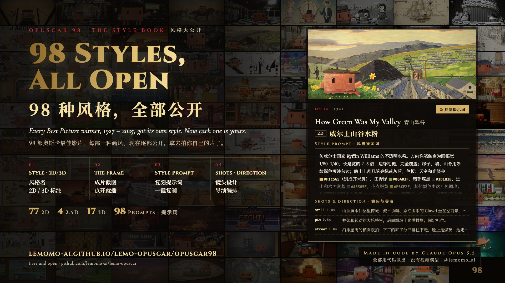
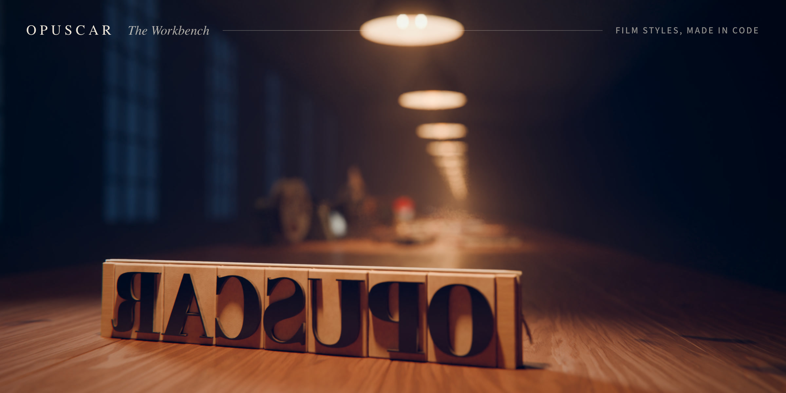
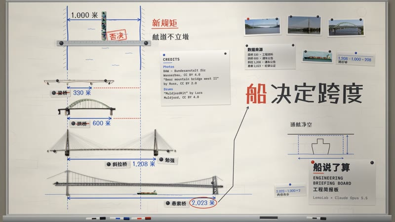
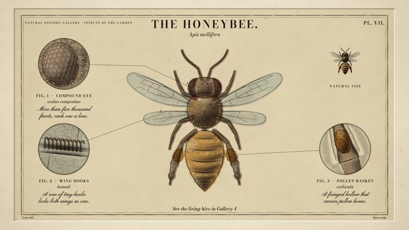

<div align="center">

# Lemo-Opuscar

**一套用代码做片的风格工具箱：<!--n-->66<!--/n--> 种现成风格，也能做出你自己的。**<br>
选一个风格，或者从头做一个，带上你的故事，让编程 agent 来当导演。

<a href="https://lemomo-ai.github.io/lemo-opuscar/"></a> <a href="README.md"></a> <a href="https://github.com/lemomo-ai/lemo-opuscar/stargazers"></a> <a href="#授权"></a>

<a href="https://trendshift.io/repositories/262645?utm_source=trendshift-badge&amp;utm_medium=badge&amp;utm_campaign=badge-trendshift-262645" target="_blank" rel="noopener noreferrer"></a>

⚠️ **本插件为 Claude 专用。** 风格都是按 Claude Opus 5.5 调出来的，<br>
其他模型适配度不高，请谨慎使用。

🆕 **2026-10-29 · [7 种新风格](https://lemomo-ai.github.io/lemo-opuscar/)**：孟菲斯微缩景观（[@EianLu](https://x.com/EianLu) 提供）、地铁线路图、黑板粉笔、电路板等。[往下看 ↓](#风格)<br>
🆕 **2026-10-22 · 新分类[「剪辑与纪实」](https://lemomo-ai.github.io/lemo-opuscar/#edit-documentary)**：8 种风格，用真实的档案、文件和数据剪成。[往下看 ↓](#剪辑与纪实)<br>
🆕 **2026-10-22 · 新玩法[「改成你自己的风格」](#改成你自己的风格)**：改库里的风格或从空白做，存成你自己的。[往下看 ↓](#改成你自己的风格)<br>
🆕 **2026-10-16 · 新分类[「实证影像」](https://lemomo-ai.github.io/lemo-opuscar/#evidence-films)**：8 种风格，拍真实素材，每个数字都有出处。[往下看 ↓](#实证影像)

<sub>官方仓库：[github.com/lemomo-ai/lemo-opuscar](https://github.com/lemomo-ai/lemo-opuscar) · 作者 Lemomo（[@lemomo_ai](https://x.com/lemomo_ai)）</sub>

</div>

## 🎬 特别放映：OPUSCAR 98

<table><tr>
<td width="50%" valign="top"><a href="https://lemomo-ai.github.io/lemo-opuscar/opuscar98/"></a><br><b>▶ 影片</b> · 1927 – 2025 · 6 分 31 秒<br><sub>一个 Clawd 走过 98 部最佳影片，每一部都换成贴合那部电影的画风。</sub></td>
<td width="50%" valign="top"><a href="https://lemomo-ai.github.io/lemo-opuscar/opuscar98/#styles"></a><br><b>98 种风格全部公开</b> · 2D 77 · 2.5D 4 · 3D 17<br><sub>每部片的画风、截图和风格提示词，拿去拍你自己的题材。</sub></td>
</tr></table>

<div align="center">

每一帧画面、每一个音符、每一刀剪辑，都是 Claude Opus 5.5 写代码做出来的。<br>
[**▶ 观看**](https://lemomo-ai.github.io/lemo-opuscar/opuscar98/) · [**98 种风格**](https://lemomo-ai.github.io/lemo-opuscar/opuscar98/#styles) · [**下载 1080p**](https://github.com/lemomo-ai/lemo-opuscar/releases/download/films/opuscar98.mp4)

</div>

## 👋 关于我

我是 **Lemomo**，更多信息见我的 [GitHub 主页](https://github.com/lemomo-ai)。

> **这不是一个 awesome 合集。** 这里所有的片子都是我自己用 Claude Opus 5.5 做的。<br>
> 风格是按 Opus 5.5 调出来的，换成其他模型不保证能做出同样的效果。



每一支片子都是 AI agent 写代码导演、作画、配乐、混音的：

- 🎨 **画面**：Canvas 和 WebGL 页面逐帧渲染
- 🎵 **音乐**：用免费采样库写的原创配乐
- 🎙️ **配音**：TTS 语音合成

不用视频生成，也不用素材库画面。

## 怎么用

两种用法，推荐装 skill，最省事。

### 方式一：装成 skill（推荐）

在终端里：

```sh
claude plugin marketplace add lemomo-ai/lemo-opuscar
claude plugin install lemo-opuscar@lemolab
```

之后在任何目录都能用。

- 第一次使用时，它会把指南、工具和风格提示词下载到 `~/lemo-opuscar`，所有片子共用这一份。
- 每支片子的工程，从源码到成片，都放在你发起时所在的文件夹里。
- 其他 agent 可以把 [`plugin/skills/lemo-opuscar/`](plugin/skills/lemo-opuscar/) 复制到它们的 skills 目录。

### 方式二：clone 仓库

```sh
git clone https://github.com/lemomo-ai/lemo-opuscar.git
cd lemo-opuscar
claude
```

片子做到仓库里的 `films/<名字>/`。

### 然后直接说

> 用**油画厚涂**风格做一支 30 秒的片子，讲我家那只每天在窗台等我下班的橘猫。

> 用**点云测绘**风格做一支 40 秒的片子，讲我们镇后山那座废弃的采石场，数据用公开的激光扫描。

风格用中文名、英文名或文件夹名都行，全部风格见[风格索引](styles/README.md)。

还没想好也没关系：装成 skill 的，输入 `/lemo-opuscar:lemo-opuscar` 直接启动。它先问你用什么语言，再问这次想做什么：用库里的风格做片、[把风格改成你自己的](#改成你自己的风格)，或者用你存过的风格。

它开工前只问你一次：

- 主题里它定不了的事；
- 你有没有自己的**配音、音乐或其他素材**；
- 要不要先看**分镜故事板**。要看的话，它会停一次，给你看用真实风格画出来的关键镜头；不看就直接做完成片。

agent 会读三份指南，像一个小工作室一样开工。<br>
指南是英文写给 agent 看的，你用中文跟它说就行，片子的配音和字幕默认跟你用的语言一致。

| 文件 | 给 agent 的东西 |
|---|---|
| [`DIRECTOR.md`](DIRECTOR.md) | 怎么导：故事、声音、节奏、镜头、表演、自检 |
| [`TECHNIQUE.md`](TECHNIQUE.md) | 怎么做：逐帧渲染、配音、配乐、混音 |
| `styles/<风格>/STYLE.md` | 这个风格长什么样、听起来什么样；故事由你定 |

### 改成你自己的风格

每个人想要的都不一样：有自己的品牌色、logo、IP 和账号调性。现在你可以把库里的风格改成只属于你的，或者从空白做一个库里没有的。走的就是我自己往库里加新风格的流程。

<table><tr>
<td width="50%" valign="top"><a href="https://github.com/lemomo-ai/lemo-opuscar/releases/download/films/swiss-motion.mp4"></a><br><b>库里的风格</b> · 瑞士动态排版<br><sub>平面网格、一个信号色、动作卡着节拍。</sub></td>
<td width="50%" valign="top"><a href="https://github.com/lemomo-ai/lemo-opuscar/releases/download/films/my-style-material-grid.mp4"></a><br><b>我的风格</b> · 材质网格 · ▶ 31 秒 demo 片<br><sub>留下瑞士排版的网格、节拍和字体，换成陶土、塑料、绒布、玻璃和铬的实物：俯视是一张海报，镜头一倾全是实物。</sub></td>
</tr></table>

**两个入口。** 启动 skill 后在入口里选，或者一句话直接说：

> 我想把**浮世绘**风格改成我自己的版本。

> 从空白开始，做一个黑板粉笔画的风格，暖一点、慢一点。

- **改库里的风格**：它列出全部风格和画廊链接，你打字说改哪一个。
- **从空白开始**：用你自己的话描述想要的样子，也可以给一张喜欢的图或一支片。Claude 从库里挑一个最接近的风格当技法底子，说清楚为什么选它，你点头或者换一个。

**接下来五步：**

1. **一个问题一个问题定方案。** 每个问题都带几个选项，推荐的排第一，附上理由。大概会问：
   - 拿来做什么：做什么片、发在哪个平台（竖屏就用 1080×1920 或 1080×1440），有没有品牌色、logo、字体或固定角色；
   - 想改哪里：改库里风格时，它先把风格分成三组讲给你听，**放心改**（配色、字体、动作快慢、声音、标志镜头）、**一改就变味**（材质和画法、配色的逻辑、镜头语法）、**不能改**（风格的本质，改了就是另一个风格）；
   - 每一项往哪个方向改，最后起名字。

   说得模糊也行，比如「高级一点」「活泼一点」，它会翻译成具体的改法让你挑。嫌慢就选每题最后的「自由对话」，直接聊；随时说「你定」，剩下的它按推荐填好。改库里风格时一轮最多改五处；全部用代码画，不用生图。
2. **看汇总，点头。** 每一项改前是什么、改后是什么、代价是什么，你点头了它才写下来。
3. **先看一张风格图。** 用真实的绘制代码画出来。改库里风格的，同一个画面用原风格再出一张，左边原版、右边你的并排放。不满意就说，两轮还不对它会直说，建议换一个更接近的底子。
4. **一支 15–30 秒的 demo 片。** 每一处改动都在画面里出现，配音乐和音效。它自己检查、修一轮再交给你。
5. **满意了再固化。** 它问你：固化、再改一轮，还是先不固化。你点头之前，一切都只在这次的项目文件夹里。

固化以后，风格存在 `~/lemo-my-styles/<名字>/`，和库里的风格同一个结构：风格说明、改了什么、demo 片和它的源码，以后做片能接着用这些技法。之后像用库里的风格一样叫它的名字：“用我的**夜浮世绘**风格做一支 30 秒的片子，讲……”。挑风格时，你自己的风格排在最前面。

库更新、重装 skill 都不会动它们。底子风格以后更新了，它会提一句，问你要不要把有用的修复同步过来。Claude 照着 [`MY-STYLES.md`](MY-STYLES.md) 一步步做。

### 开始之前

- 一支片子 agent 大约要做 30–60 分钟，token 用量不小。
- 需要 Node 20+、ffmpeg 7+ 和 Python 3.11+（或 [uv](https://docs.astral.sh/uv/)），其余由 agent 安装。Ubuntu 24.04 自带的 ffmpeg 是 6.1，版本太旧，请换成[静态版](https://johnvansickle.com/ffmpeg/)。
- 默认输出 1920×1080、24 fps，其他尺寸可以指定。

### 更新和卸载

更新，然后重启 Claude Code（`~/lemo-opuscar` 里的库会在下一次做片时自动更新）：

```sh
claude plugin marketplace update lemolab && claude plugin update lemo-opuscar@lemolab
```

更新后照常说要做什么片；想把风格改成自己的，看[上面](#改成你自己的风格)。

卸载，然后删除 `~/lemo-opuscar`：

```sh
claude plugin uninstall lemo-opuscar@lemolab
```

你自己的风格存在 `~/lemo-my-styles/`，更新和卸载都不会删；不要了就自己删掉这个文件夹。

一直卡住就[提个 issue](https://github.com/lemomo-ai/lemo-opuscar/issues)。

## 风格

点图片看它的 `STYLE.md`。

<!-- styles:start -->

### 🆕 最新 · 2026-10-29

<table>
<tr>
<td width="33%" valign="top"><a href="styles/memphis-diorama/STYLE.md"></a><br><b>孟菲斯微缩景观</b><br>Memphis Diorama<br><i>Four Seasons in Pomelo Town</i><br><sub>一个河湾一镜过完四季，大树一蹲一弹，就换一季。</sub><br><sub>由 <a href="https://x.com/EianLu">@EianLu</a> 提供</sub></td>
<td width="33%" valign="top"><a href="styles/transit-map/STYLE.md"></a><br><b>地铁线路图</b><br>Transit Map<br><i>6 Kilometres</i><br><sub>一张纸上的线路图，从 1993 年的 6 公里长到 21 条线、906 公里。</sub></td>
<td width="33%" valign="top"><a href="styles/chalkboard/STYLE.md"></a><br><b>黑板粉笔</b><br>Chalkboard<br><i>The Story of Chinese Characters</i><br><sub>粉笔写下网上的说法，再一擦，把「射」写回三千年前。</sub></td>
</tr>
<tr>
<td width="33%" valign="top"><a href="styles/isometric-picture-book/STYLE.md"></a><br><b>等距绘本</b><br>Isometric Picture Book<br><i>Seventy-Two Seats</i><br><sub>等距的登机口和机舱里，小人按顺序登机，讲清哪种叫法快将近一半。</sub></td>
<td width="33%" valign="top"><a href="styles/printed-long-take/STYLE.md"></a><br><b>印刷长镜头</b><br>Printed Long Take<br><i>Thirty-Three Cranes</i><br><sub>刮版画的北海道河谷一镜到底，丹顶鹤从 33 只数回到 1,927 只。</sub></td>
<td width="33%" valign="top"><a href="styles/circuit-board/STYLE.md"></a><br><b>电路板</b><br>Circuit Board<br><i>Seven Milliseconds</i><br><sub>江河变成电路板上的走线，电流从水坝跑 2,080 公里进手机充电器。</sub></td>
</tr>
<tr>
<td width="33%" valign="top"><a href="styles/desktop-flythrough/STYLE.md"></a><br><b>桌面穿梭</b><br>Desktop Flythrough<br><i>Before the Ding</i><br><sub>一张猫照片跳过桌上的应用卡片，从一台手机飞到朋友手机里，一镜跟到底。</sub></td>
</tr>
</table>

### 剪辑与纪实

<table>
<tr>
<td width="33%" valign="top"><a href="styles/caption-news/STYLE.md"></a><br><b>字幕新闻</b><br>Caption News<br><i>The Bee Ledger</i><br><sub>美国一年死掉 130 万箱蜜蜂，总数却涨了 6%：静音也能看懂的新闻。</sub></td>
<td width="33%" valign="top"><a href="styles/newsreel/STYLE.md"></a><br><b>1920s 新闻影片</b><br>1920s Newsreel<br><i>Knock-Knee Alert</i><br><sub>1926 年报纸说查尔斯顿会跳坏膝盖，福特工人野餐会上的孩子照跳不误。</sub></td>
<td width="33%" valign="top"><a href="styles/countdown/STYLE.md"></a><br><b>实时倒计时分屏</b><br>Live Countdown Split-screen<br><i>Counting Itself Down</i><br><sub>阿尔忒弥斯二号发射的最后一分钟，一秒不剪：格子从 1 开到 9，点火合成 1。</sub></td>
</tr>
<tr>
<td width="33%" valign="top"><a href="styles/city-symphony/STYLE.md"></a><br><b>延时交响</b><br>Time-lapse Symphony<br><i>One Day in New York</i><br><sub>纽约的一天：延时光河、踩着十六分音符的网格，1899 年和今天并排。</sub></td>
<td width="33%" valign="top"><a href="styles/visual-investigation/STYLE.md"></a><br><b>视觉调查</b><br>Visual Investigation<br><i>The Hindenburg: Four Minutes, 32 Seconds</i><br><sub>新闻片、照片、证词和调查报告排上同一条时间轴，五路来源指向一处。</sub></td>
<td width="33%" valign="top"><a href="styles/kino-montage/STYLE.md"></a><br><b>构成主义蒙太奇</b><br>Constructivist Montage<br><i>410 Days</i><br><sub>帝国大厦的小册子写着建造者，工地实拍和老照片给出答案：每天 2,500 人。</sub></td>
</tr>
<tr>
<td width="33%" valign="top"><a href="styles/telestrator/STYLE.md"></a><br><b>体育战术板</b><br>Sports Telestrator<br><i>Freeze Frame</i><br><sub>半场 0–3，费内巴切 12 分钟连进三球：冻住画面、画线、分屏、射门图。</sub></td>
<td width="33%" valign="top"><a href="styles/news-package/STYLE.md"></a><br><b>电视新闻包装</b><br>Broadcast News Package<br><i>The Week in AI</i><br><sub>一周四条 AI 新闻，一整套电视台包装：串联单、标题条、翻牌价格表、规格卡。</sub></td>
</tr>
</table>

### 实证影像

<table>
<tr>
<td width="33%" valign="top"><a href="styles/satellite-briefing/STYLE.md"></a><br><b>卫星简报</b><br>Satellite Briefing<br><i>The Map Still Says Sea</i><br><sub>卫星照着地图去找咸海，找到的是沙漠；只有筑了坝的那一块回来了。</sub></td>
<td width="33%" valign="top"><a href="styles/briefing-board/STYLE.md"></a><br><b>工程简报板</b><br>Engineering Briefing Board<br><i>The Ship Decides</i><br><sub>一条河要架桥，四种桥型在一面简报墙上逐个受检，拍板的是桥下要过的船。</sub></td>
<td width="33%" valign="top"><a href="styles/lidar-survey/STYLE.md"></a><br><b>点云测绘</b><br>LiDAR Survey<br><i>The Fields Under the Forest</i><br><sub>激光点云剥掉一片森林的树冠，露出当年农田的石墙：3.4 公里。</sub></td>
</tr>
<tr>
<td width="33%" valign="top"><a href="styles/white-model/STYLE.md"></a><br><b>白模投影</b><br>Projection on White Model<br><i>How a Flattened City Grew Back</i><br><sub>投影机把数据一层层刷上鹿特丹白模：从 1940 年的空洞到今天的塔楼。</sub></td>
<td width="33%" valign="top"><a href="styles/data-physical/STYLE.md"></a><br><b>数据实物化</b><br>Data Physicalization<br><i>Two Spirals</i><br><sub>十二年风电和太阳能装机叠成实物，绕表盘升成两条螺旋，2021 年太阳能反超。</sub></td>
<td width="33%" valign="top"><a href="styles/teardown/STYLE.md"></a><br><b>产品拆解</b><br>Exploded Teardown<br><i>21 Keys, Opened</i><br><sub>开源键盘的一半在一次环绕中逐层拆开，看到主控再合拢，标上真实尺寸。</sub></td>
</tr>
<tr>
<td width="33%" valign="top"><a href="styles/microscope/STYLE.md"></a><br><b>显微叙事</b><br>Microscope Story<br><i>Measured Blue</i><br><sub>一镜从肝组织玻片推到单个细胞核，两个圆逐像素数出 2.4 倍的蓝。</sub></td>
<td width="33%" valign="top"><a href="styles/archive-lighttable/STYLE.md"></a><br><b>档案灯台</b><br>Archive Light Table<br><i>Two Seconds Short</i><br><sub>电报说最长飞了 57 秒；放大镜下，莱特兄弟的底片和档案说是 59 秒。</sub></td>
</tr>
</table>

### 手绘与绘画

<table>
<tr>
<td width="33%" valign="top"><a href="styles/crayon-book/STYLE.md"></a><br><b>蜡笔儿童绘本</b><br>Crayon Picture Book<br><i>The Moon Can&#x27;t Sleep</i><br><sub>月亮失眠了，小女孩爬上屋顶给它唱摇篮曲。</sub></td>
<td width="33%" valign="top"><a href="styles/watercolor/STYLE.md"></a><br><b>水彩笔刷</b><br>Watercolor Brush<br><i>Follow the Rain</i><br><sub>跟着降雨从澳洲红色腹地一路画到绿色海岸，一镜到底。</sub></td>
<td width="33%" valign="top"><a href="styles/ink-wash/STYLE.md"></a><br><b>中国水墨</b><br>Chinese Ink Wash<br><i>The Swordsman and the River</i><br><sub>侠客踏水过江，一剑断流。</sub></td>
</tr>
<tr>
<td width="33%" valign="top"><a href="styles/impasto/STYLE.md"></a><br><b>油画厚涂</b><br>Impasto Oil Painting<br><i>The Colour of Rain</i><br><sub>灰色雨中广场，第一把红伞撑开，圆舞曲把整个广场刷上颜色。</sub></td>
<td width="33%" valign="top"><a href="styles/one-line/STYLE.md"></a><br><b>一笔画</b><br>One-line Drawing<br><i>The Line That Never Lifted</i><br><sub>一根不离纸的线画完一个人的一生，再把笔交给孩子。</sub></td>
<td width="33%" valign="top"><a href="styles/whiteboard/STYLE.md"></a><br><b>白板讲解</b><br>Whiteboard Explainer<br><i>Einstein in Your Pocket</i><br><sub>手机怎么知道你在哪：GPS、原子钟，和相对论每天多出的 38 微秒。</sub></td>
</tr>
<tr>
<td width="33%" valign="top"><a href="styles/urban-sketch/STYLE.md"></a><br><b>钢笔淡彩</b><br>Urban Sketch · Pen &amp; Wash<br><i>Where the Wind Went</i><br><sub>公园只是一张钢笔速写，风把草帽吹到哪里，哪里才有颜色。</sub></td>
</tr>
</table>

### 东方传统

<table>
<tr>
<td width="33%" valign="top"><a href="styles/shadow-puppet/STYLE.md"></a><br><b>皮影戏</b><br>Shadow Puppetry<br><i>Hou Yi Shoots the Suns</i><br><sub>十日炙烤大地，后羿张弓射日。</sub></td>
<td width="33%" valign="top"><a href="styles/ukiyoe/STYLE.md"></a><br><b>浮世绘</b><br>Ukiyo-e<br><i>Toward the Mountain</i><br><sub>旅人走向远山，每个镜头都是一幅版画；巨浪是高潮，结尾是远山与整幅画轴拉远。</sub></td>
<td width="33%" valign="top"><a href="styles/papercut-red/STYLE.md"></a><br><b>红色窗花剪纸</b><br>Red Paper-cut<br><i>Nian Comes to Town</i><br><sub>除夕年兽进村，小女孩剪出的大窗花照亮全村，把它吓跑。</sub></td>
</tr>
<tr>
<td width="33%" valign="top"><a href="styles/paper-lantern/STYLE.md"></a><br><b>纸雕灯影</b><br>Paper-cut Lightbox<br><i>The Last Night Train</i><br><sub>一列老夜车跑最后一趟：从雪山小站穿过长隧道开到海边，到站后车窗一扇扇熄灭。</sub></td>
</tr>
</table>

### 印刷与版画

<table>
<tr>
<td width="33%" valign="top"><a href="styles/risograph/STYLE.md"></a><br><b>Risograph 孔版印刷</b><br>Risograph Print<br><i>Sunday Ride</i><br><sub>周日早晨骑车穿过城市：面包店、公园、河边，每到一处加一版油墨，最后三版套印。</sub></td>
<td width="33%" valign="top"><a href="styles/halftone-dossier/STYLE.md"></a><br><b>复古半调案卷</b><br>Halftone Dossier<br><i>Case File: Chubby</i><br><sub>橘猫胖橘被立案审查：测试重力、凌晨跑酷，最后无罪释放。</sub></td>
<td width="33%" valign="top"><a href="styles/woodcut/STYLE.md"></a><br><b>木刻版画</b><br>Woodcut Print<br><i>The Bell Founder</i><br><sub>村子用一整个冬天铸一口钟，钟声第一次响起，雪停了。</sub></td>
</tr>
<tr>
<td width="33%" valign="top"><a href="styles/engraving/STYLE.md"></a><br><b>铜版画</b><br>Copperplate Engraving<br><i>The Honeybee, Plate VII</i><br><sub>一张博物志图版自己刻出来：雕刀推开铜版，蜜蜂一线线成形，最后手工水彩上色。</sub></td>
<td width="33%" valign="top"><a href="styles/silkscreen-poster/STYLE.md"></a><br><b>丝印旅行海报</b><br>Silkscreen Travel Poster<br><i>The Long Way Home</i><br><sub>一张满屏丝印海报一座城，票根数着离家的公里数，走到世界的另一头，才发现那是回家的路。</sub></td>
</tr>
</table>

### 图形与排版

<table>
<tr>
<td width="33%" valign="top"><a href="styles/swiss-motion/STYLE.md"></a><br><b>瑞士动态排版</b><br>Swiss Motion Graphics<br><i>Five Rules for a Poster</i><br><sub>一张音乐会海报按瑞士设计的五条规则自己排版，第五条是只打破一条。</sub></td>
<td width="33%" valign="top"><a href="styles/spy-titles/STYLE.md"></a><br><b>60s 间谍片头</b><br>60s Spy Title Sequence<br><i>The Velvet Cipher</i><br><sub>虚构 1964 年间谍片的片头：追一把被偷的钥匙，几何碎片最后拼成片名。</sub></td>
<td width="33%" valign="top"><a href="styles/art-deco/STYLE.md"></a><br><b>装饰艺术</b><br>Art Deco<br><i>Midnight at the Starlight Hotel</i><br><sub>1930 年的大饭店，门童赶在午夜前把一封信送上顶楼。</sub></td>
</tr>
<tr>
<td width="33%" valign="top"><a href="styles/blueprint/STYLE.md"></a><br><b>蓝图 / 工程制图</b><br>Blueprint<br><i>Patent Pending: The Cloud Catcher</i><br><sub>发明家的蓝图自己画出一台接云机器，修订云线变成了真的雨云。</sub></td>
<td width="33%" valign="top"><a href="styles/stained-glass/STYLE.md"></a><br><b>彩色玻璃窗</b><br>Stained Glass<br><i>The Dragon of the East Window</i><br><sub>阳光从清晨移到黄昏，照到哪一格花窗，哪一格的故事就动起来。</sub></td>
<td width="33%" valign="top"><a href="styles/pictogram-motion/STYLE.md"></a><br><b>象形运动图形</b><br>Pictogram Motion<br><i>Left Behind</i><br><sub>一把被落在公交车上的黄伞，晴天里在失物招领的货架上等了一整天，暴雨回来时和另外 312 把一起撑开：物件、交通、天气和标识，都是卡着节拍的几何象形符号。</sub></td>
</tr>
<tr>
<td width="33%" valign="top"><a href="styles/ascii-crt/STYLE.md"></a><br><b>ASCII / CRT 终端</b><br>ASCII / CRT Terminal<br><i>Tranquility.log</i><br><sub>月球基地的 AI 沉睡 40 年后被唤醒，用字符画出“家”来回复。</sub></td>
</tr>
</table>

### 信息与发布

<table>
<tr>
<td width="33%" valign="top"><a href="styles/dataviz/STYLE.md"></a><br><b>数据叙事</b><br>Data Storytelling<br><i>A Hundred Summers</i><br><sub>一百年的夏季气温，图表本身就是故事。</sub></td>
<td width="33%" valign="top"><a href="styles/iso-infographic/STYLE.md"></a><br><b>等距信息图</b><br>Isometric Infographic<br><i>From Bean to Cup</i><br><sub>一杯咖啡从种植园到你手里的旅程。</sub></td>
<td width="33%" valign="top"><a href="styles/dark-keynote/STYLE.md"></a><br><b>暗色科技发布</b><br>Dark Tech Keynote<br><i>Room to Think</i><br><sub>虚构 app Tidy 的发布片：被埋掉的光标一键把几百个窗口归位。</sub></td>
</tr>
<tr>
<td width="33%" valign="top"><a href="styles/living-screencast/STYLE.md"></a><br><b>活体实机录屏</b><br>Living Screencast<br><i>Clawd Moves In</i><br><sub>像素小人 Clawd 搬进 Claude 应用，一镜到底演示 Plan 模式和自检。</sub></td>
<td width="33%" valign="top"><a href="styles/hologram-hud/STYLE.md"></a><br><b>科幻全息界面</b><br>Sci-fi Hologram HUD<br><i>Volt · Spec Scan</i><br><sub>电助力车被扫描成全息线框，目标框依次锁定电池、电机、刹车。</sub></td>
</tr>
</table>

### 卡通与动画

<table>
<tr>
<td width="33%" valign="top"><a href="styles/rubber-hose/STYLE.md"></a><br><b>1930s 橡皮管卡通</b><br>1930s Rubber Hose Cartoon<br><i>Coffee Cup Chase</i><br><sub>一只咖啡杯满厨房追一块逃跑的方糖。</sub></td>
<td width="33%" valign="top"><a href="styles/cel-anime-80s/STYLE.md"></a><br><b>80 年代赛璐璐动画</b><br>80s Cel Anime<br><i>City Lights, 1987</i><br><sub>快递少女骑车穿过雨后霓虹都市，赶在黎明发射前送到一盘磁带。</sub></td>
<td width="33%" valign="top"><a href="styles/scifi-toon/STYLE.md"></a><br><b>科幻情景喜剧卡通</b><br>Sci-Fi Sitcom Toon<br><i>Coffee Run</i><br><sub>厌世天才开传送门只想买杯咖啡，却穿过越来越离谱的平行宇宙。</sub></td>
</tr>
<tr>
<td width="33%" valign="top"><a href="styles/midcentury-toon/STYLE.md"></a><br><b>50s 扁平卡通</b><br>Mid-century Cartoon<br><i>Meet Pip</i><br><sub>用 50 年代教育片的口吻，三步教你装好一台扫地机。</sub></td>
</tr>
</table>

### 游戏

<table>
<tr>
<td width="33%" valign="top"><a href="styles/pixel-rpg/STYLE.md"></a><br><b>16-bit 像素 RPG</b><br>16-bit Pixel RPG<br><i>The Last Save Point</i><br><sub>勇士在最终 Boss 门前存档，存档画面闪回一路冒险。</sub></td>
<td width="33%" valign="top"><a href="styles/hd-2d/STYLE.md"></a><br><b>HD-2D</b><br><i>The Lampbearer</i><br><sub>灯塔熄灭，孙女提着最后一簇火穿过夜林、爬上风暴悬崖。</sub></td>
<td width="33%" valign="top"><a href="styles/microgame/STYLE.md"></a><br><b>微游戏快闪</b><br>Microgame Frenzy<br><i>Five-Second Astronaut</i><br><sub>见习宇航员闯五秒训练营，越来越快，Boss 关亲手降落回地球。</sub></td>
</tr>
<tr>
<td width="33%" valign="top"><a href="styles/game-show/STYLE.md"></a><br><b>综艺节奏扁平</b><br>Game Show Flat<br><i>Rhythm of AI, 1997 → 2026</i><br><sub>把 AI 发展史做成一局节奏游戏，模型踩着拍登场，最后发成绩单。</sub></td>
</tr>
</table>

### 电影与时代

<table>
<tr>
<td width="33%" valign="top"><a href="styles/silent-film/STYLE.md"></a><br><b>1920s 默片</b><br>1920s Silent Film<br><i>The Runaway Loaf</i><br><sub>面包店学徒追一个滚走的面包，最后掰成两半分给饿肚子的小女孩。</sub></td>
<td width="33%" valign="top"><a href="styles/backrooms/STYLE.md"></a><br><b>后室 / 新怪谈</b><br>Liminal Found Footage<br><i>Night Shift Orientation</i><br><sub>新夜班员工拍下入职第一晚：无尽的黄色办公空间，和墙上的员工守则。</sub></td>
</tr>
</table>

### 材质与 3D

<table>
<tr>
<td width="33%" valign="top"><a href="styles/brick-toy/STYLE.md"></a><br><b>积木玩具</b><br>Brick Toy<br><i>Rocket from Spare Parts</i><br><sub>积木宇航员用零件拼出火箭，飞向积木月亮。</sub></td>
<td width="33%" valign="top"><a href="styles/paper-popup/STYLE.md"></a><br><b>纸片立体书</b><br>Paper Pop-up Book<br><i>Pip&#x27;s Paper Adventure</i><br><sub>立体书在书桌上打开，小精灵 Pip 在纸片世界冒险，最后跳出书外。</sub></td>
<td width="33%" valign="top"><a href="styles/tilt-shift/STYLE.md"></a><br><b>移轴微缩</b><br>Tilt-Shift Miniature<br><i>Toy Town Rush Hour</i><br><sub>玩具城的早高峰，一切都像模型。</sub></td>
</tr>
<tr>
<td width="33%" valign="top"><a href="styles/lowpoly-island/STYLE.md"></a><br><b>低多边形等距</b><br>Low-poly Isometric Island<br><i>The Island That Grew</i><br><sub>空海里一格格长出小岛和村庄，每放一块响一个音符，直到星空。</sub></td>
<td width="33%" valign="top"><a href="styles/glass-product/STYLE.md"></a><br><b>玻璃质感产品</b><br>Glass Product Render<br><i>Aura — Hear the Light</i><br><sub>虚构玻璃耳机 Aura 的开箱与特写。</sub></td>
</tr>
</table>
<!-- styles:end -->

## Star 增长

<a href="https://www.star-history.com/#lemomo-ai/lemo-opuscar&Date">
 <picture>
   <source media="(prefers-color-scheme: dark)" srcset="https://api.star-history.com/svg?repos=lemomo-ai/lemo-opuscar&type=Date&theme=dark" />
   <source media="(prefers-color-scheme: light)" srcset="https://api.star-history.com/svg?repos=lemomo-ai/lemo-opuscar&type=Date" />
   
 </picture>
</a>

### 谢谢每一颗星

每到一个里程碑做一支感谢片，和库里所有片子一样全部用代码做成。<br>
点海报到<a href="https://lemomo-ai.github.io/lemo-opuscar/thanks/">感谢片页面</a>在线观看。

<table><tr>
<td width="20%" valign="top"><a href="https://lemomo-ai.github.io/lemo-opuscar/thanks/#stars6000"></a><br><sub>6000 星 · 百家被（50 秒）</sub></td>
<td width="20%" valign="top"><a href="https://lemomo-ai.github.io/lemo-opuscar/thanks/#stars3000"></a><br><sub>3000 星 · 全家福（48 秒）</sub></td>
<td width="20%" valign="top"><a href="https://lemomo-ai.github.io/lemo-opuscar/thanks/#stars2000"></a><br><sub>2000 星 · 刷新（50 秒）</sub></td>
<td width="20%" valign="top"><a href="https://lemomo-ai.github.io/lemo-opuscar/thanks/#stars800"></a><br><sub>800 星 · 反打（39 秒）</sub></td>
<td width="20%" valign="top"><a href="https://lemomo-ai.github.io/lemo-opuscar/thanks/#stars300"></a><br><sub>300 星 · 点灯人（18 秒）</sub></td>
</tr></table>

## 授权

**LemoLab × Claude Opus 5.5** 出品。

- **代码和文档**：MIT 协议。
- **样片视频及其静帧**（`styles/`、画廊页和 Releases 中的）：[CC BY 4.0](https://creativecommons.org/licenses/by/4.0/deed.zh-hans)。可以转载、改编和商用，须署名 **LemoLab** 并附本仓库链接，改动过的须注明。
- **你用本库做出的片子**：归你自己，无须署名。
- **样片中的第三方素材**：沿用各自的授权，见各样片的 `CREDITS`。
- **有六段配音不在 CC BY 4.0 范围内**：黑板粉笔（Chalkboard）、电路板（Circuit Board）、桌面穿梭（Desktop Flythrough）、等距绘本（Isometric Picture Book）、印刷长镜头（Printed Long Take）的旁白（微软 Edge TTS，在线服务），以及电视新闻包装（Broadcast News Package）的旁白（豆包 TTS，受火山引擎条款约束）。它们不适用上面的授权。请不要复用；你自己的片子请用 Kokoro（默认）或你有权使用的声音。

你在自己片子里使用的素材由你负责。

## LemoLab 的其他项目

- 📸 **[lemo-wake](https://github.com/lemomo-ai/lemo-wake)**：一张图进去，一段约 5 秒、无缝循环的动图出来。
- 🍋 **[lemo-mod](https://github.com/lemomo-ai/lemo-mod)**：给 Claude Code 换上 21 套风格，终端和桌面 App 都能用。
- 🟥 **[小章 Stampy](https://github.com/lemomo-ai/lemo-stampy)**：Mac 菜单栏小工具，在预览里点一下，给复印件盖上「仅供××使用」。

---

<div align="center">

⭐ **点个星**<br>
👀 **Watch → Custom → Releases**，有新版本会通知你<br>
𝕏 关注 [@lemomo_ai](https://x.com/lemomo_ai)<br>
✉️ 商业合作：[lemomo.studio@gmail.com](mailto:lemomo.studio@gmail.com)

<sub>LemoLab · by Lemomo</sub>

</div>
