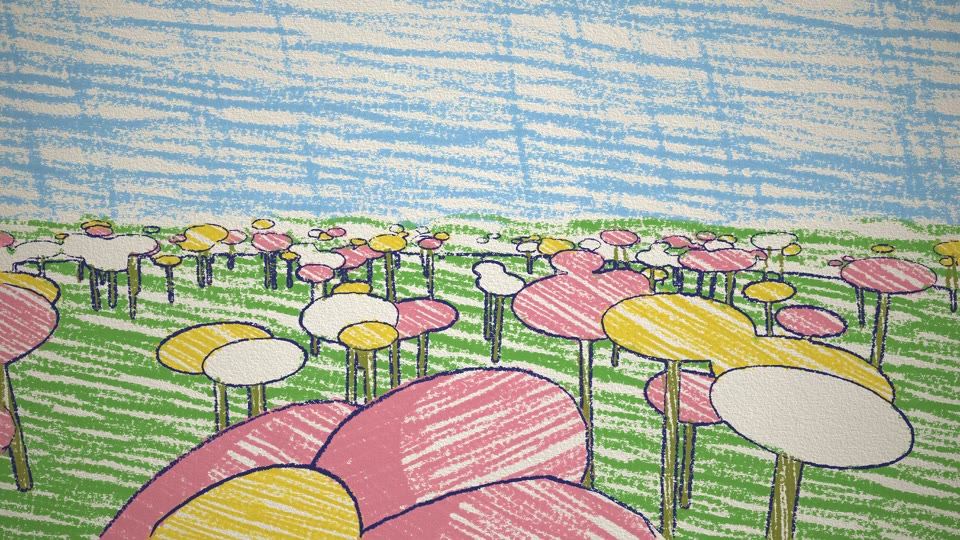
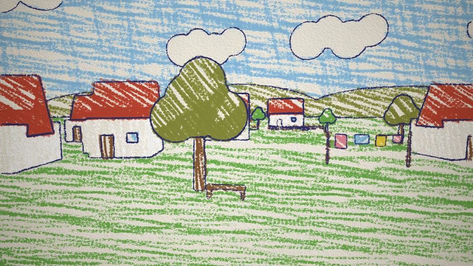
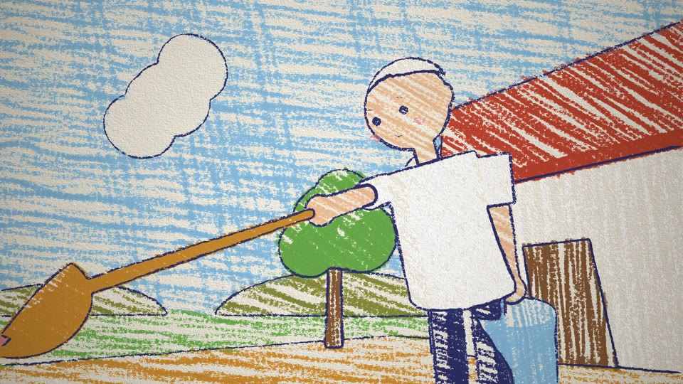
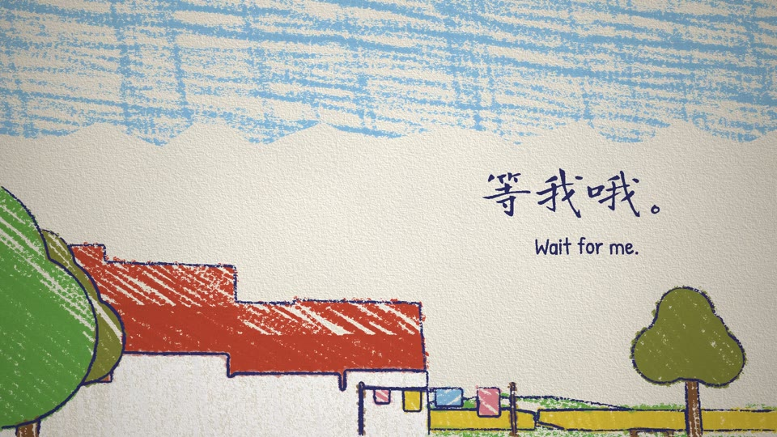

# Crayon World 3D — our demo

One example among many. Don't reuse its story, arc, shots, props or timings.

Demo: *The Butterfly* (《蝴蝶》, 64.5 s) · `crayon-world.mp4` · source in [`demo/`](demo/)

## Story & structure

An old woman has died. The film is her last visit, in first person: she wakes on a wild flower on the hillside above her village, flies down over the wheat and the roofs, over the bamboo fence into the garden she planted, and lands on one flower in the row. Her husband is watering the row with a long-handled ladle. At her flower he stops, looks down at it for a moment and doesn't pour; he waters the next ones, then looks back at it. Cut to his eyes: a yellow butterfly sits on that flower. It takes off toward the village and the hill, his gaze follows it up, and the page prints what he says: 等我哦。 / *Wait for me.*

What she is stays unseen for 44 s; nothing is explained. The clues are only flown past: fresh chrysanthemums in front of a stone on the hillside, her flowered straw hat on a nail by the door, a photo of the two of them on the windowsill.

Native moves spent: **the camera is someone** (0–43.8 s), **passing, not pointing** (the stone, the hat, the photo), **wind** (the flower she rides, the slope, the washing), **cut to the other's eyes** (43.8 s), **blank paper for words** (51–64.5 s).

## Shots

| # | Time | Shot | Camera | Native move / note |
|---|---|---|---|---|
| 1 | 0–6.9 s | wild flowers on the slope, close; she rides the head of one flower in the wind | swaying with the flower; gaze from the flowers up to the slope below (0.9–3.6 s), then round to where she will fly (3.6–6.9 s) | Wind; the sway settles by take-off |
| 2 | 6.9–12 s | take-off; the stone with chrysanthemums slides past on the left (8.5–10 s); the village swings in | spline from rest; gaze direction lags (τ 0.3 s) | Passing, not pointing |
| 3 | 12–20 s | down the hill path, skimming the wheat | low skim, a butterfly's bob | |
| 4 | 20–30.6 s | over the roofs; the bench under the big tree (slower); the washing line seen from six or seven metres | | |
| 5 | 30.6–34.2 s | over the bamboo fence into the garden; him watering the row; the house, hat and photo in passing; she lands on the 8th flower | spline comes to rest on the flower head | |
| 6 | 34.2–43.8 s | on the flower: he waters flowers 4 and 5, reaches hers (38.4 s), looks down without pouring, waters 8 and 9, looks back at it (42.5 s) | sways with the flower; gaze follows him with a lag | one breath of silence at 38.9 s |
| 7 | 43.8–51 s | **cut** to his eyes: the butterfly on that flower, wings slowly opening and closing; it takes off at 46.2 s and flies toward the village and the hill | his eye height, fov 27°, gaze follows it (τ 0.32 s) and rises | Cut to the other's eyes |
| 8 | 51–64.5 s | only a ragged strip of sky stays coloured; the rest thins to blank paper; 等我哦。 written in at 53.1 s, *Wait for me.* at 54.5 s; the butterfly becomes a doodle and is gone | held on the sky above the roofs | Blank paper for words |

## Score structure

D major, 3/4, 78 BPM (one bar = 2.308 s). Take-off (bar 3), the cut (19), the butterfly's take-off (20) and the words (23) land on bar lines.

- Bars 0–2, waking: a music box alone, slow plucks (low-passed until 1.5 s before take-off, so the steel comb isn't harsh), nylon guitar picking from bar 1; three birds, far and low.
- Bars 3–14, the flight: guitar picking in six eighths, Bm | G | D | A | Bm | G | Em | A | G | D/F# | Em | A; above it long music-box notes falling, one or two a bar; a clarinet's long low notes from bar 7; one glockenspiel note each over the village (bars 9, 11). Wistful, not a waltz.
- Bars 15–18, the garden: the guitar alone with a music-box note or two; the water foley on each pour; bar 17, beats 1–2: nothing (he looks down at her flower); bar 18 a suspension resolving as he looks back.
- Bars 19–26, his eyes: the recorder plays the theme (held back until now) once, whole: D | Bm | D | A | G | Em | Asus–A | D; from bar 23, with the words, the music box doubles it an octave up. Bar 26: back on D, one strummed chord.
- After the resolution the music box plucks four more notes, slower and slower, the last one drooping in pitch (the spring has run down), ringing to 64.5 s.
- Mix: the recorder samples sit some 14 dB hotter than the guitar and music box, so their gain is 0.22–0.27. Room reverb on everything; limited, then mastered to −14 LUFS by `mux.sh`.

## Palette & props

- Paper (0.957, 0.937, 0.890). Crayons: line `#2c2f6b`, sky `#8cc3e8`, white, grass `#6cb24a`, olive `#8a8f3a`, lemon `#f2d43a`, caramel `#d9932f`, earth `#8a5a35`, brick `#c8452f`, rose `#ec8a9a`, cream `#f4c49a`, plum `#8a4f8c`. Rose belongs to the flowers she planted.
- The hillside: about 700 wild flowers (rose, lemon, white) that sway from the base; the stone is white paper with an outline, the chrysanthemums lemon and white.
- The village: 16 white-walled, red-tiled houses (gable front, slanted side), six trees, a bench under the big tree, a washing line with four pieces of laundry; houses near the flight path are left out so the camera never clips one.
- The garden: a low bamboo fence, a row of 13 child's flowers (five petals, a lemon heart, two leaves), the old house with the door open, her straw hat with a rose band, a photo on the windowsill.
- Him: white shirt, dark trousers, white hair, cream skin; a long-handled caramel ladle that keeps its mouth up, a sky-blue tin bucket. Face drawn in 2D: dot eyes, white brows, rose cheeks.
- The butterfly: lemon wings with earth tips, an indigo body, 1.5× real size; below a few pixels it becomes a two-dab doodle.

## End card

None: the film ends on the printed words, held over the music box running down. The "LemoLab × Claude Opus 5.5" sign-off belongs to this library's demo only; a user's film carries no LemoLab credit and no copy of this card.

## Build notes

```
sh styles/crayon-world/demo/build.sh
```

Fonts (if missing) → sample libraries (if missing) → `tools/score.py` → picture at 24 fps with `core/render/video.mjs` (≈ 1 min on an M-series Mac, 4 workers) → `mux.sh` (−14 LUFS, light grain) → `readcheck.mjs` → poster at 32.5 s (over the fence into the garden) and four stills.

 
 

| File | What it holds |
|---|---|
| `demo/engine/npr.js` | regions, the analysis render and ring tracing (STYLE.md §10) |
| `demo/engine/crayon.js` | crayon line, scribble fill, dabs, type |
| `demo/engine/gl.js` | the WebGL2 compositor: paper, wax adhesion, knock-out, emboss, vignette |
| `demo/film.js` | the world, the camera route and gaze, his watering, the butterfly, the words, `frame(t)` and `texts(t)` |
| `demo/main.js` | the page contract (`render(t)`, `DUR`, `TEXTS(t)`); `?to=<s>` renders only the start |
| `demo/tools/score.py` | the score and foley, written to `demo/out/mix.wav` |
| `demo/tools/fonts.py` | subsets Long Cang and Patrick Hand to the two printed lines (reads `LINE` and `LINE_EN` in `film.js`; needs the network) |

Pitfalls tied to this demo:

- The hill is a squashed sphere; its slope must stop short of the wheat, or the flight passes inside it.
- Waking, flight and landing share one gaze follow (`follow(dirTarget, WAKE, t)`), and the camera while waking is the start point plus the flower head's offset from rest, so neither take-off nor landing jumps.
- The butterfly's wings alternate two poses in flight; for the first 0.6 s after leaving the flower the downstroke stays above level, or the wing goes through the petals.
- In his view the clouds are hidden: in this style they are outlines on paper, and floating on the blank paper they looked unfinished.
