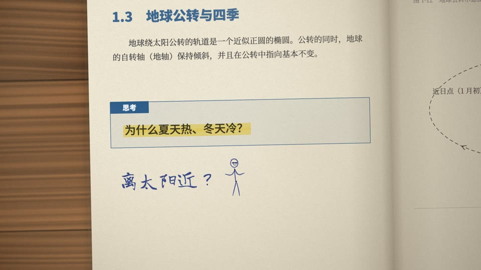
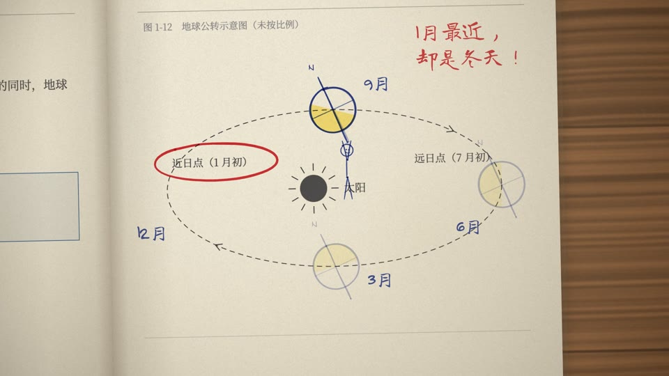
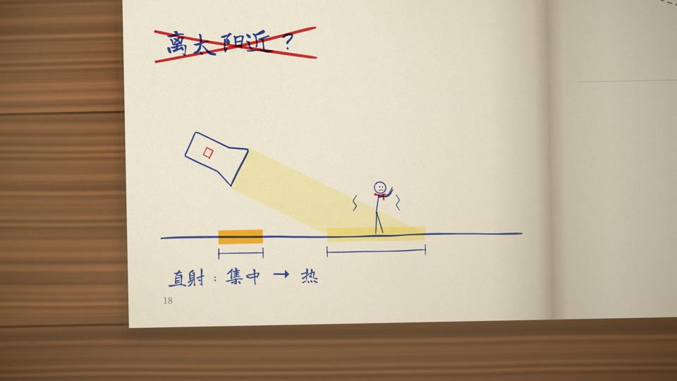
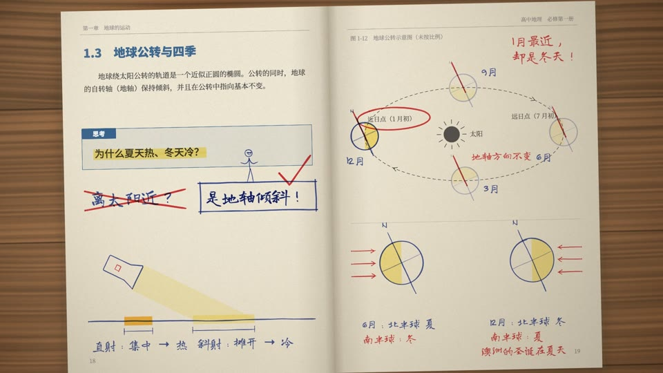

# Textbook Doodle — our demo

One example among many. Don't reuse its story, arc, shots, props or timings.

Demo: *Why We Have Seasons* (为什么会有四季, 39 s, no voice) · `textbook-doodle.mp4` · subtitles `textbook-doodle.srt` · source in [`demo/`](demo/)

## Story & structure

One invented geography textbook lies open on a desk at the chapter on the Earth's orbit. The print only asks: a blue "思考" box on the left page says 为什么夏天热、冬天冷？ (Why is summer hot and winter cold?), and the right page has a printed orbit figure with the perihelion labelled "early January". Everything that explains is the student's ink, and one margin stick figure is the only character, on screen from the first frame to the last.

The arc is a lesson in five beats: **question → wrong answer → evidence → experiment → answer**.

1. **The obvious answer.** The figure drags a highlighter bigger than himself along the question, then hugs a giant ballpoint and writes 离太阳近？ (because we're closer to the Sun?). A red ✗ lands on it; the red pen circles the printed perihelion label and writes 1月最近，却是冬天！ (closest in January, yet it's winter!).
2. **The orbit.** The student draws the Earth on the printed orbit with its axis tilted 23.5°; the figure grabs the south end of the axis and carries the globe round the sun, December → March → June → September → December. Red parallel lines on the axis at every station: 地轴方向不变 (the axis always points the same way).
3. **The flashlight test.** In the blank bottom of the left page, a torch points straight down: a small dense orange spot; the figure lands in it, sweats and fans himself. He jumps up, hangs on the torch's tail, his weight tips it: the spot stretches long and pale, and he shivers in it. Brackets measure both spots: 直射：集中 → 热, 斜射：摊开 → 冷 (straight on: concentrated → hot; slanted: spread out → cold).
4. **The hemispheres.** Bottom of the right page, two Earths: in June the north leans toward the sun, in December away. The figure stands on the June north pole (summer), hops onto the December north (freezing), then walks round the surface to the sunlit south and stands upside down in a Santa hat and sunglasses: 澳洲的圣诞在夏天 (Christmas in Australia is in summer).
5. **The answer.** He somersaults back to the question and writes 是地轴倾斜！ (it's the tilted axis!) beside the crossed-out answer with the giant pen; the student boxes it, the red tick lands, the camera pulls out to the whole spread.

 
 

The poster (20.3 s): the figure hanging on the tipped torch while the spot stretches, the wrong answer crossed out above.

## Shots

One spread, one continuous top-down camera with a constant −1° roll; framings change by eased slides and push-ins (times below are the film's, after the reading holds).

| # | Time | Shot | Camera | Native move / note |
|---|---|---|---|---|
| 1 | 0–4.2 s | the question box; highlighter pass (0.5 s), 离太阳近？ written (2.0 s), red ✗ (4.0 s) | close on the left page, 1.4× | Wrong answer, red cross |
| 2 | 4.2–5.3 s | the printed 近日点（1 月初） circled in red, 1月最近，却是冬天！ | slide to the right page, 1.5× | Red circle on the fine print |
| 3 | 5.3–17.4 s | the Earth drawn (6.5 s); four stations at 8, 10, 12, 14 s, month written at each; 14.5 s red parallels + 地轴方向不变, held to 17 s | slide onto the orbit figure (5.3–6.5), slight pull-out to 1.4× (13.2–14.2) | The figure uses the diagram |
| 4 | 17.4–25 s | the torch switched on (19 s), the figure in the hot spot; hangs on the tail and tips it (20.4 s); brackets, 直射 (21 s) and 斜射 (22 s) lines, held to 25 s | slide down to the bottom of the left page (17.4–18) | Experiment in the margin; Highlighter as light |
| 5 | 25–31 s | runs to the right page; June Earth (26 s), December Earth (27 s), 南半球：冬 / 夏 (29 s), held to 31.5 s | slide right along the bottom (25.5–26.3) | |
| 6 | 31–35 s | upside down in Australia, Santa hat, sunglasses; 澳洲的圣诞在夏天 (32.2 s), held to 35 s | push in on the figure, 2.2× (31–31.9) | push-in on the figure |
| 7 | 35–37.5 s | somersault back; 是地轴倾斜！ (36 s), box (36.7 s), red tick (37 s) | slide back to the question, 1.35× (35.25–36) | Boxed answer + tick |
| 8 | 37.5–39 s | the finished spread, the figure standing on the box | pull out to the whole spread, 0.9× (36.6–37.6), then hold | pull-out to the whole spread |

A small zoom kick (3.5 %, gone in half a second) lands on the red ✗, the circle, each orbit station and the answer.

## Score structure

F major, 120 BPM, one bar = 2 s, written on the 30 s grid of `timeline.json` and stretched with the picture (below). A classroom band of sampled instruments: pizzicato violins and cellos, clarinet, xylophone, glockenspiel, harp, a light kit, brass stabs, sleigh bells, triangle.

- **Question (0–4 s):** pizzicato arpeggios; the clarinet asks a four-note phrase that stops on G, unanswered; a confident xylophone run up as 离太阳近？ is written.
- **Red cross (4 s):** snare hit and a trombone "wah-wah-wah" sliding down D–D♭–C–B; the band stops. At 5 s one glockenspiel note and pizzicato stopping on D minor under 1月最近，却是冬天！.
- **Orbit (6.5–17 s):** a harp F–A–C as the Earth is drawn; the light kit enters with the orbit hook (xylophone doubled by staccato clarinet an octave below, phrases A and B alternating); one climbing glockenspiel note per station; a glockenspiel run and snare on the axis line.
- **Flashlight (18–25 s):** the clarinet sings the melody; the switch is a woodblock click; a shaker while he fans himself in the heat, the trombone walking down three steps as the torch tips, a xylophone trill for each shiver.
- **Hemispheres (25–35 s):** the full band over sustained high strings, the orbit hook back; a crash on the June Earth, a glockenspiel note on December, crash and snare when the south turns out reversed; sleigh bells and a glockenspiel run up for the Australian Christmas.
- **Answer (36–39 s):** tutti on F (trumpets, horns, strings, timpani, crash); the confident xylophone run from 2 s comes back, this time on the right answer; the tick on triangle + glockenspiel; a final pizzicato, horn and glockenspiel button at 37.5 s.
- **Foley:** ballpoint on paper (band-passed noise in a scratching rhythm) under every written line, a broader, duller highlighter, a xylophone run up for every jump.
- **Reading holds:** after the score is written on the grid, each hold shifts every later event by its length and fills the gap by repeating the groove (pizzicato, kit, hook, string pad) of the two seconds before it, so the music keeps moving while the picture waits.
- Played by `core/audio/sampler.py` in `demo/tools/score.py`; mastered by `core/render/mux.sh` to −14 LUFS (measured −14.1 LUFS, LRA 5.6, true peak −1.9 dBFS) with its default light grain.

## Palette & props

- Paper `#f3eedf` with fibre noise and one stain per page; desk `#5a3a22` planks; gutter shade and page edges.
- Print `#26262a`, grey `#77757a` for running headers, captions and page numbers (18, 19), one spot colour `#2f5d8a` for the chapter heading and the "思考" box. Running header 第一章　地球的运动 / 高中地理　必修第一册; figure caption 图 1-12　地球公转示意图（未按比例）.
- Ink: ballpoint `#1f3a9e`, red gel `#d3262b`, yellow highlighter `#ffe02e` (the lit half of every Earth, the slanted spot), orange highlighter `#ffb21e` (the hot spot).
- Props, all in ballpoint: a highlighter and a ballpoint taller than the figure, the Earth with its tilted axis, equator and "N", the torch with a switch, measuring brackets, sunlight arrows, sweat drops, shiver lines, a Santa hat, sunglasses.

## End card

None: the film ends on the pulled-out spread with the boxed answer and the red tick, held for the last 1.5 s. No title card and no sign-off are drawn.

## Build notes

```
sh styles/textbook-doodle/demo/build.sh
```

Fonts (if missing) → sample libraries `vsco2ce`, `vcsl`, `freepats` (if missing) → `tools/score.py` → picture at 24 fps with `core/render/video.mjs` (936 frames, about 30 s on an M-series Mac with 4 workers) → `mux.sh` → `readcheck.mjs` (stops the build on a failure) → `tools/srt.py` → poster at 20.3 s and the four stills above.

| File | What it holds |
|---|---|
| `demo/index.html` → `demo/main.js` | the page contract: `render(t)`, `DUR`, `EV`, `TEXTS(t)` |
| `demo/film.js` | the film: the ink marks with their times, the figure's track, the camera keys, `texts()` for `window.TEXTS` |
| `demo/pages.js` | the printed pages (the question, the orbit figure) and `PRINTED`, the printed lines the story needs read |
| `demo/engine/*.js` | the engine (STYLE.md §10): `pen.js`, `hand.js`, `book.js`, `stick.js` |
| `demo/timeline.json` | the cues, the reading holds and the tail, shared by the picture, the score and the subtitles |
| `demo/tools/score.py` | the score and foley, written to `demo/out/mix.wav` |
| `demo/tools/srt.py` | the written lines as bilingual subtitles (Chinese as on the page, English) |
| `demo/tools/fonts.py` | subsets Long Cang, Noto Serif SC and Noto Sans SC to the characters in the `.js` files (needs the network) |

**Timeline and reading holds.** The cues in `timeline.json` are written on a 30 s grid (one bar = 2 s). `holds` is a list of `[grid time, seconds]`: every cue at or after that grid time moves later by that many seconds (`warp()` in `film.js`, the same lambda in `score.py` and `srt.py`), and `tail` holds the last frame. The four holds (2 s each, after the axis line, the flashlight lines, the southern lines and the Australian line) give the written lines their reading time; with them the film is 39 s. In your own film, write the cues where the action wants them, run `readcheck`, and add a hold where it reports a line too short rather than squeezing the action.

**Fonts.** `tools/fonts.py` collects every CJK character from `demo/*.js` and `demo/engine/*.js` plus printable ASCII and common punctuation, so any on-screen string in those files is covered; text from elsewhere (a JSON file) is not. Google splits a subset into unicode-range blocks: one file per block, one `@font-face` per block in `fonts/fonts.css`, and `main.js` loads every face before the first frame.

**Ink in page coordinates.** `onPage()` in `book.js` hands the film a context already transformed to a page; `on(id, f)` in `film.js` registers a drawing for that page. Marks drawn this way are clipped to the page and follow it through a page turn (`drawTurn()`), which the demo never uses.

**A minimal example the demo never draws** (a figure climbing the tallest bar of a printed bar chart while a red circle lands on its label; `index.html` as in the demo, with the `engine/` folder and `fonts/` copied next to it):

```js
import { page, drawSpread, drawDesk, onPage } from './engine/book.js';
import * as P from './engine/pen.js';
import { printText } from './engine/hand.js';
import { figure, POSES, blend } from './engine/stick.js';
page('chartL', g => {                                         // print: baked once into the page, never moves
  [[120, 300], [260, 520], [400, 180]].forEach(([x, h]) => { g.fillStyle = '#2f5d8a'; g.fillRect(x, 900 - h, 90, h); });
  printText(g, '2024', 305, 940, { size: 22, align: 'center' });
});
page('chartR', () => {});
const ring = P.mark(P.ellipse(305, 932, 70, 26, { tool: 'red', w: 4, lap: .3 }), 1.0, .4);   // written at 1.0 s over 0.4 s
let NOW = 0, B = 0;
onPage((ctx, id) => { if (id === 'chartL') P.drawMark(ctx, ring, NOW, B); });         // ink in page coordinates
const c = document.getElementById('c'); c.width = innerWidth; c.height = innerHeight;   // the render size (1920×1080)
const ctx = c.getContext('2d');
await document.fonts.ready;
window.DUR = 3;
window.render = t => {
  NOW = t; B = Math.floor(t * 12);                                                   // ink boils on twos
  ctx.setTransform(1, 0, 0, 1, 0, 0); ctx.translate(c.width / 2, c.height / 2); ctx.scale(.85 * c.height / 1080, .85 * c.height / 1080);
  drawDesk(ctx, -1300, -700, 1300, 700); drawSpread(ctx, 'chartL', 'chartR');
  const u = Math.min(1, t / 2), pose = blend(POSES.climb1, POSES.climb2, B % 2);   // the figure, in world coordinates, climbs the tallest bar
  figure(ctx, { s: 60, x: -860 + 305, y: -590 + 900 - 520 * u, ...pose, face: 'grin' }, B);
};
window.READY = true;
```
