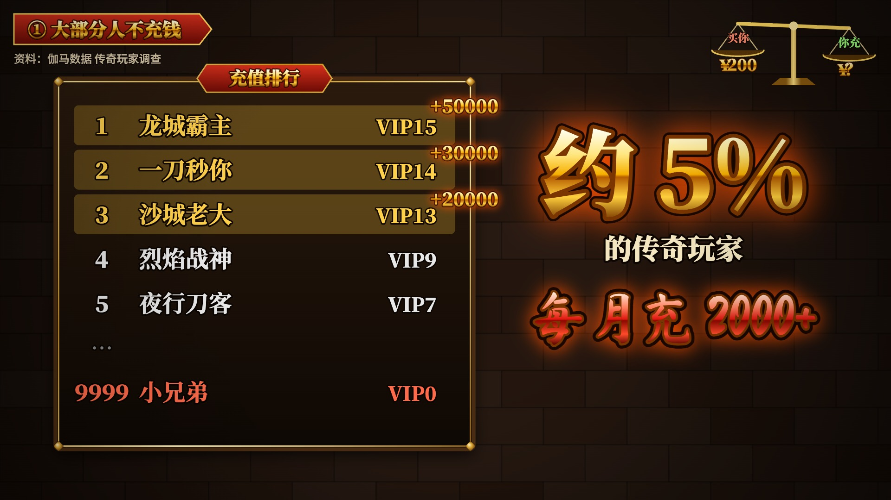
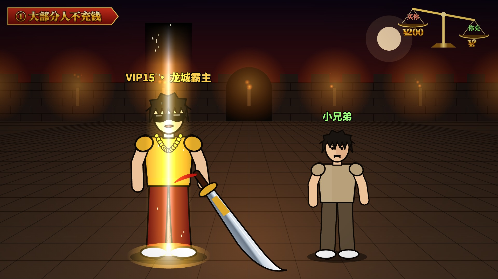
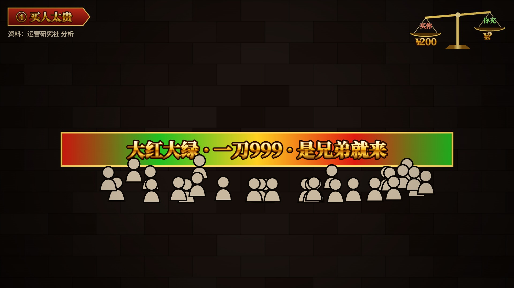

# Web Game Ad — our demo

One example among many. Don't reuse its story, arc, shots, props or timings.

Demo: *What Your Tap Costs* (买你这一下, 62.5 s) · `webgame-ad.mp4` · source in [`demo/`](demo/)

The film shows real public companies' disclosed figures (a web-game publisher's prospectus and annual reports, another's 2017 annual report) with the company names partly masked, plus third-party estimates labelled as such on screen. Every figure, its source and the quoted wording are in [`demo/FACTS.md`](demo/FACTS.md). No company is named in the voice; no spokesperson's face, name or voice is used; the ad's slogan is used as the genre's common meme.

## Story & structure

The whole film is one sum: **what they pay to acquire you must be less than what you top up later.** The voice states it at 5 s and a gold balance scale (买你 ¥200 on the left, 你充 ¥? on the right) stays in the top-right corner for the rest of the film, tipping with every step. Then four problems, each one the fix for the last, each with its question in a red tab top left:

1. **① Most people don't pay** (about one in ten) → make that one pay more: a ¥6 first top-up, then a leaderboard; one company's paying players top up ¥469 a month.
2. **② Everyone leaves** (two weeks later the server is empty) → open a new server, everyone back to level 1, pay again; merge the old ones.
3. **③ New servers need new players**, and new players cost money → one company spends 60–80 % of its revenue on promotion; if it pays back in about 40 days, the loop keeps turning.
4. **④ Players are expensive** → the ad can't be wasted on people who won't pay, so it is tacky on purpose: it filters. The star? 0.4–0.6 % of the budget.

The lead, 小兄弟 (a newbie in a plain tunic, no weapon), is in every scene that isn't a chart: he taps the ad, gets the ¥6 blade, sits at rank 9999, is cut down by a big spender for the crowd, stands alone in the empty square, gets a price tag over his head. At the end he closes the game himself; a new ad buzzes in; the voice says it isn't made for everyone, it's made for you, who pays; the 立即试玩 button turns grey and reads 不了 (no thanks).

 
 

## Shots

Every time comes from `demo/timeline.json`, laid out from the voice by `tools/timeline.py` on a 128 BPM grid (an eighth = 0.234 s).

| # | Time | Shot | Native move / note |
|---|---|---|---|
| 1 | 0–1.6 s | The ad: fire, rays, the warrior swings, 暴击 999, 「是兄弟 / 就来砍我」, 立即试玩 pulsing | The ad, played straight |
| 2 | 1.6–2.8 s | A finger taps the button; the frame freezes and greys | Freeze |
| 3 | 2.8–5.2 s | Pull back: the ad is on 小兄弟's phone; a red tag drops on a string, 买你这一下 ¥200 | Pull back to a device · Price tag |
| 4 | 5.2–9.8 s | The balance scale fills the frame: ¥200 ＜ ¥? | — |
| 5 | 9.8–13.1 s | A row of ten players, one lights up 会充钱; 某款传奇：付费率约 10% | — |
| 6 | 13.1–15.0 s | The 首充 6 元 pop-up, a light pillar, the blade in his hand | The pop-up · Light pillar |
| 7 | 15.0–16.9 s | The leaderboard; +50000 floats up; 约 5% 的传奇玩家 每月充 2000+ | Game system as chart |
| 8 | 16.9–19.7 s | Case card 贪▒游戏: ¥469 a month (2023), 10.9 × the national average (2021) | — |
| 9 | 19.7–22.8 s | Night square: the big spender in gold one-shots the newbie, 你已死亡, the crowd claps | Crit |
| 10 | 22.8–25.3 s | 两周后: the same square empty, the chat shows 37 online and his 「有人吗」 | Lateral slide |
| 11 | 25.3–28.8 s | Revenue spikes, one per server (示意); the newbie hops from peak to peak; then case card 恺▒《蓝▒传奇》 | Game system as chart |
| 12 | 28.8–30.7 s | 系统公告: four server tiles slam into one | The pop-up |
| 13 | 30.7–33.0 s | 新区88服: a price tag drops over every newcomer | Price tag |
| 14 | 33.0–36.1 s | Bars, 贪▒游戏 销售费用占收入 2019–2023, the 50 % line; ¥200 / 下一个你 | — |
| 15 | 36.1–38.2 s | The loop 买量 → 开新服 → 充值 → 回本; 约 40 天回本 | — |
| 16 | 38.2–44.5 s | The sieve: a loud banner over a crowd, 嫌土的，划走 / 留下的，会充钱 | The sieve |
| 17 | 44.5–47.2 s | An empty gold frame where a star would be; 0.4–0.6 % | — |
| 18 | 47.2–49.5 s | He closes the game; black, silence | — |
| 19 | 49.5–51.6 s | Buzz: a new ad pops up on the phone | — |
| 20 | 51.6–56.0 s | Gold 它不是做给所有人看的 / red 是做给会充钱的你; the button turns grey: 不了 | The button changes |
| 21 | 56.0–62.5 s | End card | — |

## Score structure

One piece in D minor at 128 BPM (`demo/tools/score.py`, every event placed from `timeline.json`, sampled instruments through `core/audio/sampler.py`).

- **The ad (0–2.8 s):** frame drums in eighths, timpani, a gong and bass drum on frame 0, a trumpet call A–D–F; a woodblock and glockenspiel on the tap; tremolo violins and a contrabass under the freeze.
- **Sections ① and ③–④:** a trap-like groove (kick on 1, the "and" of 2 and 4; claps on 3; hats in sixteenths, rolled every other bar), finger bass and tuba on Dm–B♭–C–A; section ③ goes darker (Dm–Gm–B♭–A, held trombones). Each new question opens with a guzheng sweep and a small gong.
- **Section ②:** the kit thins to hats; a low erhu line and contrabass.
- **Hits:** a kick on every cue in `timeline.json`; between lines the big ones add a brass stab or a crash. Game foley from the same instruments: coins, a marimba level-up, woodblock price tags, a falling trombone for 你已死亡, claps for the crowd.
- **Closing the game (47.8 s):** the music fades in 0.25 s; silence until the buzz.
- **Ending:** frame drums and a gong return with the ad; violins hold under 「它不是做给所有人看的」; after 「会充钱的你」 a gong, bass drum, timpani and a D-minor horn chord; two trombone notes (A–D) for 不了; a soft gong and a harp run up D minor under the end card.
- The voice (edge-tts zh-CN-YunxiNeural, +40 %) ducks the music ~9 dB; `mux.sh` masters to −14 LUFS.

## Palette & props

- Grounds: ad red `#7a1a08 → #3a0804 → #0a0202` with rays; stone wall `#2a1610` / `#1e120c` with a vignette; night square: sky `#0a0410 → #4a1008`, wall `#1e1410`, flagstones `#2a1c14 → #4a3424`.
- Type: gold gradient `#fffef0 · #ffe680 · #f7b000 · #b55d00 · #ffcf3d · #7a3a00`, outline `#1a0700`, rim `#7a3500`; red gradient for 是做给会充钱的你 and losses; cream `#f3e6c0` labels; MMO-green `#9dff7a` nameplates.
- Characters: 小兄弟 (`xd`, tan tunic), the big spender (`dr`, gold shirt, sunglasses, gold chain, a 刀), the ad's warrior (`p4`, red cap, white shirt, silver chain). Everyone wears white sneakers.
- Props: the phone (landscape, held in his hands, lit by its screen), the price tag on a string, the balance scale, the 首充 pop-up and Dragon Slayer blade, the leaderboard, the case card with masked names, server tiles, the chat box, the loop arrows, pawn crowds, an empty gold frame for the star.

## End card

At 56.0 s, over a dark ad background with embers: 买你这一下 in gold, *What Your Tap Costs*, 传奇页游广告 · WEB GAME AD, **LemoLab × Claude Opus 5.5**, then three source lines: 数据：公司年报 / 招股书 · 媒体报道; 第三方估算：DataEye · 伽马数据 · 券商研报; 公司名部分打码 · 估算与示意均已标注. Held until 62.0 s, then a 0.45 s fade to black. The "LemoLab × Claude Opus 5.5" sign-off belongs to this library's demo only; a user's film carries no LemoLab credit and no copy of this card.

## Build notes

```
sh styles/webgame-ad/demo/build.sh
```

Fonts (if missing) → instruments (vcsl, vsco2ce, karoryfer, freepats) → voice (21 lines) and speech check → `timeline.py` → `score.py` → picture at 24 fps with `core/render/video.mjs` (about 20 s on an M-series Mac, 4 workers) → `mux.sh` (no grain) → `readcheck.mjs` → `.srt` → poster at 0.9 s (the ad) and the four stills above.

- **Ad pace and reading time.** The demo runs at the pace of the ads it explains: 21 lines in 56 s, a scene every 2–3 s. Game UI copy is left out of `TEXTS` (`film.js`, `UI`): buttons, slogans, nameplates, rank rows, server tags, chat and system lines. Of what remains, 37 blocks are shorter than `readcheck.mjs` asks (`out/readcheck.txt`): the source lines under the section tab, and claims and numbers that land on the word the voice says (¥200, 付费率约 10%, ¥469, 0.4–0.6 %…). Four figures are on screen only, not in the voice: 约 5% 每月充 2000+, 10.9 倍, 开服数连续 18 个月第一, 约 40 天回本. Everything is in the subtitles or `FACTS.md`, and the end card holds the sources for reading. A film for a user holds each claim for its reading time.
- **Speech check.** At +40 % Whisper writes several words with a same-sounding character (充/冲, 服/符, 土/吐, 新/心…); `lines.json` spells those in `asr`. Five lines still come back one tone off (是/师, 于/欲, 服/夫, 人/忍, 买/马), the recogniser slipping at speed; the build prints them as a cue to listen, and any regenerated line should be listened to.
- **Subtitles.** One cue per voice line; a cue holds until the next line starts, so two short lines (那就让这一个，多充点。and 所以，别笑它土。) hold 1.4 s.

| File | What it holds |
|---|---|
| `demo/film.js` | the scenes, the always-on overlay (question tab, source line, balance scale), the bilingual karaoke subtitles, `TEXTS`, `EV` |
| `demo/main.js` | the page contract (`render(t)`, `DUR`, `EV`, `TEXTS(t)`, `READY`); `?nosubs` hides the subtitles for stills |
| `demo/engine/fx.js` | the ad kit: gold type, fire, embers, light pillar, crit, panel, button, dialog, chat box, seal, flash, burst; `TX` / `note` for `TEXTS` |
| `demo/engine/hero.js` | the characters (`xd`, `dr`, `p4`), weapon, nameplate |
| `demo/engine/props.js` | ad background, fire wall, night square, stone wall, ingot |
| `demo/lines.json`, `demo/lines_en.json` | the 21 voice lines (voice and rate per line, `asr` spellings) and their English |
| `demo/tools/timeline.py` | lays the lines on the beat grid, per-character times, cues, hits, scenes and subtitle cues → `timeline.json` |
| `demo/tools/score.py` | the score and the voice mix → `out/mix.wav`; prints the sample credits |
| `demo/tools/fonts.py` | subsets Ma Shan Zheng, Noto Serif SC and Noto Sans SC to the characters the page draws (needs the network) |
| `demo/tools/srt.py` | `webgame-ad.srt` from the subtitle cues |
| `demo/FACTS.md` | every figure: source, URL, quoted wording, and whether it is a company disclosure or a third-party estimate |
